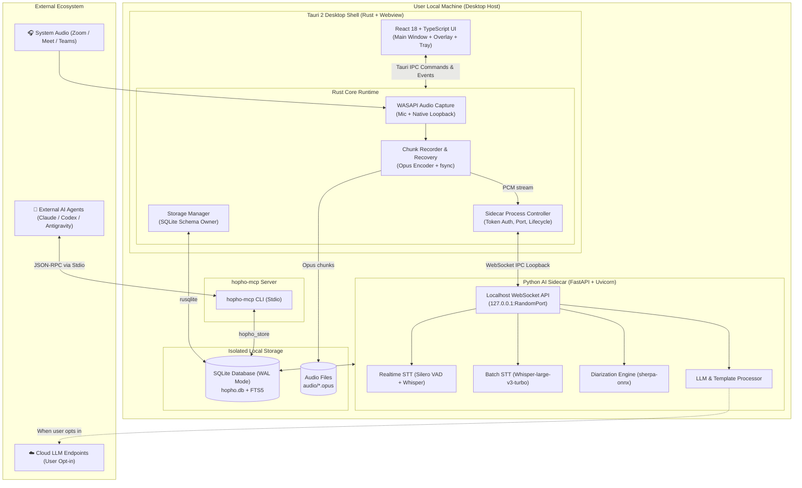

# HopHo 🎙️🤖

> *"Let AI attend meetings for you — Absolute data privacy, directly on your personal computer."*

**English** | [Tiếng Việt](README.vn.md)

---

[](LICENSE)
[-lightgrey.svg)](#-system-requirements)
[](#-architecture-overview)
[](#-security--privacy)

**HopHo** is a next-generation personal meeting assistant desktop application built on a strict **Local-first** philosophy. It captures system audio (Zoom, Google Meet, Microsoft Teams) and microphone input simultaneously, provides real-time translation through a floating overlay, and auto-generates structured meeting minutes, executive summaries, and action items — **without requiring any virtual meeting bot** to join your calls.

---

## 📑 Table of Contents

- [Core Differentiators](#-core-differentiators)
- [Key Features](#-key-features)
- [Architecture Overview](#-architecture-overview)
- [Monorepo Project Structure](#-monorepo-project-structure)
- [System Requirements](#-system-requirements)
- [Getting Started & Development](#-getting-started--development)
- [Milestone Roadmap](#-milestone-roadmap)
- [Documentation Hub](#-documentation-hub)
- [Security & Privacy](#-security--privacy)
- [License](#-license)

---

## 🌟 Core Differentiators

1. **No Meeting Bot**: Directly captures audio via physical microphone and OS loopback (Windows WASAPI). Never intrudes into meeting rooms, avoids awkward bot invitations, and bypasses organizational bot restrictions.
2. **100% Local-First**: Audio recordings, transcripts, and database storage remain entirely on your local machine by default.
3. **Resource-Light when Idle**: No persistent heavyweight AI processes running in the background. The AI Sidecar automatically frees CPU and RAM when inactive.
4. **Zero Data Loss Guarantee**: Audio streams are chunked and periodically flushed to disk with `fsync`, ensuring automatic session recovery even across sudden system crashes or power failures.
5. **Agent-Ready via MCP**: Native integration with the **Model Context Protocol (MCP)** and headless Agent CLI adapters (`claude -p`, `codex exec`, `agy`), allowing external AI assistants to query meeting records seamlessly.

---

## ✨ Key Features

- 🎙️ **Dual-Channel Native Audio Capture**: Concurrently captures system output (remote participants) and microphone input (local speaker) with clean channel separation.
- ⚡ **Dual-Tier Speech-to-Text (STT)**:
  - *Tier 1 (Realtime)*: Instant streaming draft with low latency (< 5 seconds) powered by Silero VAD and lightweight Whisper.
  - *Tier 2 (Batch Post-Meeting)*: High-accuracy post-meeting transcription using Whisper Large-v3-Turbo or language-specialized models (e.g., PhoWhisper).
- 💬 **Floating Subtitle Overlay**:
  - Transparent, draggable, always-on-top window with toggleable hotkey shortcuts.
  - Real-time sentence-level translation during live conversations.
- 👥 **Offline Speaker Diarization**: Detects and clusters distinct speaker voices post-meeting, providing a bulk renaming tool without requiring internet access.
- 📝 **Intelligent Summarization & Action Item Extraction**:
  - Automatically compiles meeting minutes, structured summaries, and assigned action items.
  - Ships with standard templates and supports user-uploaded custom templates (`.docx`, `.md`).
  - Supports local LLM inference (`llama.cpp`) or optional Cloud LLMs (OpenAI-compatible) with explicit user consent.
- 📚 **Workspaces & Custom Glossaries**: Tailor terminology recognition to specific industries, projects, or clients for optimal STT and LLM accuracy.
- 🔍 **Full-Text Search (FTS5)**: Instantly search across historical meeting transcripts and generated notes using SQLite FTS5.

---

## 🏗️ Architecture Overview

HopHo adopts a **Multi-Process Hybrid Desktop Architecture**, uniting the performance and native capabilities of **Rust (Tauri 2)** with the rich machine learning ecosystem of **Python**:



---

## 📁 Monorepo Project Structure

```text
HopHo/
├── apps/
│   └── desktop/                 # Primary desktop app (Tauri 2 + React 18 + Vite)
│       ├── src/                 # Frontend UI (React, TypeScript, Tailwind CSS)
│       └── src-tauri/           # Rust Core Engine (WASAPI, Storage, Process Controller)
├── sidecar/                     # Standalone Python AI service (Python 3.10+, FastAPI, uv)
├── packages/
│   └── hopho_store/             # Shared Python library for SQLite database access
├── mcp/                         # Model Context Protocol server (hopho-mcp stdio)
├── templates/                   # Default prompt and report templates (.md, .docx)
├── spikes/
│   └── stt-benchmark/           # STT measurement, benchmark scripts, and evaluation harness
├── docs/                        # 3-Layer standardized documentation architecture
│   ├── business/                # BRD, Roadmap, Stakeholders, Glossary
│   ├── architecture/            # 14 Living System Invariants & Architecture Decision Records
│   ├── implementation/          # PRD, SRS, Technical Design, Backlog (Gherkin stories)
│   └── views/                   # Standalone HTML mockup & visual prototypes
├── tasks/                       # Task & progress tracking (todo.md, lessons.md, workflow.md)
├── AGENTS.md                    # Project intelligence layer for AI Coding Agents
├── README.md                    # English project documentation (this file)
└── README.vn.md                 # Vietnamese project documentation
```

---

## 💻 System Requirements

| Specification | Baseline Target | Minimum | Hardware Acceleration (Optional) |
|---|---|---|---|
| **Operating System** | Windows 10 / 11 (64-bit) | Windows 10 (64-bit) | macOS (Apple Silicon M1+) |
| **CPU** | Intel Core i5 Gen 10 / AMD Ryzen 5 | Intel Core i5 Gen 8 / 9 | High core-count modern CPU |
| **RAM** | 16 GB | 16 GB *(Record-Only mode recommended)* | 32 GB+ |
| **GPU** | Not required (CPU-only execution) | Not required | NVIDIA GPU with CUDA support |
| **Available Disk** | 10 GB SSD | 5 GB SSD | Fast NVMe SSD |

---

## 🛠️ Getting Started & Development

### Prerequisites

- **Rust**: Latest stable release (`rustup default stable`) including `cargo`.
- **Node.js**: Version 18+ and `pnpm` package manager (`corepack enable` or `npm install -g pnpm`).
- **Python**: Version 3.10+ and [`uv`](https://github.com/astral-sh/uv) packaging tool.

> ⚠️ **Environment Isolation**: Never install packages globally. Always use an isolated virtual environment (`.venv`) or `uv run` as enforced in [AGENTS.md](AGENTS.md).

### 1. Clone the Repository

```bash
git clone https://github.com/your-org/HopHo.git
cd HopHo
```

### 2. Set Up Python Environment (Sidecar & Shared Store)

```bash
# Create local virtual environment with uv
uv venv .venv

# Activate virtual environment (Windows PowerShell)
.venv\Scripts\Activate.ps1

# Install editable packages for sidecar and shared store
uv pip install -e ./packages/hopho_store
uv pip install -e ./sidecar
```

### 3. Install Desktop Dependencies

```bash
cd apps/desktop
pnpm install
```

### 4. Run in Development Mode

```bash
# Launch Tauri 2 dev runner (compiles Rust and starts Vite with HMR)
pnpm tauri dev
```

---

## 🗺️ Milestone Roadmap

Progress is tracked in [tasks/todo.md](tasks/todo.md):

- [ ] **M0 — STT Benchmark Spike**: Measure WER, RTF, and resource footprint across Whisper and PhoWhisper models.
- [ ] **M1 — Skeleton & Infrastructure**: Set up Tauri 2, FastAPI Sidecar, WebSocket IPC, and CI/CD pipelines.
- [ ] **M2 — Audio Capture & Storage**: Implement native WASAPI capture (Mic + Loopback), safe Opus chunking, and SQLite WAL storage.
- [ ] **M3 — Dual-Tier STT**: Connect low-latency streaming realtime STT and batch post-meeting transcription.
- [ ] **M4 — Diarization & Review**: Implement offline speaker diarization and bulk speaker renaming UI.
- [ ] **M5 — LLM, Templates & Translation**: Meeting summarization, action item extraction, and custom template engine.
- [ ] **M6 — MCP & Agent Integration**: Build `hopho-mcp` server and CLI adapters for external AI agents.
- [ ] **M7 — In-Meeting Experience**: Floating subtitle overlay, global hotkeys, and system tray integration.
- [ ] **M8 — Packaging, Onboarding & Model Manager**: Single `.msi` Windows installer, onboarding wizard, and on-demand model downloader.
- [ ] **M9 — Hardening & Release v0.1**: Stability stress testing, benchmark validation, and final documentation.

---

## 📚 Documentation Hub

The project adheres to a 3-layer documentation system:

| Layer | Directory | Key Documents |
|---|---|---|
| **Business Layer** | [`docs/business/`](docs/business/) | [BRD](docs/business/brd.md), [Roadmap](docs/business/roadmap.md), [Glossary](docs/business/glossary.md), [Stakeholders](docs/business/stakeholders.md) |
| **Architecture Layer** | [`docs/architecture/`](docs/architecture/) | [14 System Invariants](docs/architecture/README.md), [ADR Decisions](docs/architecture/adr/ADR-001.md) |
| **Implementation Layer** | [`docs/implementation/release-1/`](docs/implementation/release-1/) | [PRD](docs/implementation/release-1/prd.md), [SRS](docs/implementation/release-1/srs.md), [Technical Design](docs/implementation/release-1/technical-design.md), [Story Backlog](docs/implementation/release-1/backlog/story-index.md) |
| **Visual Prototypes** | [`docs/views/`](docs/views/) | [Homepage Prototype](docs/views/homepage-prototype.html) |

---

## 🔒 Security & Privacy

- **Zero Telemetry**: HopHo does not contain any tracking SDKs, telemetry collectors, or external analytics endpoints.
- **No Persistent Voice Profiles**: Speaker diarization only operates on acoustic features within the active session. Voice embeddings are permanently discarded after processing.
- **Localhost Token Authentication**: Communication between Tauri UI and Python Sidecar occurs exclusively on loopback (`127.0.0.1`) secured with an ephemeral token generated per launch.
- **Transparent Cloud Opt-In**: Cloud LLM requests require explicit user consent via an Outbound Consent Gate. API keys are securely stored in the Windows Credential Manager.

---

## 📄 License

This project is licensed under the **Apache License 2.0**. See the [LICENSE](LICENSE) file for complete terms.

---

<div align="center">
  <sub>Crafted for privacy-conscious teams and knowledge workers. HopHo — "Let AI attend meetings for you."</sub>
</div>
