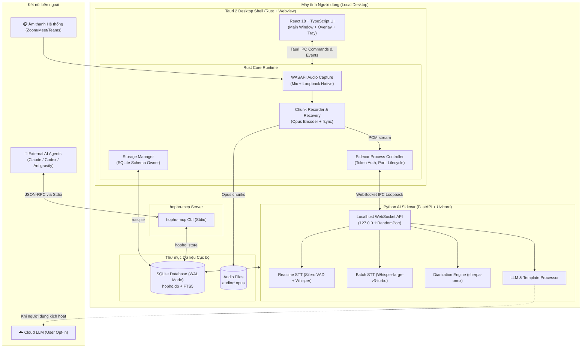

# HopHo (Họp Hộ) 🎙️🤖

> *"Để AI họp hộ bạn — An toàn dữ liệu tuyệt đối, trực tiếp trên máy tính của bạn."*

[English](README.md) | **Tiếng Việt**

---

[](LICENSE)
[-lightgrey.svg)](#yêu-cầu-hệ-thống-system-requirements)
[](#kiến-trúc-hệ-thống-architecture-overview)
[](#bảo-mật--quyền-riêng-tư-security--privacy)

**HopHo (Họp Hộ)** là ứng dụng desktop trợ lý cuộc họp cá nhân thế hệ mới, vận hành theo triết lý **Local-first**. Ứng dụng tự động ghi âm âm thanh hệ thống (Zoom, Google Meet, Microsoft Teams) và microphone, phiên dịch trực tiếp qua cửa sổ phụ đề nổi, đồng thời tự động hóa hoàn toàn công tác lập biên bản, tóm tắt và trích xuất việc cần làm (action items) mà **không cần meeting bot** can thiệp vào phòng họp.

---

## 📑 Mục lục

- [Điểm khác biệt cốt lõi](#-điểm-khác-biệt-cốt-lõi-core-differentiators)
- [Tính năng nổi bật](#-tính-năng-nổi-bật-key-features)
- [Kiến trúc hệ thống](#-kiến-trúc-hệ-thống-architecture-overview)
- [Cấu trúc Monorepo](#-cấu-trúc-monorepo-project-structure)
- [Yêu cầu hệ thống](#-yêu-cầu-hệ-thống-system-requirements)
- [Hướng dẫn phát triển](#-hướng-dẫn-phát-triển-getting-started)
- [Lộ trình triển khai](#-lộ-trình-triển-khai-milestones)
- [Hệ thống tài liệu](#-hệ-thống-tài-liệu-documentation-hub)
- [Bảo mật & Quyền riêng tư](#-bảo-mật--quyền-riêng-tư-security--privacy)
- [Giấy phép](#-giấy-phép-license)

---

## 🌟 Điểm khác biệt cốt lõi (Core Differentiators)

1. **Không bot phòng họp (No Meeting Bot)**: Thu nhận trực tiếp âm thanh từ microphone và loopback hệ điều hành (WASAPI trên Windows). Không làm phiền người khác và không lo bị từ chối cấp quyền vào phòng họp.
2. **Ưu tiên xử lý cục bộ (100% Local-first)**: Toàn bộ âm thanh, bản phiên âm (transcripts) và cơ sở dữ liệu lưu trữ trực tiếp trên máy của bạn.
3. **Tiết kiệm tài nguyên (Resource-Light when Idle)**: Không chạy tiến trình ngầm nặng nề khi không họp. AI Sidecar tự giải phóng CPU/RAM sau khi hoàn tất tác vụ.
4. **An toàn dữ liệu tuyệt đối (Zero Data Loss)**: Dữ liệu ghi âm được chia nhỏ và đồng bộ định kỳ xuống đĩa kèm `fsync`, tự động phục hồi phiên họp ngay cả khi mất điện đột ngột hoặc crash ứng dụng.
5. **Mở rộng cho AI Agents (Agent-Ready via MCP)**: Tích hợp máy chủ **Model Context Protocol (MCP)** và adapter CLI (`claude -p`, `codex exec`, `agy`) để các trợ lý bên ngoài truy xuất lịch sử họp dễ dàng.

---

## ✨ Tính năng nổi bật (Key Features)

- 🎙️ **Thu âm 2 kênh độc lập**: Thu âm song song âm thanh hệ thống (loa ngoài cuộc họp) và mic đàm thoại, tách kênh rõ ràng để xử lý chính xác.
- ⚡ **Speech-to-Text 2 lớp (Dual-tier STT)**:
  - *Lớp 1 (Realtime)*: Bản nháp hiển thị ngay lập tức với độ trễ cực thấp (dưới 5 giây), dùng mô hình VAD + Whisper nhẹ.
  - *Lớp 2 (Batch Post-Meeting)*: Chạy lại bản hoàn thiện chất lượng cao sau khi kết thúc cuộc họp bằng Whisper Large-v3-Turbo / PhoWhisper.
- 💬 **Cửa sổ phụ đề nổi (Floating Overlay)**:
  - Cửa sổ trong suốt, luôn nổi trên cùng (Always-on-top), hỗ trợ kéo thả và ẩn hiện nhanh bằng phím tắt.
  - Hỗ trợ phiên dịch trực tiếp theo thời gian thực (Real-time translation).
- 👥 **Phân tách người nói (Speaker Diarization)**: Tự động phát hiện và phân nhóm các giọng nói khác nhau, hỗ trợ đổi tên người nói hàng loạt trên giao diện trực quan.
- 📝 **Tóm tắt & Trích xuất hành động thông minh**:
  - Tự động sinh biên bản cuộc họp, ghi chú tóm tắt và danh sách việc cần làm (Action Items).
  - Tích hợp sẵn các mẫu biên bản chuẩn hoặc nhập mẫu người dùng (`.docx`, `.md`).
  - Hỗ trợ cả Local LLM (`llama.cpp`) lẫn Cloud LLM (OpenAI-compatible) khi người dùng đồng ý.
- 📚 **Quản lý Workspace & Từ điển thuật ngữ (Glossary)**: Tối ưu độ chính xác nhận diện theo từng ngành nghề, dự án hoặc khách hàng.
- 🔍 **Tìm kiếm toàn văn (Full-Text Search)**: Tra cứu nhanh mọi nội dung cuộc họp trong quá khứ nhờ SQLite FTS5 index.

---

## 🏗️ Kiến trúc hệ thống (Architecture Overview)

HopHo được thiết kế theo mô hình **Multi-Process Hybrid Desktop Architecture**, kết hợp giữa tính an toàn, tốc độ của **Rust (Tauri 2)** và sức mạnh của hệ sinh thái AI trong **Python**:



---

## 📁 Cấu trúc Monorepo (Project Structure)

```text
HopHo/
├── apps/
│   └── desktop/                 # Ứng dụng Desktop chính (Tauri 2 + React 18 + Vite)
│       ├── src/                 # Giao diện Frontend (React, TypeScript, Tailwind)
│       └── src-tauri/           # Rust Core Engine (WASAPI, Storage, Process Controller)
├── sidecar/                     # Dịch vụ AI cục bộ độc lập (Python 3.10+, FastAPI, uv)
├── packages/
│   └── hopho_store/             # Thư viện Python dùng chung truy cập SQLite Database
├── mcp/                         # Máy chủ Model Context Protocol (hopho-mcp stdio)
├── templates/                   # Mẫu prompt và mẫu biên bản cuộc họp (.md, .docx)
├── spikes/
│   └── stt-benchmark/           # Công cụ đo lường và đánh giá Benchmark STT
├── docs/                        # Hệ thống tài liệu 3 tầng chuẩn hóa
│   ├── business/                # BRD, Roadmap, Stakeholders, Glossary
│   ├── architecture/            # 14 tài liệu Kiến trúc sống & ADRs
│   ├── implementation/          # PRD, SRS, Technical Design, User Stories (Gherkin)
│   └── views/                   # Bản thiết kế giao diện HTML độc lập
├── tasks/                       # Quản lý tiến độ (todo.md, lessons.md, workflow.md)
├── AGENTS.md                    # Bản chỉ dẫn trí tuệ cho AI Coding Agents
├── README.md                    # Tài liệu giới thiệu dự án (Tiếng Anh)
└── README.vn.md                 # Tài liệu giới thiệu dự án (Tiếng Việt)
```

---

## 💻 Yêu cầu hệ thống (System Requirements)

| Tiêu chí | Cấu hình Tiêu chuẩn (Baseline) | Cấu hình Tối thiểu | Tùy chọn Tăng tốc |
|---|---|---|---|
| **Hệ điều hành** | Windows 10 / 11 (64-bit) | Windows 10 (64-bit) | macOS (Apple Silicon - M1 trở lên) |
| **CPU** | Intel Core i5 Gen 10 / AMD Ryzen 5 | Intel Core i5 Gen 8 / 9 | Đa nhân hiệu năng cao |
| **RAM** | 16 GB | 16 GB *(khuyến nghị chế độ Chỉ ghi âm)* | 32 GB trở lên |
| **GPU** | Không yêu cầu (chạy thuần CPU) | Không yêu cầu | NVIDIA GPU (hỗ trợ CUDA) |
| **Ổ cứng trống** | 10 GB SSD | 5 GB SSD | NVMe SSD |

---

## 🛠️ Hướng dẫn phát triển (Getting Started)

### Yêu cầu môi trường cài đặt

- **Rust**: Phiên bản ổn định mới nhất (`rustup default stable`) kèm `cargo`.
- **Node.js**: Phiên bản 18+ và trình quản lý gói `pnpm` (`npm install -g pnpm` hoặc qua `corepack`).
- **Python**: Phiên bản 3.10+ và công cụ quản lý gói hiện đại [`uv`](https://github.com/astral-sh/uv).

> ⚠️ **Quy tắc cách ly môi trường**: Tuyệt đối không cài đặt packages vào môi trường Python toàn cục. Luôn sử dụng môi trường ảo (`.venv`) hoặc `uv run` theo hướng dẫn trong [AGENTS.md](AGENTS.md).

### 1. Sao chép mã nguồn

```bash
git clone https://github.com/your-org/HopHo.git
cd HopHo
```

### 2. Cài đặt môi trường Python (Sidecar & Tools)

```bash
# Tạo môi trường ảo với uv
uv venv .venv

# Kích hoạt môi trường (Windows PowerShell)
.venv\Scripts\Activate.ps1

# Cài đặt dependencies cho Sidecar
uv pip install -e ./packages/hopho_store
uv pip install -e ./sidecar
```

### 3. Cài đặt dependencies Giao diện Desktop

```bash
cd apps/desktop
pnpm install
```

### 4. Khởi chạy chế độ phát triển (Development Mode)

```bash
# Khởi chạy ứng dụng Tauri 2 (tự động biên dịch Rust và Vite hot-reload)
pnpm tauri dev
```

---

## 🗺️ Lộ trình triển khai (Milestones)

Tiến độ dự án được theo dõi tại [tasks/todo.md](tasks/todo.md):

- [ ] **M0 — STT Benchmark Spike**: Đo lường WER, RTF và mức tiêu thụ tài nguyên trên các model Whisper/PhoWhisper.
- [ ] **M1 — Skeleton & Hạ tầng**: Khởi tạo khung Tauri 2, Sidecar FastAPI, cơ chế IPC WebSocket và pipeline CI/CD.
- [ ] **M2 — Audio Capture & Storage**: Thu âm WASAPI (Mic + Loopback), lưu chunk Opus an toàn, SQLite WAL.
- [ ] **M3 — STT hai lớp**: Tích hợp luồng Realtime STT độ trễ thấp và Batch STT độ chính xác cao.
- [ ] **M4 — Diarization & Review**: Phân tách người nói ngoại tuyến, công cụ đổi tên hàng loạt.
- [ ] **M5 — LLM, Templates & Dịch**: Tóm tắt biên bản, trích xuất hành động, mẫu biên bản tùy chỉnh.
- [ ] **M6 — MCP & Tích hợp Agent**: Xây dựng máy chủ `hopho-mcp` và adapter CLI.
- [ ] **M7 — Trải nghiệm trong lúc họp**: Cửa sổ Overlay nổi, phím tắt toàn cục, khay hệ thống (System Tray).
- [ ] **M8 — Đóng gói, Onboarding & Model Manager**: Trình cài đặt `.msi`, tải model theo nhu cầu.
- [ ] **M9 — Hardening & Phát hành v0.1**: Kiểm thử độ ổn định, kiểm thử tải, tài liệu người dùng.

---

## 📚 Hệ thống tài liệu (Documentation Hub)

Dự án áp dụng cấu trúc tài liệu 3 tầng chuẩn hóa:

| Tầng tài liệu | Thư mục | Nội dung chính |
|---|---|---|
| **Tầng Nghiệp vụ (Business)** | [`docs/business/`](docs/business/) | [BRD](docs/business/brd.md), [Roadmap](docs/business/roadmap.md), [Glossary](docs/business/glossary.md), [Stakeholders](docs/business/stakeholders.md) |
| **Tầng Kiến trúc (Architecture)** | [`docs/architecture/`](docs/architecture/) | [14 Tài liệu Kiến trúc Hệ thống](docs/architecture/README.md), [ADR Decisions](docs/architecture/adr/ADR-001.md) |
| **Tầng Thực thi (Implementation)** | [`docs/implementation/release-1/`](docs/implementation/release-1/) | [PRD](docs/implementation/release-1/prd.md), [SRS](docs/implementation/release-1/srs.md), [Technical Design](docs/implementation/release-1/technical-design.md), [Backlog / User Stories](docs/implementation/release-1/backlog/story-index.md) |
| **Giao diện Mẫu (Views)** | [`docs/views/`](docs/views/) | [Homepage Prototype](docs/views/homepage-prototype.html) |

---

## 🔒 Bảo mật & Quyền riêng tư (Security & Privacy)

- **Zero Telemetry**: HopHo tuyệt đối không cài cắm mã theo dõi người dùng, không gửi dữ liệu phân tích hay gửi log về bất kỳ máy chủ nào.
- **Không lưu hồ sơ giọng nói (No Persistent Voice Profiles)**: Quá trình phân tách người nói chỉ phân tích đặc trưng âm học trong phiên họp hiện tại và giải phóng ngay sau khi xử lý xong.
- **Cổng xác thực cục bộ (Localhost Token Authentication)**: Giao tiếp giữa giao diện Tauri và Python Sidecar chỉ diễn ra trên loopback `127.0.0.1` với token ngẫu nhiên được cấp phát riêng cho từng phiên.
- **Minh bạch khi dùng Cloud LLM**: Mọi tác vụ gửi dữ liệu lên Cloud LLM bắt buộc phải có sự xác nhận trực tiếp của người dùng (Outbound Consent Gate). Khóa API được lưu trữ an toàn trong Windows Credential Manager.

---

## 📄 Giấy phép (License)

Dự án được phân phối dưới giấy phép **Apache License 2.0**. Xem chi tiết tại tệp [LICENSE](LICENSE).

---

<div align="center">
  <sub>Được phát triển với tâm huyết dành cho cộng đồng làm việc số. HopHo — "Để AI họp hộ bạn."</sub>
</div>
