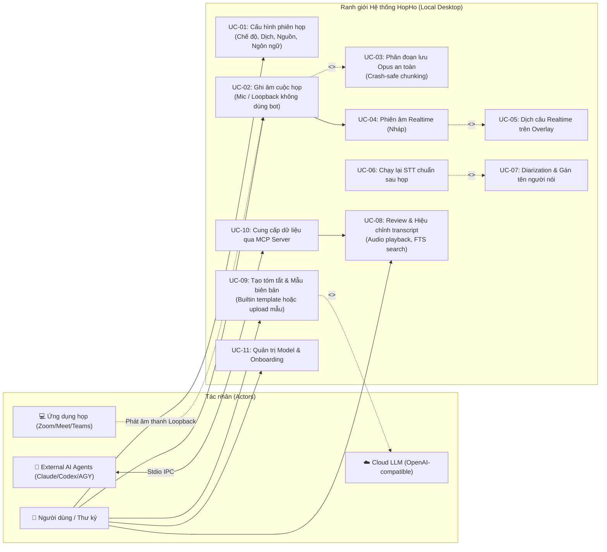
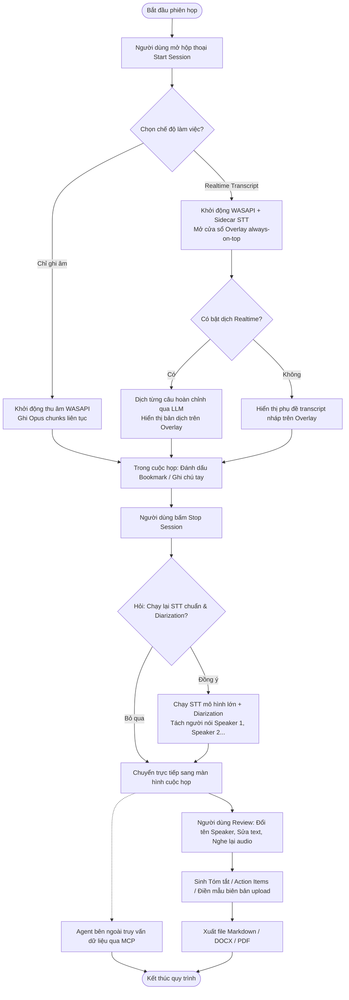

# System Context & Scope Boundary — HopHo (Họp Hộ)

**Tầng tài liệu**: Architecture Layer (`docs/architecture/01-system-context.md`)  
**Hệ thống**: HopHo (Họp Hộ) Desktop Assistant  
**Phiên bản**: 1.0  
**Ngày cập nhật**: 2026-10-15  
**Nguồn tham chiếu**: `docs/project-idea/requirements.md` §2 & §3, `docs/plan/mvp-plan.md` §1 & §4  

---

## 1. Ranh giới hệ thống & Tác nhân (System Boundary & Actors)

HopHo là ứng dụng Desktop hoạt động theo mô hình **Local-first**, cô lập toàn bộ quy trình ghi nhận, xử lý và lưu trữ dữ liệu trên thiết bị cục bộ của người dùng. Hệ thống tương tác với các tác nhân người dùng và hệ thống ngoài theo ranh giới bảo mật nghiêm ngặt:

- **Actors Người dùng**:
  - `👤 Người dùng cá nhân / Thư ký họp`: Khởi tạo phiên, theo dõi phụ đề, hiệu chỉnh biên bản sau họp.
  - `👥 Thành viên tham gia cuộc họp`: Phát ra âm thanh trực tiếp (Mic) hoặc qua phòng họp online (System audio).
- **External Systems**:
  - `🎧 Phần cứng âm thanh & OS`: Microphone vật lý và luồng loopback âm thanh hệ thống (WASAPI trên Windows).
  - `🤖 AI Agent bên ngoài`: Claude Desktop, Claude Code, Codex, Antigravity kết nối qua máy chủ `hopho-mcp`.
  - `☁️ Cloud LLM Provider`: Các điểm cuối tương thích chuẩn OpenAI (người dùng tự chọn và cung cấp API key).
  - `💻 Agent CLI cục bộ`: `claude -p`, `codex exec`, `agy` chạy headless khi người dùng chọn (opt-in).
  - `🤗 Nguồn tải model`: Hugging Face hoặc mirror; chỉ truy cập khi người dùng bấm tải model.
  - `🐙 GitHub Releases`: nguồn bản cập nhật ứng dụng (Tauri Updater); chỉ kiểm tra khi người dùng cho phép, không gửi dữ liệu cuộc họp.

---

## 2. Sơ đồ Use Case tổng thể (Use Case Diagram)

---

## 3. Dòng chảy quy trình nghiệp vụ chính (High-Level Process Flow)

---

## 4. Ma trận đặc tả Use Case (Use Case Specification Matrix)

| Mã Use Case | Tên Use Case | Tác nhân chính | Đầu vào (Input) | Kết quả kỳ vọng (Outcome) |
|---|---|---|---|---|
| **UC-01** | Cấu hình phiên họp | Người dùng | Nguồn âm, chế độ, ngôn ngữ, đích dịch, tag | Khởi tạo thông số phiên họp hợp lệ |
| **UC-02** | Ghi âm cuộc họp | Người dùng, Ứng dụng họp | Luồng PCM từ Mic và/hoặc WASAPI Loopback | Luồng âm thanh được thu nhận liên tục |
| **UC-03** | Phân đoạn lưu Opus an toàn | Hệ thống | Luồng PCM thô từ WASAPI | Tệp audio `.opus` chia nhỏ từng vài giây, an toàn khi crash |
| **UC-04** | Phiên âm Realtime | Hệ thống | Khung âm thanh PCM 16kHz | Text nháp được đẩy tức thời qua WebSocket lên UI/Overlay |
| **UC-05** | Dịch câu Realtime | Hệ thống, LLM | Câu tiếng nguồn hoàn chỉnh | Câu tiếng đích hiển thị trên Overlay, bản gốc vẫn lưu transcript |
| **UC-06** | Chạy lại STT chuẩn sau họp | Người dùng, Sidecar | Tệp âm thanh đầy đủ của cuộc họp | Transcript chính xác cao, hỗ trợ tạm dừng/chạy tiếp |
| **UC-07** | Phân tách người nói (Diarization) | Sidecar | Audio sau cuộc họp | Phân đoạn âm thanh gán nhãn `Speaker 1`, `Speaker 2`... |
| **UC-08** | Review & Hiệu chỉnh | Người dùng | Thao tác click câu, sửa text, tìm kiếm | Nghe đúng đoạn audio, cập nhật text, đổi tên Speaker toàn bộ |
| **UC-09** | Sinh văn bản tổng hợp | Người dùng, LLM | Template prompt / Mẫu upload, transcript | Biên bản, Tóm tắt, Action items dạng Markdown/DOCX |
| **UC-10** | Cung cấp dữ liệu qua MCP | External AI Agent | Câu lệnh/truy vấn từ Agent CLI hoặc GUI | Trả về metadata, transcript, action items qua stdio |
| **UC-11** | Quản lý Model & Onboarding | Người dùng | Thư mục data, benchmark máy, tải model | Hệ thống sẵn sàng hoạt động với gói model phù hợp |
