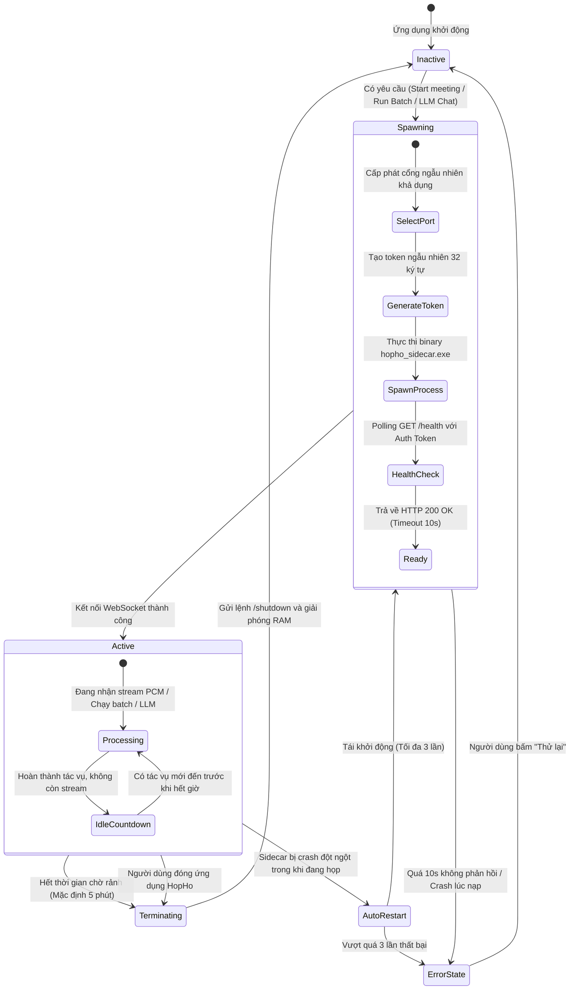

# Service & Process Architecture — HopHo (Họp Hộ)

**Tầng tài liệu**: Architecture Layer (`docs/architecture/03-service-architecture.md`)  
**Hệ thống**: HopHo (Họp Hộ) Desktop Assistant  
**Phiên bản**: 1.0  
**Ngày cập nhật**: 2026-10-15  
**Trạng thái**: Living System Invariant  
**Nguồn tham chiếu**: `docs/plan/mvp-plan.md` §2 (AD-2, AD-3, AD-6), `docs/project-idea/requirements.md` §6 (NFR-06, NFR-07)  

---

## 1. Mô hình Tiến trình Hệ thống (Multi-Process Architecture)

HopHo được cấu trúc thành **3 tiến trình hệ điều hành độc lập**, đảm bảo sự cô lập lỗi (fault isolation) và tối ưu hóa tài nguyên phần cứng:

```mermaid
flowchart TD
    subgraph HostOS ["Hệ điều hành Windows"]
        subgraph P1 ["Tiến trình 1: HopHo Main Process (Tauri Desktop App)"]
            UI_Webview["Webview UI Thread<br/>(React / TypeScript)"]
            Rust_Main["Rust Main Thread<br/>(Tauri Event Loop, Window Manager)"]
            Rust_Audio["Rust Audio Thread<br/>(WASAPI Capture, Opus Chunk Writer)"]
            Rust_SidecarMgr["Rust Sidecar Controller<br/>(Process Watchdog, WS Client)"]
            
            UI_Webview <-->|Tauri IPC Invoke/Listen| Rust_Main
            Rust_Main <--> Rust_Audio
            Rust_Main <--> Rust_SidecarMgr
        end

        subgraph P2 ["Tiến trình 2: Python AI Sidecar (hopho_sidecar)"]
            Py_Uvicorn["Uvicorn Server<br/>(FastAPI App @ 127.0.0.1:{Port})"]
            Py_STTWorker["STT Worker Thread<br/>(Realtime & Batch Decode)"]
            Py_LLMWorker["LLM Worker Thread<br/>(llama.cpp / Cloud Dispatcher)"]
            
            Py_Uvicorn <--> Py_STTWorker
            Py_Uvicorn <--> Py_LLMWorker
        end

        subgraph P3 ["Tiến trình 3: hopho-mcp Server (On-Demand Stdio)"]
            MCP_Runner["MCP Stdio Server<br/>(Python MCP SDK)"]
        end

        subgraph SharedFS ["Hệ thống Tệp & Database Cục bộ"]
            SQLiteFile[("hopho.db (WAL Mode)")]
        end

        %% Giao tiếp giữa các tiến trình
        Rust_SidecarMgr <-->|WebSocket IPC (Loopback + Token)| Py_Uvicorn
        P1 <-->|rusqlite| SQLiteFile
        P2 <-->|hopho_store| SQLiteFile
        P3 <-->|hopho_store (Read-only WAL)| SQLiteFile
    end

    ExtAgent["🤖 Claude / Codex / Antigravity"] <-->|Stdio JSON-RPC| MCP_Runner
```

---

## 2. Vòng đời Tiến trình AI Sidecar (Sidecar Lifecycle Management)

Để thỏa mãn yêu cầu phi chức năng **NFR-06 (0% CPU khi không ghi âm)**, tiến trình Python Sidecar không chạy ngầm vĩnh viễn mà tuân theo cỗ máy trạng thái (State Machine) nghiêm ngặt do Rust Core làm chủ:



### Các thông số điều khiển vòng đời:
- **Cổng ngẫu nhiên (Ephemeral Port)**: Rust bind thử socket trên `127.0.0.1:0` để nhận cổng trống từ OS, sau đó đóng socket và truyền tham số `--port {port}` cho Sidecar.
- **Token xác thực theo phiên sidecar**: sinh mới mỗi lần khởi động sidecar, dùng cho mọi kết nối WebSocket của phiên đó (hỗ trợ reconnect và nhiều kênh song song). Sinh bằng bộ sinh số ngẫu nhiên mật mã (CSPRNG), độ dài 32 ký tự hex, truyền qua biến môi trường hoặc tham số `--auth-token {token}`.
- **Thời gian chờ rảnh (Idle Timeout)**: Mặc định là **5 phút**. Nếu sau 5 phút không có bất kỳ kết nối WebSocket hoạt động nào, Sidecar tự động gọi hàm thoát an toàn hoặc Rust gửi tín hiệu `SIGTERM`.
- **Chống tiến trình mồ côi (Orphan Process Prevention)**: Trên Windows, Rust Core gắn tiến trình Sidecar vào một **Windows Job Object** với cờ `JOB_OBJECT_LIMIT_KILL_ON_JOB_CLOSE`. Nếu HopHo bị kill đột ngột, hệ điều hành Windows sẽ tự động quét dọn và tắt toàn bộ tiến trình Sidecar con.

---

## 3. Kiến trúc Giao tiếp Liên tiến trình (IPC Architecture)

Hệ thống sử dụng 3 kênh IPC chuyên biệt phù hợp với từng đặc thù băng thông:

### 3.1 Webview UI $\leftrightarrow$ Rust Core: Tauri IPC
- **Cơ chế**: Tauri Commands (dựa trên cơ chế message passing nhị phân của Webview2/Wry).
- **Mục đích**: Gọi các hành động điều khiển (`start_session`, `stop_session`, `save_settings`, `open_storage_folder`).
- **Sự kiện hai chiều**: Rust phát các sự kiện qua `app_handle.emit_all()` để UI lắng nghe: `meeting-status-changed`, `vu-meter-tick`, `hotkey-pressed`.

### 3.2 Rust Core $\leftrightarrow$ Python Sidecar: Localhost WebSocket
- **Cơ chế**: WebSocket qua giao thức TCP loopback `127.0.0.1:{random_port}`.
- **Handshake bảo mật**: Bắt buộc đính kèm query parameter `?token={session_token}` hoặc header `Authorization: Bearer {token}`. Mọi kết nối thiếu token sẽ bị từ chối ngay lập tức (HTTP 401).
- **Luồng dữ liệu nhị phân (Binary Frames)**: Rust gửi liên tục các mảng byte PCM 16kHz mono (kích thước mỗi frame 100ms = 3,200 bytes).
- **Luồng dữ liệu văn bản (Text Frames)**: Sidecar trả về các gói tin JSON (đặc tả đầy đủ tại [08-integration-architecture.md](./08-integration-architecture.md) §2.3), ví dụ:
  ```json
  {
    "event": "partial_transcript",
    "meeting_id": "9b1deb4d-3b7d-4bad-9bdd-2b0d7b3dcb6d",
    "text": "chào các bạn",
    "audio_end_ms": 1250
  }
  ```

### 3.3 External AI Agent $\leftrightarrow$ hopho-mcp: Standard I/O (Stdio)
- **Cơ chế**: Chuẩn giao thức JSON-RPC 2.0 truyền nhận qua luồng `stdin` / `stdout`.
- **Đặc điểm**: Đảm bảo sự đơn giản tối đa, tương thích tự nhiên 100% với kiến trúc Client của Claude Desktop, Claude Code và Antigravity mà không cần mở thêm cổng mạng.

---

## 4. Quản trị Đồng thời & Toàn vẹn Dữ liệu (Concurrency & Data Safety)

Do có 3 tiến trình cùng truy cập tệp SQLite (`hopho.db`), cơ chế an toàn dữ liệu được thiết lập như sau:

| Tiến trình | Loại truy cập | Rào chắn bảo vệ |
|---|---|---|
| **HopHo Desktop (Rust)** | Đọc & Ghi (Audio chunks, meeting status, settings, migrations) | Là **chủ sở hữu Schema duy nhất**. Mở kết nối với `PRAGMA journal_mode = WAL;` và `PRAGMA busy_timeout = 5000;`. |
| **Python Sidecar** | Đọc & Ghi (Segments transcript, outputs, bookmarks) | Truy cập qua package `hopho_store`. Sử dụng transaction ngắn, commit ngay sau từng segment. |
| **hopho-mcp** | Đọc là chủ yếu (Read-mostly) / Ghi `save_summary` | Chỉ đọc dữ liệu qua WAL snapshot mà không khóa tiến trình ghi của app desktop. |
