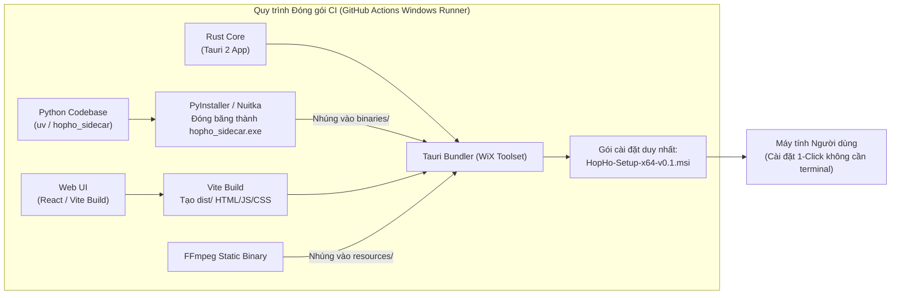
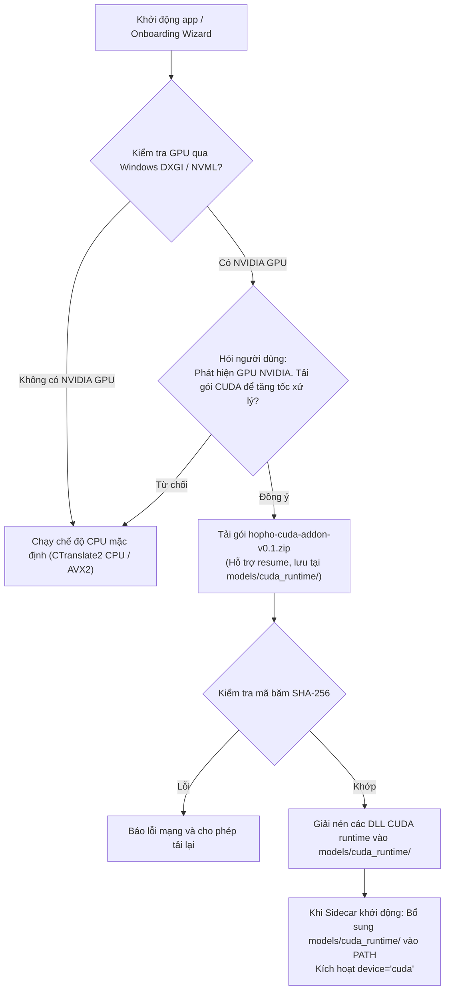

# Deployment & Packaging Architecture — HopHo (Họp Hộ)

**Tầng tài liệu**: Architecture Layer (`docs/architecture/04-deployment-architecture.md`)  
**Hệ thống**: HopHo (Họp Hộ) Desktop Assistant  
**Phiên bản**: 1.0  
**Ngày cập nhật**: 2026-10-15  
**Trạng thái**: Living System Invariant  
**Nguồn tham chiếu**: `docs/project-idea/requirements.md` §1 & §5, `docs/plan/mvp-plan.md` §1 & §6 (M8)  

---

## 1. Chiến lược Đóng gói & Phân phối (Packaging Strategy)

Để đáp ứng nguyên tắc **Dễ cài đặt cho người dùng low-code / no-code (FR-INS-01)**, HopHo phân phối trên hệ điều hành Windows dưới dạng gói cài đặt MSI chuẩn mực, tích hợp trọn gói toàn bộ môi trường thực thi cần thiết mà không yêu cầu người dùng cài đặt thêm Python, Git hay CUDA.



### Các thành phần trong bộ cài:
1. **Tauri Shell Executable (`hopho.exe`)**: Ứng dụng chính chịu trách nhiệm quản lý cửa sổ, khay hệ thống, thu âm WASAPI và kết nối SQLite.
2. **Đóng băng Python Sidecar (`hopho_sidecar.exe`)**: Toàn bộ runtime Python, thư viện FastAPI, CTranslate2, ONNX Runtime và llama.cpp được đóng băng độc lập. Không gây ô nhiễm môi trường Python của hệ điều hành.
3. **Tiến trình MCP Server (`hopho-mcp.exe`)**: Được biên dịch để các Agent AI bên ngoài có thể gọi độc lập.
4. **Binary FFmpeg tĩnh (`ffmpeg.exe`)**: Bản dựng gọn nhẹ tĩnh phục vụ việc trích xuất và chuẩn hóa audio khi người dùng import file.

---

## 2. Phân hạng Cấu hình Phần cứng (Hardware Tiers & Profiles)

Ứng dụng tự động điều chỉnh cấu hình hoạt động dựa trên 3 phân hạng phần cứng được xác định trong quá trình Onboarding Wizard:

| Phân hạng (Hardware Tier) | Cấu hình máy tính đại diện | Hành vi & Đề xuất của Hệ thống | Mô hình STT / LLM ứng viên (chốt bằng M0/M4/M5) |
|---|---|---|---|
| **Tier Lite (Máy yếu)** | Intel Core i5 Gen 8/9 / AMD tương đương, RAM 16GB, Only CPU | Khuyến nghị ưu tiên chế độ **"Chỉ ghi âm"** để xử lý ngoại tuyến sau họp. Nếu bật Realtime, app chỉ dùng model STT siêu nhẹ (Tiny/Base) và đề xuất dịch qua Cloud. | STT Realtime: Whisper đa ngôn ngữ cỡ nhỏ (tiny/base, int8) nếu M0 xác nhận đạt; LLM: Cloud OpenAI-compatible. |
| **Tier Standard (Máy chuẩn)** | **Intel Core i5 Gen 10 / AMD tương đương, RAM 16GB, Only CPU** | **Mốc tham chiếu cho toàn bộ NFR**. Chạy mượt mà đồng thời Realtime STT + Ghi âm + Zoom/Meet. Tải CPU $<= 50\%$, RAM $<= 4\text{GB}$, trễ $<= 5\text{s}$. | STT Realtime: Whisper `small` int8 / sherpa Zipformer; STT sau họp: Whisper `large-v3-turbo` int8; LLM: Qwen2.5 1.5B/3B GGUF. |
| **Tier Pro (Tăng tốc phần cứng)** | Máy có card đồ họa rời **NVIDIA GPU** (VRAM $\ge 4\text{GB}$) hoặc **Apple Silicon** (Phase 2) | Kích hoạt bộ tăng tốc phần cứng (CUDA trên Windows, Metal trên Mac). Cho phép chạy các mô hình lớn với tốc độ cực nhanh, RTF sau họp ước lượng $< 0.2$ (chưa đo). | STT: Whisper `large-v3-turbo` float16; Diarization: pyannote GPU; LLM: Qwen 7B GGUF GPU offload. |

---

## 3. Chiến lược Tải & Tích hợp Add-on CUDA

Để giữ cho bộ cài đặt ban đầu `.msi` gọn nhẹ (tránh phình to trên $1\text{GB}$ do thư viện CUDA toolkit), gói CUDA được tách thành **Add-on tải riêng theo nhu cầu (FR-INS-05)**:



---

## 4. Bố cục Thư mục Dữ liệu Cô lập (Isolated Data Directory Layout)

Tuân thủ nghiêm ngặt yêu cầu **FR-DATA-02**, toàn bộ dữ liệu của HopHo được gom gọn trong **một thư mục duy nhất do người dùng chọn khi onboarding** (mặc định gợi ý phân vùng ổ đĩa còn nhiều dung lượng trống nhất, không ép buộc ổ C):

```
HopHoData/ (Thư mục do người dùng chỉ định, vd: D:\HopHoData\)
├── data/                     # Dữ liệu ứng dụng
│   ├── hopho.db              # Cơ sở dữ liệu SQLite chính
│   ├── hopho.db-wal          # SQLite Write-Ahead Log (khi có kết nối)
│   ├── hopho.db-shm          # SQLite Shared Memory index
│   └── templates/            # Template prompt và mẫu biên bản
│       ├── custom/           # Template .md do người dùng tạo (nguồn sự thật, FR-LLM-02)
│       └── uploaded/         # File .docx/.md/.pdf mẫu biên bản người dùng tải lên
│
├── audio/                    # Lưu trữ các file âm thanh cuộc họp
│   ├── {meeting_id_1}/       # Mỗi cuộc họp là 1 thư mục riêng
│   │   ├── 00001.opus        # Chunk 1 (2-5 giây)
│   │   ├── 00002.opus        # Chunk 2
│   │   └── full.opus         # File tổng hợp sau khi kết thúc cuộc họp
│   └── {meeting_id_2}/
│
├── models/                   # Thư mục chứa các mô hình AI đã tải
│   ├── stt/                  # Mô hình Whisper int8, Zipformer
│   ├── diarization/          # Model sherpa-onnx segmentation / embedding
│   ├── llm/                  # File GGUF (Qwen, Llama)
│   └── cuda_runtime/         # Các file DLL CUDA runtime (nếu đã tải add-on)
│
├── exports/                  # Tệp xuất bản báo cáo (.docx, .md, .pdf)
└── logs/                     # Nhật ký hoạt động cục bộ (tự động rotate theo ngày)
```

---

## 5. Cơ chế Tự cập nhật Ứng dụng (Auto-Updater Pipeline)

- **Giao thức cập nhật**: Tích hợp sẵn cơ chế **Tauri Updater** trỏ tới endpoint GitHub Releases chính thức của dự án.
- **Xác thực chữ ký số**: Mọi bản cập nhật đều được kiểm tra chữ ký số công khai (`tauri.conf.json` -> `pubkey`) trước khi cho phép cài đặt để chống giả mạo mã độc.
- **Quyền quyết định của người dùng**: Ứng dụng chỉ tải và cài đặt bản cập nhật khi người dùng nhấp chọn **"Đồng ý cập nhật"** trên hộp thoại thông báo.
- **Kiểm tra cập nhật là kết nối ra ngoài có kiểm soát**: chỉ truy vấn GitHub Releases khi người dùng bật tùy chọn kiểm tra cập nhật (mặc định tắt, hỏi ở Onboarding) hoặc bấm "Kiểm tra cập nhật"; không gửi dữ liệu cuộc họp hay định danh người dùng (xem [07-security-architecture.md](./07-security-architecture.md) §2.1).
