# Data Architecture & Storage Engine — HopHo (Họp Hộ)

**Tầng tài liệu**: Architecture Layer (`docs/architecture/05-data-architecture.md`)  
**Hệ thống**: HopHo (Họp Hộ) Desktop Assistant  
**Phiên bản**: 1.0  
**Ngày cập nhật**: 2026-10-15  
**Trạng thái**: Living System Invariant (Schema Single Source of Truth)  
**Nguồn tham chiếu**: `docs/plan/mvp-plan.md` §2 (AD-4) & §5, `docs/project-idea/requirements.md` §4  

---

## 1. Triết lý Thiết kế Lưu trữ & Cơ chế Động cơ Dữ liệu

HopHo sử dụng mô hình lưu trữ lai cục bộ (**Local Hybrid Storage**):
1. **Dữ liệu cấu trúc, quan hệ & tìm kiếm**: Lưu trong cơ sở dữ liệu nhúng **SQLite 3**, kích hoạt chế độ **WAL (Write-Ahead Logging)** để hỗ trợ đọc/ghi đồng thời an toàn giữa nhiều tiến trình.
2. **Dữ liệu âm thanh lớn**: Lưu trực tiếp trên hệ thống tệp đĩa dưới dạng các tệp nén **Opus** phân đoạn (chunked audio).
3. **Chủ quyền Schema**: **Rust Core là chủ sở hữu duy nhất (Sole Owner)** của cơ sở dữ liệu SQLite và các script migration. Python Sidecar và máy chủ `hopho-mcp` chỉ truy cập dữ liệu qua package dùng chung `packages/hopho_store`.

### Cấu hình Bắt buộc của SQLite Engine (Pragmas):
```sql
PRAGMA journal_mode = WAL;          -- Hỗ trợ đọc/ghi đồng thời không lock giữa App, Sidecar và MCP
PRAGMA synchronous = NORMAL;        -- Cân bằng hoàn hảo giữa tốc độ ghi và an toàn dữ liệu
PRAGMA busy_timeout = 5000;         -- Tự động đợi tối đa 5 giây khi có xung đột ghi trước khi báo lỗi
PRAGMA foreign_keys = ON;           -- Kích hoạt ràng buộc khóa ngoại bảo vệ tính toàn vẹn
PRAGMA cache_size = -64000;         -- Cấp phát 64MB bộ nhớ đệm RAM cho SQLite
```

---

## 2. Sơ đồ Thực thể Quan hệ (Entity-Relationship Diagram - ERD)

```mermaid
erDiagram
    WORKSPACES ||--o{ MEETINGS : contains
    WORKSPACES ||--o{ GLOSSARY_TERMS : defines
    
    MEETINGS ||--o{ MEETING_TAGS : has
    MEETINGS ||--o{ AUDIO_CHUNKS : stores
    MEETINGS ||--o{ SEGMENTS : transcribes
    MEETINGS ||--o{ SPEAKERS : identifies
    MEETINGS ||--o{ BOOKMARKS : marks
    MEETINGS ||--o{ NOTES : records
    MEETINGS ||--o{ OUTPUTS : generates
    MEETINGS ||--o{ CHAT_MESSAGES : holds
    MEETINGS ||--o{ BATCH_JOBS : processes
    MEETINGS ||--o{ ACTION_ITEMS : extracts
    OUTPUTS ||--o{ ACTION_ITEMS : yields
    
    SPEAKERS ||--o{ SEGMENTS : speaks
    TEMPLATES ||--o{ OUTPUTS : structures

    BATCH_JOBS {
        string id PK "UUID"
        string meeting_id FK
        string status "queued | running | paused | completed | failed"
        string stt_model "Model STT batch đã dùng"
        string diarize_engine "sherpa-onnx | pyannote | none"
        integer last_processed_ms "Checkpoint để Resume"
        integer total_ms "Tổng thời lượng audio"
        string error_code "Mã lỗi chuẩn hóa nếu failed"
        integer updated_at "Timestamp ms"
    }

    ACTION_ITEMS {
        string id PK "UUID"
        string meeting_id FK
        string output_id FK "Output sinh ra (nullable)"
        text task "Việc cần làm"
        string assignee "Người phụ trách (nullable)"
        string due_date "Deadline ISO-8601 (nullable)"
        integer done "0 | 1"
        integer created_at "Timestamp ms"
    }

    APP_SETTINGS {
        string key PK
        text value "JSON"
        integer updated_at "Timestamp ms"
    }

    WORKSPACES {
        string id PK "UUID"
        string name "Tên không gian làm việc"
        integer created_at "Timestamp Unix ms"
    }

    MEETINGS {
        string id PK "UUID"
        string workspace_id FK "Thuộc workspace"
        string title "Tiêu đề cuộc họp"
        integer started_at "Bắt đầu ms"
        integer ended_at "Kết thúc ms"
        string mode "record_only | realtime"
        string primary_lang "vi | en | zh | ko | auto"
        string source "mic | mic_loopback | import"
        string status "recording | recorded | processing | ready | interrupted"
    }

    MEETING_TAGS {
        string id PK "UUID"
        string meeting_id FK
        string tag "Tên thẻ tag"
    }

    AUDIO_CHUNKS {
        string id PK "UUID"
        string meeting_id FK
        integer seq "Thứ tự tuần tự 1, 2, 3..."
        string path "Đường dẫn file .opus tương đối"
        integer start_ms "Mốc bắt đầu chunk"
        integer duration_ms "Thời lượng chunk ms"
        string channel "mic | loopback | mixed"
    }

    SEGMENTS {
        string id PK "UUID"
        string meeting_id FK
        string kind "realtime | final"
        integer start_ms "Thời điểm bắt đầu ms"
        integer end_ms "Thời điểm kết thúc ms"
        string speaker_id FK "Khóa ngoại trỏ sang speakers"
        text text "Nội dung phiên âm gốc"
        string lang "Ngôn ngữ phát hiện"
        text translated_text "Nội dung dịch (nếu có)"
        integer edited "0: Chưa sửa | 1: Đã sửa tay"
    }

    SPEAKERS {
        string id PK "UUID"
        string meeting_id FK
        string label "Speaker 1, Speaker 2..."
        string display_name "Tên hiển thị người dùng đổi"
    }

    BOOKMARKS {
        string id PK "UUID"
        string meeting_id FK
        integer at_ms "Mốc thời gian bookmark"
        string label "Nhãn ghi chú bookmark"
    }

    NOTES {
        string id PK "UUID"
        string meeting_id FK
        integer at_ms "Mốc thời gian ghi chú"
        text content "Nội dung ghi chú tay"
    }

    GLOSSARY_TERMS {
        string id PK "UUID"
        string workspace_id FK
        string term "Thuật ngữ chuẩn"
        string aliases "Các từ đồng nghĩa/viết tắt"
    }

    TEMPLATES {
        string id PK "UUID"
        string name "Tên template"
        string kind "builtin | custom | uploaded_minutes"
        text prompt_md "Bản sao cache của file prompt"
        string prompt_path "Đường dẫn file .md (nguồn sự thật)"
        string source_file_path "Đường dẫn file mẫu gốc (.docx/.pdf)"
    }

    OUTPUTS {
        string id PK "UUID"
        string meeting_id FK
        string template_id FK
        string provider "llamacpp | openai_compat | agent_cli | external_agent"
        text content_md "Nội dung văn bản sinh ra"
        integer created_at "Timestamp tạo ms"
    }

    CHAT_MESSAGES {
        string id PK "UUID"
        string meeting_id FK
        string role "user | assistant | system"
        text content "Nội dung tin nhắn"
        integer created_at "Timestamp ms"
    }
```



> ⛔ **Bất biến Bảo mật Dữ liệu (Privacy Invariant)**:  
> Tuyệt đối **KHÔNG TỒN TẠI BẢNG LƯU TRỮ VOICE PROFILE HOẶC EMBEDDING GIỌNG NÓI** giữa các cuộc họp khác nhau (tuân thủ nguyên tắc `FR-DIA-04`).

---

## 3. Đặc tả Định nghĩa Dữ liệu Chi tiết (Full SQLite DDL)

Dưới đây là mã DDL tiêu chuẩn được Rust Core thực thi trong quá trình khởi tạo hoặc migration:

```sql
-- 1. Bảng Workspace (Không gian làm việc)
CREATE TABLE IF NOT EXISTS workspaces (
    id TEXT PRIMARY KEY,
    name TEXT NOT NULL,
    created_at INTEGER NOT NULL
);

-- 2. Bảng Cuộc họp (Meetings)
CREATE TABLE IF NOT EXISTS meetings (
    id TEXT PRIMARY KEY,
    workspace_id TEXT NOT NULL REFERENCES workspaces(id) ON DELETE CASCADE,
    title TEXT NOT NULL,
    started_at INTEGER NOT NULL,
    ended_at INTEGER,
    mode TEXT NOT NULL CHECK (mode IN ('record_only', 'realtime')),
    primary_lang TEXT NOT NULL DEFAULT 'auto',
    source TEXT NOT NULL CHECK (source IN ('mic', 'mic_loopback', 'import')),
    status TEXT NOT NULL CHECK (status IN ('recording', 'recorded', 'processing', 'ready', 'interrupted'))
);

CREATE INDEX IF NOT EXISTS idx_meetings_workspace ON meetings(workspace_id);
CREATE INDEX IF NOT EXISTS idx_meetings_started_at ON meetings(started_at DESC);

-- 3. Bảng Thẻ phân loại (Meeting Tags)
CREATE TABLE IF NOT EXISTS meeting_tags (
    id TEXT PRIMARY KEY,
    meeting_id TEXT NOT NULL REFERENCES meetings(id) ON DELETE CASCADE,
    tag TEXT NOT NULL
);
CREATE INDEX IF NOT EXISTS idx_tags_meeting ON meeting_tags(meeting_id);
CREATE INDEX IF NOT EXISTS idx_tags_name ON meeting_tags(tag);

-- 4. Bảng Đoạn âm thanh phân đoạn (Audio Chunks)
CREATE TABLE IF NOT EXISTS audio_chunks (
    id TEXT PRIMARY KEY,
    meeting_id TEXT NOT NULL REFERENCES meetings(id) ON DELETE CASCADE,
    seq INTEGER NOT NULL,
    path TEXT NOT NULL,
    start_ms INTEGER NOT NULL,
    duration_ms INTEGER NOT NULL,
    channel TEXT NOT NULL CHECK (channel IN ('mic', 'loopback', 'mixed')),
    UNIQUE(meeting_id, seq)
);
CREATE INDEX IF NOT EXISTS idx_audio_chunks_meeting ON audio_chunks(meeting_id, seq);

-- 5. Bảng Người nói trong cuộc họp (Speakers)
CREATE TABLE IF NOT EXISTS speakers (
    id TEXT PRIMARY KEY,
    meeting_id TEXT NOT NULL REFERENCES meetings(id) ON DELETE CASCADE,
    label TEXT NOT NULL,
    display_name TEXT NOT NULL,
    UNIQUE(meeting_id, label)
);
CREATE INDEX IF NOT EXISTS idx_speakers_meeting ON speakers(meeting_id);

-- 6. Bảng Phân đoạn văn bản phiên âm (Segments)
CREATE TABLE IF NOT EXISTS segments (
    id TEXT PRIMARY KEY,
    meeting_id TEXT NOT NULL REFERENCES meetings(id) ON DELETE CASCADE,
    kind TEXT NOT NULL CHECK (kind IN ('realtime', 'final')),
    start_ms INTEGER NOT NULL,
    end_ms INTEGER NOT NULL,
    speaker_id TEXT REFERENCES speakers(id) ON DELETE SET NULL,
    text TEXT NOT NULL,
    lang TEXT,
    translated_text TEXT,
    edited INTEGER NOT NULL DEFAULT 0 CHECK (edited IN (0, 1))
);
CREATE INDEX IF NOT EXISTS idx_segments_meeting_kind ON segments(meeting_id, kind, start_ms);

-- 7. Bảng Đánh dấu thời điểm quan trọng (Bookmarks)
CREATE TABLE IF NOT EXISTS bookmarks (
    id TEXT PRIMARY KEY,
    meeting_id TEXT NOT NULL REFERENCES meetings(id) ON DELETE CASCADE,
    at_ms INTEGER NOT NULL,
    label TEXT NOT NULL DEFAULT 'Đánh dấu quan trọng'
);
CREATE INDEX IF NOT EXISTS idx_bookmarks_meeting ON bookmarks(meeting_id, at_ms);

-- 8. Bảng Ghi chú tay có gắn mốc thời gian (Notes)
CREATE TABLE IF NOT EXISTS notes (
    id TEXT PRIMARY KEY,
    meeting_id TEXT NOT NULL REFERENCES meetings(id) ON DELETE CASCADE,
    at_ms INTEGER NOT NULL,
    content TEXT NOT NULL
);
CREATE INDEX IF NOT EXISTS idx_notes_meeting ON notes(meeting_id, at_ms);

-- 9. Bảng Từ điển chuyên ngành (Glossary Terms)
CREATE TABLE IF NOT EXISTS glossary_terms (
    id TEXT PRIMARY KEY,
    workspace_id TEXT NOT NULL REFERENCES workspaces(id) ON DELETE CASCADE,
    term TEXT NOT NULL,
    aliases TEXT,
    UNIQUE(workspace_id, term)
);
CREATE INDEX IF NOT EXISTS idx_glossary_workspace ON glossary_terms(workspace_id);

-- 10. Bảng Mẫu prompt & Mẫu biên bản (Templates)
CREATE TABLE IF NOT EXISTS templates (
    id TEXT PRIMARY KEY,
    name TEXT NOT NULL,
    kind TEXT NOT NULL CHECK (kind IN ('builtin', 'custom', 'uploaded_minutes')),
    prompt_md TEXT NOT NULL,   -- Bản sao cache; nguồn sự thật là file .md tại prompt_path
    prompt_path TEXT,          -- builtin: templates/ trong bộ cài; custom: {data}/templates/custom/
    source_file_path TEXT
);

-- 11. Bảng Kết quả văn bản đầu ra từ LLM (Outputs)
CREATE TABLE IF NOT EXISTS outputs (
    id TEXT PRIMARY KEY,
    meeting_id TEXT NOT NULL REFERENCES meetings(id) ON DELETE CASCADE,
    template_id TEXT REFERENCES templates(id) ON DELETE SET NULL,
    provider TEXT NOT NULL,    -- llamacpp | openai_compat | agent_cli | external_agent (save_summary qua MCP)
    content_md TEXT NOT NULL,
    created_at INTEGER NOT NULL
);
CREATE INDEX IF NOT EXISTS idx_outputs_meeting ON outputs(meeting_id);

-- 12. Bảng Hội thoại hỏi đáp trong cuộc họp (Chat Messages)
CREATE TABLE IF NOT EXISTS chat_messages (
    id TEXT PRIMARY KEY,
    meeting_id TEXT NOT NULL REFERENCES meetings(id) ON DELETE CASCADE,
    role TEXT NOT NULL CHECK (role IN ('user', 'assistant', 'system')),
    content TEXT NOT NULL,
    created_at INTEGER NOT NULL
);
CREATE INDEX IF NOT EXISTS idx_chat_meeting ON chat_messages(meeting_id, created_at);

-- 13. Bảng Tiến trình chạy lại sau họp (Batch Jobs) — checkpoint cho Pause/Resume (FR-STT-07)
CREATE TABLE IF NOT EXISTS batch_jobs (
    id TEXT PRIMARY KEY,
    meeting_id TEXT NOT NULL REFERENCES meetings(id) ON DELETE CASCADE,
    status TEXT NOT NULL CHECK (status IN ('queued', 'running', 'paused', 'completed', 'failed')),
    stt_model TEXT NOT NULL,
    diarize_engine TEXT NOT NULL DEFAULT 'none',
    last_processed_ms INTEGER NOT NULL DEFAULT 0,
    total_ms INTEGER NOT NULL,
    error_code TEXT,
    updated_at INTEGER NOT NULL
);
CREATE INDEX IF NOT EXISTS idx_batch_jobs_meeting ON batch_jobs(meeting_id, updated_at DESC);

-- 14. Bảng Việc cần làm có cấu trúc (Action Items)
CREATE TABLE IF NOT EXISTS action_items (
    id TEXT PRIMARY KEY,
    meeting_id TEXT NOT NULL REFERENCES meetings(id) ON DELETE CASCADE,
    output_id TEXT REFERENCES outputs(id) ON DELETE SET NULL,
    task TEXT NOT NULL,
    assignee TEXT,
    due_date TEXT,
    done INTEGER NOT NULL DEFAULT 0 CHECK (done IN (0, 1)),
    created_at INTEGER NOT NULL
);
CREATE INDEX IF NOT EXISTS idx_action_items_meeting ON action_items(meeting_id);

-- 15. Bảng Cài đặt ứng dụng (khóa-giá trị JSON, xem mục 7)
CREATE TABLE IF NOT EXISTS app_settings (
    key TEXT PRIMARY KEY,
    value TEXT NOT NULL,
    updated_at INTEGER NOT NULL
);
```

---

## 4. Tích hợp Tìm kiếm Toàn văn (SQLite FTS5 Full-Text Search)

Để phục vụ yêu cầu tìm kiếm tức thời dưới $200\text{ms}$ trên hàng trăm cuộc họp (FR-REV-04), hệ thống kích hoạt extension **FTS5** với bộ tokenizer Unicode61 hỗ trợ dấu tiếng Việt chuẩn:

```sql
-- Bảng ảo FTS5 cho các đoạn transcript (cả realtime và final; quy tắc ưu tiên xem mục 6)
CREATE VIRTUAL TABLE IF NOT EXISTS segments_fts USING fts5(
    segment_id UNINDEXED,
    meeting_id UNINDEXED,
    kind UNINDEXED,
    text,
    translated_text,
    tokenize = 'unicode61 remove_diacritics 0'
);

-- Bảng ảo FTS5 cho nội dung tóm tắt & biên bản
CREATE VIRTUAL TABLE IF NOT EXISTS outputs_fts USING fts5(
    output_id UNINDEXED,
    meeting_id UNINDEXED,
    content_md,
    tokenize = 'unicode61 remove_diacritics 0'
);

-- Trigger tự động đồng bộ khi thêm mới Segment (realtime hoặc final)
CREATE TRIGGER IF NOT EXISTS trg_segments_after_insert AFTER INSERT ON segments
BEGIN
    INSERT INTO segments_fts(segment_id, meeting_id, kind, text, translated_text)
    VALUES (NEW.id, NEW.meeting_id, NEW.kind, NEW.text, NEW.translated_text);
END;

-- Trigger tự động đồng bộ khi sửa nội dung Segment (inline edit)
CREATE TRIGGER IF NOT EXISTS trg_segments_after_update AFTER UPDATE OF text, translated_text ON segments
BEGIN
    UPDATE segments_fts 
    SET text = NEW.text, translated_text = NEW.translated_text
    WHERE segment_id = NEW.id;
END;

-- Trigger tự động đồng bộ khi xóa Segment
CREATE TRIGGER IF NOT EXISTS trg_segments_after_delete AFTER DELETE ON segments
BEGIN
    DELETE FROM segments_fts WHERE segment_id = OLD.id;
END;
```

---

## 5. Định dạng Lưu trữ Tệp Âm thanh (Audio File Storage Engine)

- **Định dạng đóng gói**: Tệp âm thanh nén theo chuẩn **Ogg Opus** (`.opus`).
- **Thông số kỹ thuật nén**:
  - Sample rate: $16,000 \text{ Hz}$ (tối ưu nhất cho các mô hình STT).
  - Bitrate: $32 \text{ kbps}$ (cho chế độ mono chỉ có giọng nói) hoặc $64 \text{ kbps}$ (cho kênh đôi mic + loopback).
  - Kích thước trung bình: $\approx 25 - 30 \text{ MB / 1 giờ ghi âm}$.
- **Cơ chế phân đoạn an toàn (Chunking)**:
  - Rust recorder duy trì một bộ đệm RingBuffer trong bộ nhớ RAM.
  - Cứ mỗi $3.0 \text{ giây}$, bộ đệm được nén thành một chunk Opus độc lập, ghi xuống file `audio/{meeting_id}/{seq:05d}.opus` và gọi hàm `File::sync_all()` (`fsync`).
  - Khi cuộc họp kết thúc an toàn, hệ thống nối các chunk thành một file `full.opus` chuẩn để phục vụ việc phát lại nhanh (fast playback).

---

## 6. Vòng đời Segment & Quy tắc Truy vấn Transcript

- Segment `realtime` được ghi trong lúc họp (bản nháp). Segment `final` do batch STT sinh ra sau họp.
- Khi batch hoàn tất, segment `realtime` **không bị xóa** (giữ làm dự phòng và lưu bản dịch realtime). Mọi truy vấn hiển thị/tìm kiếm transcript áp dụng quy tắc: *với mỗi cuộc họp, nếu tồn tại segment `final` thì chỉ dùng `final`, ngược lại dùng `realtime`*.
- Quy tắc áp dụng cho UI, FTS (`segments_fts.kind`), `get_transcript`, `search_meetings` và LLM; được cài đặt tập trung trong `hopho_store`. Nhờ đó họp chỉ chạy realtime (người dùng bỏ qua batch) vẫn tìm kiếm được.
- Họp `record_only` chưa chạy batch thì chưa có transcript.

## 7. Cài đặt Ứng dụng (`app_settings`)

Khóa-giá trị JSON do Rust Core ghi: mặc định hộp thoại bắt đầu họp (FR-START-01), vị trí/kích thước/độ trong suốt Overlay, số ngày tự xóa audio (FR-REV-05), thời gian chờ tắt sidecar, nhà cung cấp LLM theo từng tác vụ (**không** chứa API key — key nằm ở OS keychain), bật/tắt kiểm tra cập nhật. Đường dẫn thư mục data được lưu trong file cấu hình chung của HopHo (ngoài DB) để `hopho-mcp` định vị được trước khi mở DB.
