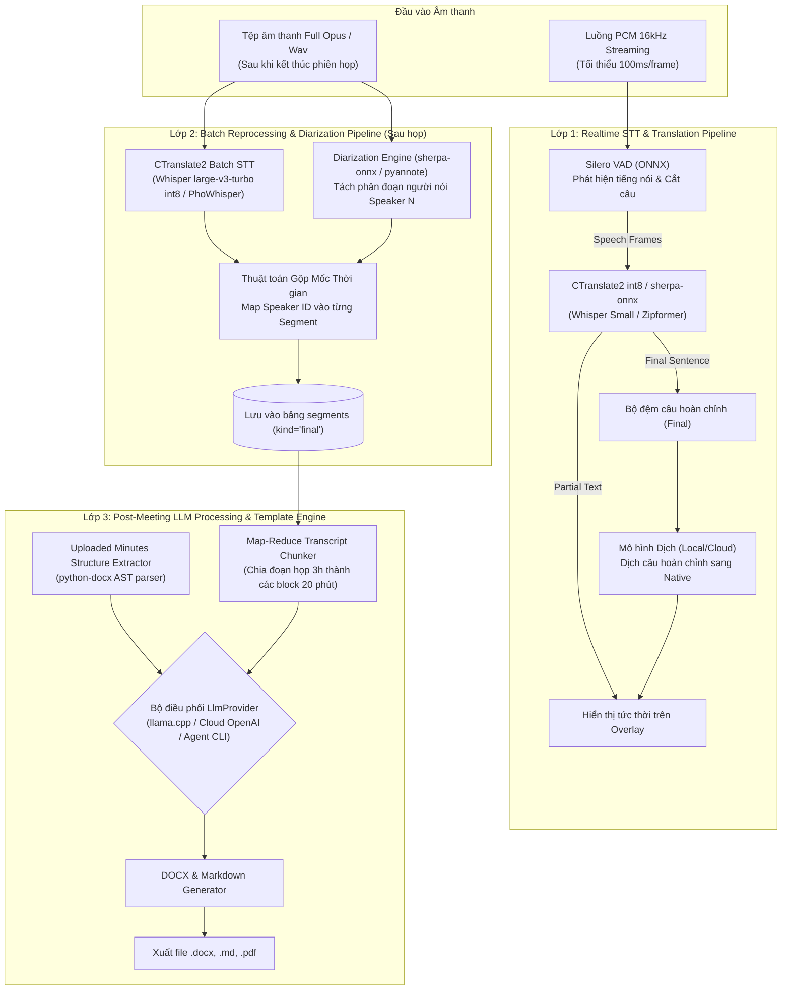
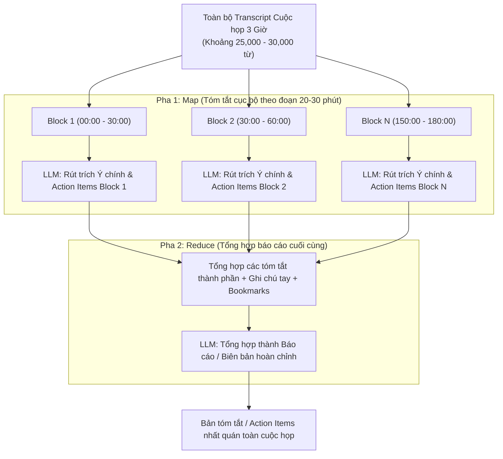

# AI Architecture & Pipeline Runtimes — HopHo (Họp Hộ)

**Tầng tài liệu**: Architecture Layer (`docs/architecture/06-ai-architecture.md`)  
**Hệ thống**: HopHo (Họp Hộ) Desktop Assistant  
**Phiên bản**: 1.0  
**Ngày cập nhật**: 2026-10-15  
**Trạng thái**: Living System Invariant  
**Nguồn tham chiếu**: `docs/project-idea/requirements.md` §3 (FR-STT, FR-DIA, FR-TRN, FR-LLM), `docs/plan/spike-stt-benchmark.md`  

---

## 1. Tổng quan Kiến trúc Pipeline AI (AI Pipeline Topology)

Toàn bộ các tác vụ xử lý thông minh nhân tạo trong HopHo được tổ chức thành các luồng xử lý độc lập bên trong **Python Sidecar**, ưu tiên tối đa các runtime suy luận siêu nhẹ (**CTranslate2, ONNX Runtime, llama.cpp**) để giảm kích thước bộ nhớ và kích thước đóng gói:



---

## 2. Pipeline Speech-to-Text Hai Lớp (Two-Tier STT Architecture)

Tuân thủ triệt để yêu cầu **FR-STT-01**, hệ thống phân tách hoàn toàn giữa luồng bản nháp thời gian thực và luồng chuẩn hóa chất lượng cao sau cuộc họp:

### 2.1 Lớp Realtime (Realtime Streaming Draft Tier)
- **Mục tiêu**: Tốc độ hiển thị nhanh nhất, độ trễ $<= 5\text{ giây}$, tải CPU $<= 50\%$ trên máy chuẩn.
- **Quy trình xử lý**:
  1. **VAD (Voice Activity Detection)**: Sử dụng **Silero VAD** dạng ONNX runtime để lọc khoảng lặng (silence), chỉ kích hoạt giải mã khi có giọng nói thực sự.
  2. **Streaming Decoder**: Sử dụng mô hình int8 qua **faster-whisper** (CTranslate2) hoặc **sherpa-onnx Zipformer streaming**.
  3. **Ngắt câu tự nhiên**: Chỉ thực hiện chia câu bằng dấu ngắt nghỉ và chấm/phẩy. **Tuyệt đối không phân tách danh tính người nói (FR-STT-04)** để tiết kiệm tài nguyên CPU.
  4. **Nạp Glossary**: Danh mục từ khóa của Workspace được nạp vào `hotwords` để hạn chế lỗi nhận diện tên riêng ngay từ lúc realtime.

### 2.2 Lớp Batch Sau họp (High-Precision Batch Reprocessing Tier)
- **Mục tiêu**: Độ chính xác tối đa, hỗ trợ hội thoại trộn Việt - Anh (Code-switching), WER tiếng Việt thấp nhất trong các model qua được ngưỡng RTF (ngưỡng WER mục tiêu chốt sau M0).
- **Mô hình mục tiêu**: **Whisper large-v3-turbo** (lượng hóa int8) hoặc **PhoWhisper** (fine-tuned tiếng Việt).
- **Cơ chế Tạm dừng / Chạy tiếp (Pause & Resume)**:
  - Sidecar chia file audio thành các block $60\text{ giây}$.
  - Sau khi giải mã xong mỗi block, tiến trình ghi nhận checkpoint `last_processed_ms` vào bảng `batch_jobs` ([05-data-architecture.md](./05-data-architecture.md)).
  - Người dùng có thể nhấn Pause bất kỳ lúc nào để nhường CPU cho việc khác và Resume lại chính xác từ checkpoint cũ.

---

## 3. Pipeline Phân tách Người nói (Speaker Diarization Pipeline)

Tuân thủ nghiêm ngặt nguyên tắc thiết kế **FR-DIA-01** và **FR-DIA-04**:

1. **Chỉ chạy ngoại tuyến sau họp**: Không bao giờ thực thi Diarization trong luồng streaming realtime.
2. **Lựa chọn Engine (OQ-03 — chốt ở mini-spike M4)**:
   - **Ứng viên mặc định**: Sử dụng **`sherpa-onnx`** (dựa trên mô hình 3D-speaker ONNX). Đây là engine mã nguồn mở hoàn toàn, không yêu cầu token Hugging Face (non-gated), dung lượng nhẹ ($< 50\text{MB}$) và chạy mượt mà trên CPU.
   - **Tùy chọn nâng cao (Power User)**: Hỗ trợ **`pyannote.audio`** cho người dùng có token Hugging Face và card đồ họa NVIDIA.
3. **Quy trình gán nhãn người nói**:
   - Trích xuất embedding giọng nói của các đoạn hội thoại.
   - Áp dụng thuật toán gom cụm (Spectral Clustering) để phân định $K$ người nói (`Speaker 1`, `Speaker 2`...).
   - Khớp nối mốc thời gian của Diarization với các câu transcript từ Batch STT để gán `speaker_id`.
4. **Bảo mật & Quyền riêng tư (Zero Profile Invariant)**:
   - Toàn bộ vector đặc trưng giọng nói (voice embeddings) chỉ tồn tại trong bộ nhớ RAM tạm thời và **bị xóa sạch 100% ngay khi kết thúc pipeline gom cụm**.
   - Không lưu trữ bất kỳ bảng nhận dạng giọng nói nào qua các cuộc họp khác nhau.

---

## 4. Pipeline Phiên dịch Trực tiếp (Realtime Translation Pipeline)

- **Nguyên lý cốt lõi**: Không sử dụng tính năng `task=translate` của Whisper vì Whisper chỉ dịch sang tiếng Anh. Dịch sang tiếng Việt hoặc các ngôn ngữ khác bắt buộc phải qua mô hình ngôn ngữ (LLM).
- **Luồng xử lý câu hoàn chỉnh (Sentence-level)**:
  1. Bộ đệm chỉ kích hoạt dịch khi VAD xác nhận một câu nói đã kết thúc (`is_final = true`).
  2. Câu tiếng nguồn được gửi sang mô hình dịch với prompt ngắn:
     ```
     Translate the following meeting sentence directly to Vietnamese. Output ONLY the translated sentence, without any explanations:
     "{source_text}"
     ```
  3. Mô hình thực thi: **Local LLM siêu nhỏ** (ứng viên như Qwen2.5 1.5B GGUF chạy qua llama.cpp nhúng; model mặc định chốt ở mini-spike M5) hoặc **Cloud OpenAI-compatible endpoint** (nếu người dùng cấu hình).
  4. Cửa sổ Overlay chỉ hiển thị bản dịch tiếng Việt để người dùng đọc thuận mắt; câu gốc vẫn được lưu vào database.

---

## 5. Pipeline Xử lý Hậu kỳ & Trích xuất Mẫu Biên bản (LLM Post-Processing)

### 5.1 Xử lý Cuộc họp Dài 3 Giờ (Map-Reduce Long Context Strategy)
Để không làm tràn bộ nhớ và vượt ngưỡng context window của các mô hình LLM local (thường là 8k - 32k tokens), hệ thống triển khai pipeline **Map-Reduce 2 pha**:



### 5.2 Cơ chế Trích xuất & Điền Mẫu Biên bản Người dùng Tải lên (FR-LLM-07)
1. **Phân tích cấu trúc mẫu (AST Parsing)**:
   - Sử dụng thư viện `python-docx` duyệt cây cấu trúc của file mẫu `.docx`.
   - Nhận diện các vùng văn bản quy chuẩn: Tiêu đề cơ quan, Logo, Bảng thành phần tham dự, các Heading mục tiêu thảo luận, Bảng phân công công việc.
2. **Tạo Schema Prompt**:
   - Chuyển đổi các mục cần điền thành một JSON Schema yêu cầu LLM trích xuất thông tin tương ứng từ transcript cuộc họp.
3. **Tái tạo tệp Word giữ nguyên mẫu (Fidelity Rendering)**:
   - Sao chép toàn bộ tệp mẫu gốc (giữ nguyên style, font, header, footer, margin).
   - Điền trực tiếp các đoạn văn bản do LLM sinh ra vào đúng các ô bảng và paragraph mục tiêu.

### 5.3 Action Items có cấu trúc
- Template "Action items" yêu cầu LLM trả về JSON (`task`, `assignee`, `due_date`).
- Sidecar lưu từng mục vào bảng `action_items` (liên kết `output_id`) và đồng thời lưu bản Markdown vào `outputs`. Tool MCP `get_action_items` đọc từ `action_items`.
- Bản tóm tắt do Agent ngoài gửi qua `save_summary` chỉ ghi vào `outputs` (`provider = 'external_agent'`), không tự sinh `action_items`.

---

## 6. Ma trận Giấy phép & Tuân thủ Bản quyền Mô hình (License Compliance)

> [!WARNING]
> Bảng dưới đây là thông tin **sơ bộ, chưa được xác minh** (OQ-04 còn mở). License từng model/runtime phải được xác minh ở M0/M4/M5 trước khi đưa vào gói tải mặc định; mọi model được đóng gói hoặc gợi ý trong Model Manager phải tương thích Apache 2.0 của HopHo.

| Tác vụ AI | Tên mô hình khuyến nghị | Giấy phép (License) | Tình trạng đóng gói / Phân phối |
|---|---|---|---|
| **STT Realtime & Batch** | OpenAI Whisper (Base / Small / Large-v3-turbo) | **MIT License** | ✅ Được phép đóng gói và tải về tự do |
| **STT Tiếng Việt** | PhoWhisper (Small / Medium / Large) | **MIT License** | ✅ Hoàn toàn tương thích |
| **STT Streaming** | sherpa-onnx Zipformer | **Apache 2.0** | ✅ Tương thích hoàn hảo |
| **Diarization (Mặc định)** | sherpa-onnx 3D-speaker | **Apache 2.0** | ✅ Phân phối mặc định, không cần token |
| **Diarization (Tùy chọn)** | pyannote.audio v3 | **MIT License (Gated HF)** | ⚠️ Không đóng gói sẵn, người dùng tự cấp token |
| **LLM Local (Tóm tắt/Dịch)** | Qwen 2.5 (ứng viên; các cỡ nhỏ/lớn khác nhau có thể có license khác nhau, ví dụ cỡ 3B cần kiểm tra riêng) | **Cần xác minh theo từng cỡ** | ⚠️ Chờ xác minh ở M0/M5 trước khi đưa vào gói mặc định |
| **Mô hình Dịch cấm dùng** | Meta NLLB-200 | **CC-BY-NC 4.0 (Phi thương mại)** | ⛔ **TUYỆT ĐỐI CẤM ĐÓNG GÓI SẴN** |
