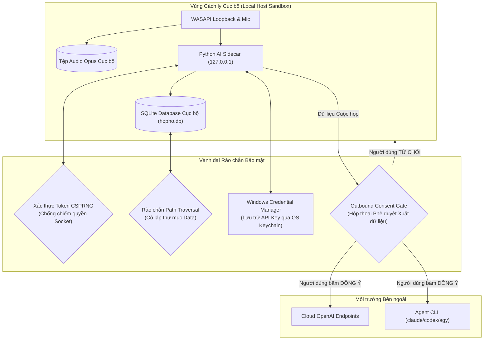
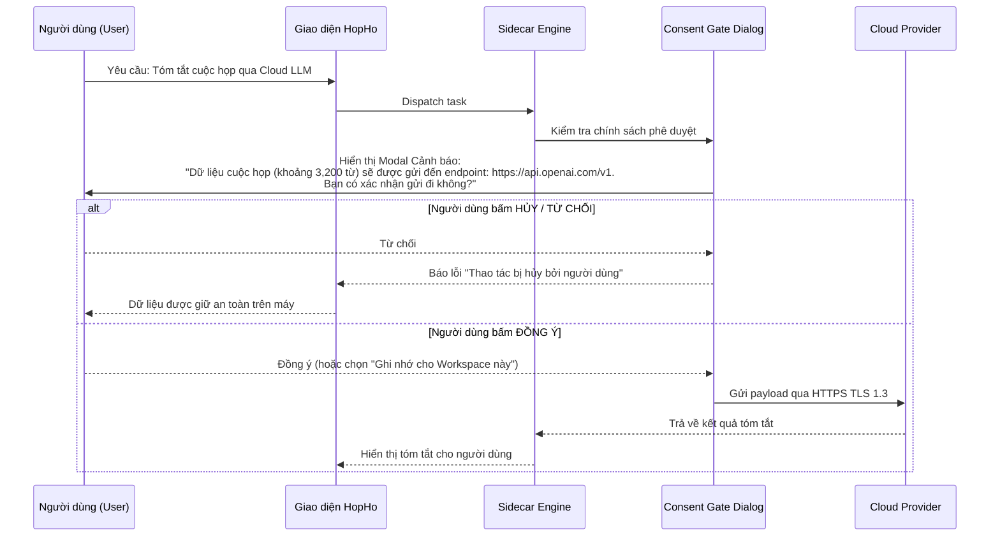

# Security & Privacy Architecture — HopHo (Họp Hộ)

**Tầng tài liệu**: Architecture Layer (`docs/architecture/07-security-architecture.md`)  
**Hệ thống**: HopHo (Họp Hộ) Desktop Assistant  
**Phiên bản**: 1.0  
**Ngày cập nhật**: 2026-10-15  
**Trạng thái**: Living System Invariant  
**Nguồn tham chiếu**: `docs/project-idea/requirements.md` §0 & §4 (FR-DATA)  

---

## 1. Mô hình Bảo mật Cốt lõi & Triết lý Local-First

HopHo được xây dựng dựa trên nguyên tắc **Bảo mật theo Thiết kế (Security by Design)** và **Ưu tiên Cục bộ (Local-first)**. Trong bối cảnh các cuộc họp thường chứa thông tin bí mật kinh doanh, mã nguồn dự án, dữ liệu nhân sự và tài chính, hệ thống thiết lập các rào chắn kỹ thuật không thể vượt qua:

---

## 2. Cam kết Quyền riêng tư Tuyệt đối (Privacy Guarantees)

### 2.1 Chính sách Không thu thập dữ liệu (Zero Telemetry Invariant - FR-DATA-05)
- **Tuyệt đối cấm**: Không tích hợp bất kỳ công cụ theo dõi hành vi, Google Analytics, Mixpanel, Sentry cloud hay SDK phân tích từ xa nào vào mã nguồn.
- **Không có cuộc gọi ngầm (No Phone-home)**: Ứng dụng không tự ý gửi bất kỳ tín hiệu ping hay thống kê lượt dùng về máy chủ trung tâm.
- **Ngoại lệ có kiểm soát (không gửi dữ liệu cuộc họp hay định danh)**: (1) tải model từ Hugging Face/mirror khi người dùng bấm tải; (2) kiểm tra cập nhật ứng dụng chỉ khi người dùng bật tùy chọn hoặc bấm kiểm tra thủ công (xem [04-deployment-architecture.md](./04-deployment-architecture.md) §5).
- **Nhật ký cục bộ**: Mọi log lỗi và thông số hoạt động chỉ được ghi xuống thư mục `logs/` trên máy tính người dùng và tự động xoay vòng (log rotation) sau 7 ngày.

### 2.2 Không lưu trữ Hồ sơ Nhận dạng Giọng nói (Zero Voice Profile Invariant - FR-DIA-04)
- Quá trình phân tách người nói (Speaker Diarization) chỉ trích xuất các vector đặc trưng giọng nói (voice embeddings) tạm thời trong bộ nhớ RAM phục vụ thuật toán phân cụm trong phiên họp đó.
- **Hành động bắt buộc**: Ngay khi thuật toán gom cụm hoàn tất và gán nhãn `Speaker N`, toàn bộ mảng dữ liệu embedding trong RAM phải được giải phóng và ghi đè (zeroize). Tuyệt đối không lưu embedding vào cơ sở dữ liệu.

---

## 3. Cổng Phê duyệt Dữ liệu Xuất Ngoại (Outbound Data Consent Gate)

Tuân thủ nguyên tắc **User quyết định mọi thứ (FR-DATA-06)**, hệ thống không bao giờ tự ý gửi dữ liệu cuộc họp ra mạng Internet:

---

## 4. Quản lý Khóa Bí mật qua OS Keychain (Credential Security - FR-DATA-07)

- **Cấm lưu Plaintext**: Tuyệt đối không lưu trữ API Key, Token bí mật của các nhà cung cấp Cloud LLM dưới dạng văn bản rõ trong database SQLite, file cấu hình `.json` hay nhật ký hệ thống.
- **Cơ chế lưu trữ**: Sử dụng crate Rust **`keyring`** để giao tiếp trực tiếp với **Windows Credential Manager** (API `CredWriteW` / `CredReadW` được mã hóa bởi hệ điều hành Windows bằng khóa người dùng).
- **Vòng đời trong bộ nhớ (In-Memory Lifetime)**:
  - Khóa API chỉ được đọc từ Windows Credential Manager vào bộ nhớ RAM khi bắt đầu thực hiện cuộc gọi mạng.
  - Sử dụng cấu trúc dữ liệu tự xóa (Zeroize on Drop) để xóa sạch vùng nhớ chứa khóa ngay sau khi yêu cầu mạng hoàn tất.

---

## 5. Gia cố An ninh Giao tiếp Nội bộ (IPC Hardening)

Do hệ thống sử dụng mô hình đa tiến trình giao tiếp qua WebSocket nội bộ, các biện pháp gia cố được áp dụng nghiêm ngặt để chống lại các cuộc tấn công chiếm quyền từ các phần mềm độc hại khác trên máy:

1. **Ràng buộc Địa chỉ Loopback Tuyệt đối**:
   - Máy chủ WebSocket của Sidecar chỉ bind duy nhất vào địa chỉ `127.0.0.1`. Tuyệt đối không bind `0.0.0.0` (ngăn chặn mọi truy cập từ mạng LAN hoặc thiết bị ngoài).
2. **Cổng mạng Động Ngẫu nhiên (Ephemeral Port)**:
   - Mỗi lần khởi động, Rust Core cấp phát một cổng ngẫu nhiên chưa sử dụng (không dùng cổng cố định để tránh bị quét cổng).
3. **Mã Token Xác thực Mật mã (CSPRNG Token)**:
   - Rust Core sinh chuỗi token ngẫu nhiên 32 ký tự hex thông qua bộ sinh số ngẫu nhiên mật mã của hệ điều hành (`ring::rand::SystemRandom`).
   - Mọi kết nối WebSocket kết nối tới Sidecar bắt buộc phải truyền token này trong header hoặc query string. Nếu token không khớp, Sidecar đóng kết nối ngay lập tức (HTTP 401 Unauthorized) và ngắt socket.
4. **Chống Tấn công Vượt thư mục (Path Traversal Guard)**:
   - Mọi thao tác ghi tệp (Opus chunks, exports, models) đều được kiểm tra chuẩn hóa đường dẫn (`canonicalize`).
   - Tuyệt đối từ chối và ghi log cảnh báo nếu đường dẫn tệp nằm ngoài thư mục dữ liệu cô lập đã được người dùng chỉ định.
