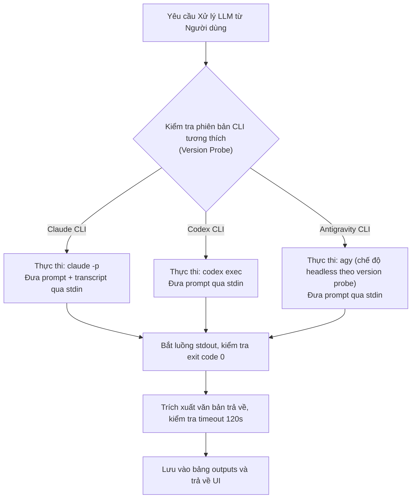

# Integration & Communication Architecture — HopHo (Họp Hộ)

**Tầng tài liệu**: Architecture Layer (`docs/architecture/08-integration-architecture.md`)  
**Hệ thống**: HopHo (Họp Hộ) Desktop Assistant  
**Phiên bản**: 1.0  
**Ngày cập nhật**: 2026-10-15  
**Trạng thái**: Living System Invariant  
**Nguồn tham chiếu**: `docs/plan/mvp-plan.md` §2 (AD-2, AD-3) & §6 (M6), `docs/project-idea/requirements.md` §3.7  

---

## 1. Bản đồ Giao thức Giao tiếp (Communication Protocols Topology)

HopHo phân tách rạch ròi giữa giao tiếp nội bộ hiệu năng cao (Internal IPC) và các chuẩn giao thức mở kết nối với hệ sinh thái bên ngoài (External Integrations):

```mermaid
flowchart LR
    subgraph InternalIPC ["Giao tiếp Nội bộ (Local Machine)"]
        UI["React Webview"] <-->|Tauri IPC Commands / Events| Rust["Rust Core Engine"]
        Rust <-->|WebSocket Loopback<br/>127.0.0.1:{port}?token={token}| Sidecar["Python AI Sidecar"]
    end

    subgraph ExternalMCP ["Tích hợp Agent qua Model Context Protocol"]
        Sidecar -.->|hopho_store| DB[("SQLite hopho.db")]
        MCP["hopho-mcp (stdio)"] <-->|hopho_store| DB
        AgentExt["Claude Desktop / Claude Code<br/>Codex / Antigravity"] <-->|JSON-RPC 2.0 (stdio)| MCP
    end

    subgraph ExternalCloud ["Tích hợp Đám mây & CLI (User Opt-in)"]
        Sidecar -- "Headless CLI Call" --> AgentCLI["claude -p / codex / agy"]
        Sidecar -- "HTTPS TLS 1.3" --> OpenAI["Cloud OpenAI-compatible APIs"]
    end
```

---

## 2. Giao thức IPC Nội bộ (Internal WebSocket Protocol: Rust $\leftrightarrow$ Sidecar)

### 2.1 Bắt tay Kết nối (Handshake)
- **URL**: `ws://127.0.0.1:{port}/ws/session`
- **Header xác thực**: `Authorization: Bearer {session_token}` (hoặc query parameter `?token={session_token}`).
- **Khởi tạo phiên (Client $\rightarrow$ Server)**:
  ```json
  {
    "action": "start_session",
    "meeting_id": "9b1deb4d-3b7d-4bad-9bdd-2b0d7b3dcb6d",
    "mode": "realtime",
    "primary_lang": "vi",
    "enable_translation": true,
    "target_lang": "vi",
    "glossary_terms": ["HopHo", "Antigravity", "Kubernetes"]
  }
  ```

### 2.2 Luồng Dữ liệu Nhị phân (Binary PCM Ingress)
- Rust Audio Capture gửi liên tục các mảng byte nhị phân qua WebSocket frame (`OpCode::Binary`).
- Định dạng: **16,000 Hz, 16-bit Signed Integer (Little-Endian), Mono**.
- Chu kỳ gửi: Mỗi **100ms** (tương đương 3,200 bytes/frame).

### 2.3 Luồng Sự kiện Kết quả (Text Egress: Server $\rightarrow$ Client)
Sidecar trả về kết quả qua WebSocket frame dạng văn bản JSON (`OpCode::Text`):

```json
// 1. Kết quả nháp tức thời (Partial Result - đang nói)
{
  "event": "partial_transcript",
  "meeting_id": "9b1deb4d-3b7d-4bad-9bdd-2b0d7b3dcb6d",
  "text": "chúng ta cần hoàn thành",
  "audio_end_ms": 1450
}

// 2. Kết quả dứt câu hoàn chỉnh (Final Result - đã ngắt câu bằng VAD)
{
  "event": "final_transcript",
  "meeting_id": "9b1deb4d-3b7d-4bad-9bdd-2b0d7b3dcb6d",
  "segment_id": "c1f72e90-1234-5678-abcd-ef0123456789",
  "start_ms": 0,
  "end_ms": 2800,
  "text": "Chúng ta cần hoàn thành báo cáo này trước thứ Sáu.",
  "lang": "vi",
  "translated_text": null
}

// 3. Kết quả phiên dịch câu trực tiếp (Translation Result)
{
  "event": "translation_update",
  "segment_id": "c1f72e90-1234-5678-abcd-ef0123456789",
  "translated_text": "We need to finish this report before Friday."
}

// 4. Thông báo lỗi chuẩn hóa (Error Notification)
{
  "event": "error",
  "code": "MODEL_OUT_OF_MEMORY",
  "message": "Không đủ bộ nhớ để chạy mô hình đã chọn. Hệ thống tự động chuyển sang chế độ Chỉ ghi âm.",
  "recoverable": true
}
```

---

### 2.4 Điều khiển Tiến trình Batch (REST cùng sidecar, cùng token)

Mọi endpoint yêu cầu `Authorization: Bearer {session_token}`.

| Endpoint | Mô tả |
|---|---|
| `GET /health` | Health check (HTTP 200) |
| `POST /api/batch/start` | Body `{meeting_id, stt_model, diarize}`; tạo bản ghi `batch_jobs` và chạy nền |
| `POST /api/batch/pause` | Body `{meeting_id}`; lưu `last_processed_ms` rồi tạm dừng |
| `POST /api/batch/resume` | Body `{meeting_id}`; chạy tiếp từ checkpoint |
| `GET /api/batch/{meeting_id}/status` | Trả về `status`, `last_processed_ms`, `total_ms` |

Tiến độ batch được đẩy qua WebSocket `/ws/session`:

```json
{ "event": "batch_progress", "meeting_id": "...", "progress_pct": 35, "eta_seconds": 45 }
```

Client kết thúc luồng realtime bằng `{ "action": "end_stream", "meeting_id": "..." }`.

---

## 3. Đặc tả Máy chủ Model Context Protocol (`hopho-mcp`)

Tiến trình `hopho-mcp` triển khai đầy đủ thông số kỹ thuật Model Context Protocol chính thức, giao tiếp thông qua standard input/output (`stdio`).

### 3.1 Danh mục 6 Tools Chuẩn hóa

| Tên Tool | Mô tả chức năng | Đầu vào (Input Schema) | Đầu ra kỳ vọng (Output) |
|---|---|---|---|
| **`list_meetings`** | Lấy danh sách các cuộc họp theo bộ lọc | `workspace_id` (string, optional), `limit` (int, default 20), `offset` (int), `tag` (string, optional) | Mảng metadata cuộc họp: `id`, `title`, `started_at`, `duration_ms`, `tags` |
| **`get_meeting`** | Lấy thông tin chi tiết một cuộc họp | `meeting_id` (string, required) | Metadata đầy đủ, số người nói, trạng thái xử lý |
| **`get_transcript`** | Trích xuất toàn bộ văn bản phiên âm | `meeting_id` (string, required), `format` (enum: `json`, `text`, `markdown`) | Danh sách các câu kèm timestamp, nhãn người nói (`Speaker N` hoặc tên thật) |
| **`search_meetings`** | Tìm kiếm từ khóa trên toàn bộ lịch sử họp | `query` (string, required), `limit` (int, default 10) | Danh sách kết quả từ SQLite FTS5 kèm đoạn trích dẫn (snippets bôi đậm) |
| **`get_action_items`** | Trích xuất các việc cần làm của cuộc họp | `meeting_id` (string, required) | Mảng các đầu việc đọc từ bảng `action_items`: công việc, người phụ trách, hạn chót |
| **`save_summary`** | Cho phép Agent lưu bản tóm tắt mới vào app | `meeting_id` (string, required), `title` (string), `content_md` (string, required) | Xác nhận lưu thành công; ghi vào `outputs` với `provider = 'external_agent'`, hiển thị tức thời trên UI của HopHo |

### 3.2 Cấu hình Tích hợp Mẫu cho các AI Agent (Client Configurations)

#### Cho Claude Desktop (`claude_desktop_config.json`):
```json
{
  "mcpServers": {
    "hopho": {
      "command": "C:\\Program Files\\HopHo\\hopho-mcp.exe",
      "args": ["--data-dir", "D:\\HopHoData"]
    }
  }
}
```

#### Cho Codex (`~/.codex/config.toml`):
```toml
[mcp_servers.hopho]
command = "C:\\Program Files\\HopHo\\hopho-mcp.exe"
```

#### Cho Antigravity (`mcp_config.json`) và Claude Code (`.mcp.json`) — cùng cấu trúc `mcpServers`:
```json
{
  "mcpServers": {
    "hopho": {
      "command": "C:\\Program Files\\HopHo\\hopho-mcp.exe"
    }
  }
}
```

---

## 4. Bộ Điều hợp Trợ lý Dòng lệnh (Agent CLI Headless Adapters)

Để tận dụng các gói tài khoản trả phí sẵn có của người dùng mà không bắt họ phải chi trả thêm API key đám mây, hệ thống xây dựng các Adapter gọi lệnh CLI ở chế độ headless:



> [!NOTE]
> Cờ dòng lệnh cụ thể của từng CLI là **cấu hình của adapter**, được xác minh theo phiên bản bằng version probe (rủi ro R5); không phải bất biến của kiến trúc. Config MCP của từng agent cũng cần được kiểm tra lại theo phiên bản agent.

- **Kiểm soát Thời gian chờ (Timeout Guard)**: Mọi lệnh CLI đều bị giới hạn thời gian chờ tối đa **120 giây**. Nếu quá hạn, tiến trình con sẽ bị chấm dứt an toàn (`process.kill()`).
- **Xử lý Mã lỗi (Error Translation)**: Nếu CLI trả về lỗi (như hết hạn phiên đăng nhập hoặc thay đổi cờ dòng lệnh), hệ thống bắt lỗi tường minh và hiển thị hướng dẫn người dùng chạy lệnh `login` ngoài terminal.

---

## 5. Kết nối Đám mây Chuẩn OpenAI (OpenAI-Compatible REST Client)

- **Chuẩn giao tiếp**: HTTPS REST API tuân thủ đặc tả `POST /v1/chat/completions`.
- **Cấu hình**: Base URL tùy chỉnh (hỗ trợ OpenAI, Groq, OpenRouter, DeepSeek, vLLM local).
- **Bảo mật kết nối**: Bắt buộc TLS 1.3; xác thực bằng header `Authorization: Bearer {API_KEY}` lấy từ Windows Credential Manager.
