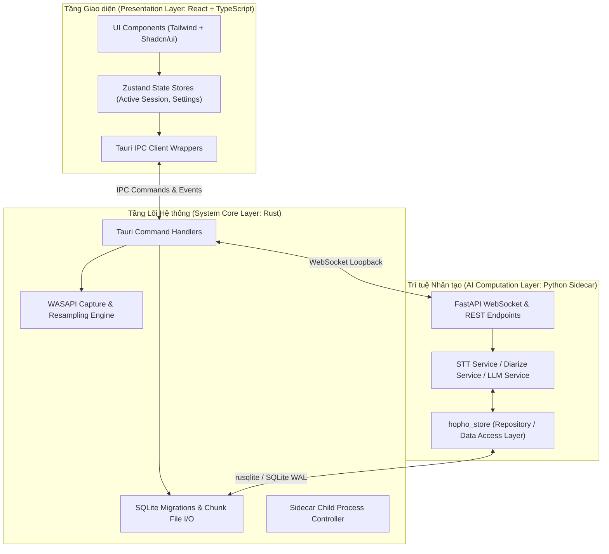

# Design Principles & Engineering Standards — HopHo (Họp Hộ)

**Tầng tài liệu**: Architecture Layer (`docs/architecture/09-design-principles.md`)  
**Hệ thống**: HopHo (Họp Hộ) Desktop Assistant  
**Phiên bản**: 1.0  
**Ngày cập nhật**: 2026-10-15  
**Trạng thái**: Living System Invariant  
**Nguồn tham chiếu**: `AGENTS.md` §2 & §5, `docs/plan/mvp-plan.md` §7  

---

## 1. Triết lý Thiết kế Clean Architecture & Phân tách Trách nhiệm

Hệ thống tuân thủ nghiêm ngặt nguyên tắc **Phân tách Ranh giới Độc lập (Separation of Concerns)** giữa 3 tầng công nghệ:



### Quy tắc phân định ranh giới bất biến:
1. **Không nhúng logic AI vào Rust Core**: Rust chỉ làm những gì nó giỏi nhất (thu âm tốc độ cao, quản lý bộ nhớ an toàn, tương tác Win32 API, quản lý file I/O).
2. **Không nhúng logic hệ thống vào Python**: Python không trực tiếp gọi WASAPI hay tạo cửa sổ Windows. Python chỉ tập trung tính toán mô hình và xử lý tài liệu.
3. **UI không gọi trực tiếp Sidecar**: Mọi tương tác từ Webview UI đều đi qua Rust Core thông qua Tauri IPC commands, giúp Rust nắm trọn vẹn trạng thái hệ thống.

---

## 2. Ứng dụng Bộ Nguyên tắc SOLID trong Hệ thống

### 2.1 Single Responsibility Principle (SRP - Trách nhiệm Duy nhất)
- Module `audio/wasapi.rs` **chỉ** thu nhận luồng âm thanh từ Windows Core Audio và đưa vào kênh buffer. Nó không biết gì về việc nén Opus hay ghi đĩa.
- Module `recorder/chunk_writer.rs` **chỉ** nhận buffer âm thanh, nén Opus và ghi xuống đĩa kèm `fsync`.

### 2.2 Open/Closed Principle (OCP - Mở rộng, Đóng thay đổi)
- Hệ thống hỗ trợ đa dạng nhà cung cấp LLM thông qua interface trừu tượng `LlmProvider`:
  ```python
  class LlmProvider(Protocol):
      async def generate(self, prompt: str, system_prompt: str | None = None) -> str:
          ...
      async def stream(self, prompt: str) -> AsyncIterator[str]:
          ...
  ```
- Khi bổ sung một nhà cung cấp mới (ví dụ DeepSeek local hay vLLM), chỉ cần tạo class mới hiện thực interface trên mà không cần sửa đổi bất kỳ dòng code nào trong controller xử lý tóm tắt.

### 2.3 Dependency Inversion Principle (DIP - Đảo ngược Phụ thuộc)
- Các tầng nghiệp vụ cấp cao (như Service tóm tắt hay Service phiên dịch) không phụ thuộc trực tiếp vào các thư viện cụ thể (`llama-cpp-python` hay `openai`). Chúng phụ thuộc vào abstraction interface được inject vào khi khởi tạo.

---

## 3. Tiêu chuẩn Xử lý Lỗi Thống nhất (Unified Error Envelope - NFR-07)

Tuân thủ nghiêm ngặt quy tắc **Không có lỗi im lặng (No Silent Failures)**, mọi lỗi phát sinh từ tầng Sidecar hoặc Rust Core đều phải được bọc trong một cấu trúc dữ liệu lỗi chuẩn hóa trước khi đẩy lên UI:

```json
{
  "success": false,
  "error": {
    "code": "DEVICE_MIC_ACCESS_DENIED",
    "message": "Không thể truy cập microphone. Vui lòng cấp quyền trong Windows Privacy Settings.",
    "category": "HARDWARE",
    "recoverable": true,
    "suggested_action": "OPEN_SYSTEM_SETTINGS",
    "details": {
      "device_id": "{0.0.1.00000000}.{default}",
      "os_error_code": 5
    }
  }
}
```

### Danh mục Mã Lỗi Tiêu chuẩn (Standard Error Codes):
- `HARDWARE_WASAPI_INIT_FAILED`: Không khởi tạo được luồng loopback âm thanh hệ thống.
- `STORAGE_DISK_FULL`: Ổ đĩa lưu trữ còn dưới ngưỡng an toàn (50MB).
- `MODEL_NOT_FOUND`: Mô hình AI chưa được tải vào thư mục `models/`.
- `MODEL_OUT_OF_MEMORY`: Không đủ dung lượng RAM/VRAM để nạp mô hình.
- `LLM_GATEWAY_TIMEOUT`: Gọi Cloud LLM hoặc Agent CLI bị quá thời gian chờ (120s).
- `IPC_SOCKET_DISCONNECTED`: Mất kết nối WebSocket giữa Rust và Sidecar.

---

## 4. Kiểm soát Chất lượng Mã nguồn & Cổng Linter (Quality Gates)

Trước khi bất kỳ đoạn mã nào được merge vào nhánh chính, hệ thống CI (GitHub Actions) bắt buộc phải kiểm tra và đảm bảo không có cảnh báo nào:

| Ngôn ngữ / Công nghệ | Công cụ Lint & Format | Lệnh kiểm tra bắt buộc | Tiêu chuẩn chất lượng |
|---|---|---|---|
| **Rust** | `clippy` + `rustfmt` | `cargo clippy -- -D warnings`<br/>`cargo fmt --check` | 0 warnings, tuân thủ idiom Rust chuẩn, không unwrap tùy tiện |
| **Python** | `ruff` + `mypy` | `uv run ruff check .`<br/>`uv run ruff format --check .`<br/>`uv run mypy src/ --strict` | Type checking nghiêm ngặt (`--strict`), 0 lỗi lint, chuẩn PEP 8 |
| **TypeScript / React** | `eslint` + `prettier` + `tsc` | `pnpm lint`<br/>`pnpm tsc --noEmit`<br/>`pnpm prettier --check .` | Không dùng `any`, 100% type-safe, tuân thủ React Hooks rules |

---

## 5. Quy tắc Tránh Lãng phí Tài nguyên (Resource Efficiency Invariants)

1. **Bộ đệm có giới hạn (Bounded Buffers)**: Mọi hàng đợi truyền âm thanh giữa các luồng đều phải có kích thước tối đa (ví dụ RingBuffer 10 giây). Nếu phía sau xử lý chậm, hệ thống áp dụng cơ chế backpressure hoặc drop frame có cảnh báo chứ không để phình to RAM vô hạn.
2. **Không thăm dò lặp vô tận (No Busy Waiting / Polling)**: Sử dụng các cơ chế đồng bộ hóa luồng bất đồng bộ (`tokio::sync::mpsc`, `asyncio.Event`) thay vì vòng lặp `while True: sleep(0.01)`.
3. **Dọn dẹp File Tạm**: Mọi tệp sinh ra trong quá trình trích xuất âm thanh hoặc chuyển đổi DOCX phải được dọn dẹp trong khối `finally` / `Drop`.
