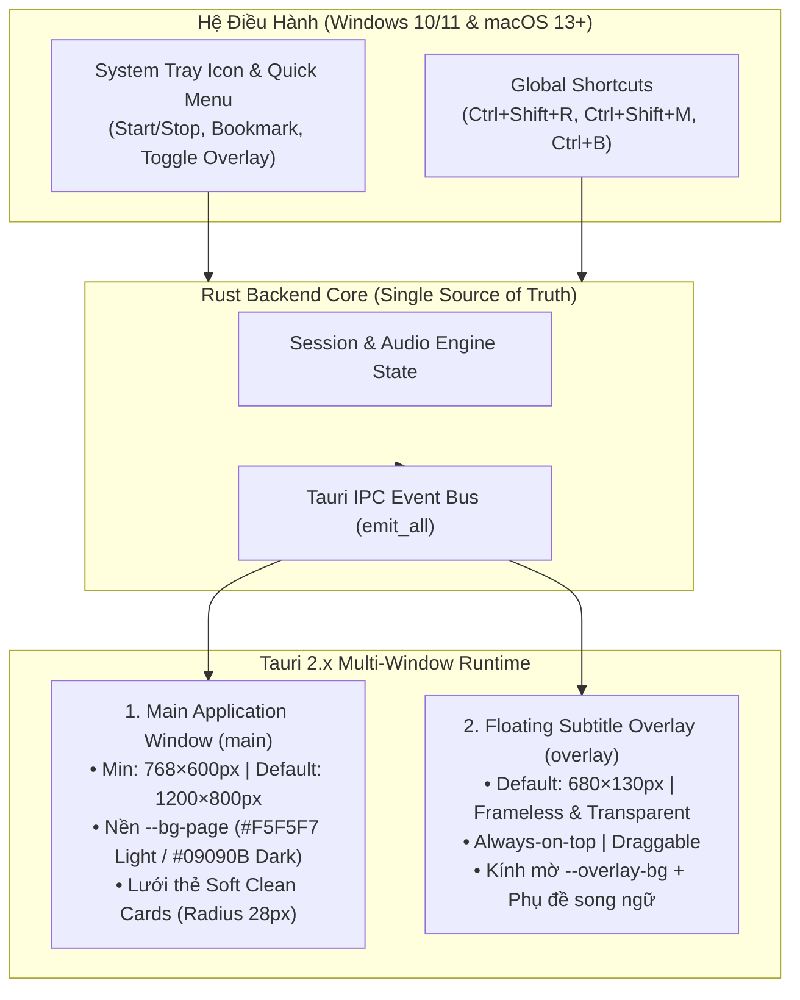
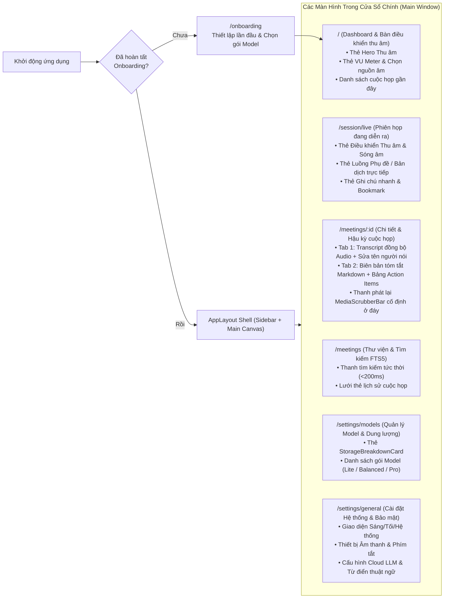

# Thiết Kế Hệ Thống Giao Diện Người Dùng (Frontend System Design)

> **Trạng thái**: Đã phê duyệt (Approved) — Phiên bản 1.0  
> **Kiến trúc cửa sổ**: Đa cửa sổ Tauri 2.x (`Main Window` + `Floating Subtitle Overlay` + `System Tray`)  
> **Phong cách bố cục**: Lưới thẻ **Soft Clean Cards** trên nền đơn sắc (`--bg-page`), thích ứng linh hoạt từ chế độ chia đôi màn hình (`768px`) đến màn hình rộng (`1440px+`)

---

## 1. Kiến Trúc Đa Cửa Sổ Desktop (Multi-Window Desktop Architecture)

Ứng dụng **Họp Hộ (HopHo)** vận hành đồng thời hai ngữ cảnh hiển thị kết hợp với khay hệ thống (System Tray) để không làm gián đoạn luồng làm việc khi người dùng đang họp trên Zoom, Google Meet hoặc Microsoft Teams.

### 1.1. Thông Số Kỹ Thuật Các Cửa Sổ

| Thuộc tính | Cửa sổ chính (`main`) | Cửa sổ phụ đề nổi (`overlay`) | Khay hệ thống (`system-tray`) |
| :--- | :--- | :--- | :--- |
| **Kích thước mặc định** | `1200 × 800 px` | `680 × 130 px` | Menu ngữ cảnh chuẩn OS |
| **Kích thước tối thiểu** | `768 × 600 px` | `420 × 88 px` | — |
| **Khung viền (`Decorations`)** | Chuẩn OS (hoặc Custom Titlebar đồng màu `--bg-page`) | `false` (Frameless hoàn toàn, bo góc `16px`) | — |
| **Độ trong suốt (`Transparent`)** | `false` (Nền đặc `--bg-page`) | `true` (Nền kính mờ `--overlay-bg`) | — |
| **Luôn nổi trên cùng (`Always-on-top`)** | `false` | `true` (Luôn nổi trên Zoom/Meet/Slide) | — |
| **Hành vi khi nhấn nút Đóng (`X`)** | Nếu đang thu âm: Thu nhỏ xuống System Tray (không làm đứt luồng ghi âm). Nếu rảnh: Thoát hoặc ẩn tùy cài đặt | Ẩn cửa sổ Overlay (vẫn tiếp tục thu âm ngầm) | Thoát hoàn toàn ứng dụng (có xác nhận nếu đang thu) |

---

## 2. Cấu Trúc Điều Hướng & Sơ Đồ Màn Hình (Navigation & Route Hierarchy)

Ứng dụng sử dụng bộ định tuyến trong bộ nhớ (`MemoryRouter` của React Router v6) với cấu trúc nông tối đa **2 cấp độ** để người dùng có thể truy cập mọi tính năng chỉ trong 1–2 cú nhấp chuột:

---

## 3. Hệ Thống Lưới Bố Cục & Đáp Ứng Kích Thước (Responsive Card Grid System)

Vì người dùng thường đặt cửa sổ **Họp Hộ** nằm cạnh cửa sổ **Zoom / Google Meet** (chế độ Split-Screen 50/50 trên màn hình laptop), giao diện bắt buộc phải thích ứng mượt mà qua 3 ngưỡng kích thước (Breakpoints) theo đúng chuẩn **Soft Clean Cards**:

### 3.1. Ba Ngưỡng Bố Cục (Breakpoints)

| Ngưỡng (`Breakpoint`) | Chiều rộng cửa sổ | Cấu trúc Sidebar | Cấu trúc Lưới Thẻ (`Card Grid`) | Ngữ cảnh sử dụng thực tế |
| :--- | :--- | :--- | :--- | :--- |
| **Compact (Chia đôi màn hình)** | `768px – 1023px` | Thu gọn thành thanh Icon dọc `64px` | **1 cột đơn (`1fr`)**, các thẻ `SoftCard` xếp chồng dọc, khoảng cách `16px`, padding khung chính `20px` | Đặt Họp Hộ chiếm nửa màn hình bên phải trong khi xem slide họp bên trái |
| **Standard (Mặc định)** | `1024px – 1439px` | Thanh bên đầy đủ `240px` (Logo, Nút Thu âm nhanh, Menu, Trạng thái GPU/Ổ cứng ở đáy) | **Lưới 2 cột (`repeat(2, minmax(0, 1fr))`)** hoặc bố cục bất đối xứng `7fr 5fr`, khoảng cách `16px`, padding khung chính `28px` | Sử dụng toàn màn hình trên Laptop 13–15 inch |
| **Wide Desktop (Bento Rộng)** | `>= 1440px` | Thanh bên đầy đủ `256px` | **Lưới tối đa 3 cột (`repeat(3, minmax(0, 1fr))`)**, chiều rộng vùng nội dung giới hạn ở `max-width: 1280px` căn giữa | Màn hình rời 24–27 inch trở lên; xem đồng thời Transcript và Biên bản |

### 3.2. Quy Tắc Bố Cục Thẻ ("Soft Clean Cards Layout Rules")

1. **Tương phản giữa Nền trang và Thẻ**:
   - Khung nền chính (`Main Canvas`) luôn mang màu `--bg-page` (`#F5F5F7` ở Light Mode, `#09090B` ở Dark Mode).
   - Các khối chức năng nằm tách biệt bên trong các thẻ `SoftCard` màu `--bg-card` (`#FFFFFF` ở Light Mode, `#121215` ở Dark Mode) với góc bo `28px` và khoảng cách lưới `16px` (`--space-4`).
2. **Thanh Bên Tối Giản (`Sidebar Navigation`)**:
   - Nằm bên trái, sử dụng nền `--bg-page` (hòa tiệp với nền cửa sổ để tạo cảm giác nhẹ nhàng) hoặc thẻ nổi cách lề `12px`.
   - Mục đang chọn (`Active Nav Item`) dùng nền `--bg-card` (Light) / `--bg-subtle` (Dark), chữ `--text-primary` đậm `500`, bo góc `12px`.
   - Đáy Sidebar luôn hiển thị **Thẻ Trạng Thái Phần Cứng Thu Gọn (`HardwareMiniCard`)**: cho biết ứng dụng đang chạy trên `GPU CUDA` hay `CPU` và dung lượng ổ cứng còn trống.
3. **Không Cuộn Kép (No Nested Conflicting Scrollbars)**:
   - Trên các màn hình Dashboard và Cài đặt: Chỉ có một thanh cuộn dọc duy nhất của vùng `Main Canvas`.
   - Trên màn hình **Chi tiết Cuộc họp (`/meetings/:id`)**: Khung tiêu đề và thanh `MediaScrubberBar` ở đáy được ghim cố định (`sticky`), vùng danh sách `Transcript` ở giữa sử dụng cuộn ảo hóa (`@tanstack/react-virtual`) độc lập để xử lý mượt trên `10,000` câu thoại.

---

## 4. Thiết Kế Trải Nghiệm Chuyển Đổi Chế Độ Sáng / Tối (Light & Dark Mode Ergonomics)

- **Light Mode (Mặc định ban ngày / Soạn thảo biên bản)**:
  - Mang lại cảm giác như những tờ giấy trắng mịn (`#FFFFFF`) đặt trên mặt bàn xám ấm (`#F5F5F7`). Tối ưu cho việc đọc lại biên bản họp, rà soát bảng Action Items và chỉnh sửa văn bản sau cuộc họp.
- **Dark Mode (Tối ưu khi họp tối / Đa màn hình)**:
  - Sử dụng nền đen sâu (`#09090B`) và bề mặt thẻ than chì (`#121215`) với đường viền sáng cực nhẹ (`#22222A`). Giảm thiểu ánh sáng xanh phát ra khi người dùng đang họp trong phòng tối hoặc đặt ứng dụng cạnh giao diện tối mặc định của Zoom/Discord.
  - Nút hành động chính (`--ink`) tự động đảo thành màu trắng ngà (`#F5F5F7`) với chữ đen (`#0B0B0F`), giữ nguyên độ tương phản thị giác mạnh mẽ như nút đen trên nền trắng ở Light Mode.
