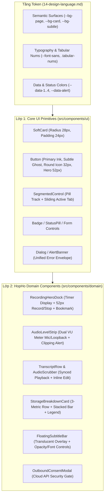

# Hệ Thống Thành Phần Giao Diện (Design System & Component Library)

> **Trạng thái**: Đã phê duyệt (Approved) — Phiên bản 1.0  
> **Nền tảng kỹ thuật**: React 18 + TypeScript + Tailwind CSS + Radix UI (`shadcn/ui` tùy biến theo phong cách **Soft Clean Cards**)  
> **Tham chiếu Token**: `docs/architecture/14-design-language.md`  
> **Nguồn cảm hứng thiết kế**: `docs/research/soft-clean-cards.md`

---

## 1. Kiến Trúc Thư Viện Thành Phần (Component Architecture)

Hệ thống thành phần giao diện của **Họp Hộ (HopHo)** được chia làm 2 lớp rõ rệt:
1. **Core UI Primitives (`src/components/ui/`)**: Các thành phần nguyên tử được xây dựng trên nền tảng **Radix UI** (đảm bảo chuẩn truy cập bàn phím WAI-ARIA, quản lý focus trap, screen-reader) và được tạo kiểu lại hoàn toàn theo ngôn ngữ **Soft Clean Cards** (`--radius-xl: 28px`, viền mảnh `1px`, đơn sắc `--ink` / `--bg-subtle`).
2. **Domain Composite Components (`src/components/domain/`)**: Các thành phần nghiệp vụ đặc thù của ứng dụng trợ lý họp AI (Bộ điều khiển thu âm Hero, Thanh đo âm lượng VU Meter, Dòng văn bản Transcript ảo hóa, Biểu đồ phân bổ dung lượng ổ cứng, Hộp thoại xác nhận bảo mật Outbound Data Consent Gate).

---

## 2. Lớp 1: Thành Phần Nguyên Tử (Core UI Primitives)

### 2.1. Thẻ Chuẩn (`SoftCard`)

Thẻ `SoftCard` là đơn vị bố cục cơ bản nhất của toàn bộ hệ thống ("1 thẻ = 1 tác vụ").

#### Giải phẫu thành phần (Anatomy)
- **Container**: Nền `--bg-card` (`#FFFFFF` ở Light Mode, `#121215` ở Dark Mode), viền `1px solid var(--border-card)`, góc bo `--radius-xl` (`28px`), bóng đổ `--shadow-card`, khoảng đệm chuẩn `--space-6` (`24px`).
- **CardHeader**: Chứa tiêu đề thẻ (`title-md` `18px/1.25`, `font-weight: 600`) bên trái và tối đa **1 thành phần phụ** bên phải (nút tròn `32×32px`, `Badge`, hoặc `SegmentedControl` nhỏ).
- **CardBody**: Khu vực hiển thị nội dung chính hoặc con số Hero (`margin-top: 16px`).
- **CardSubtleWell** *(Tùy chọn)*: Khối nền phụ lồng bên trong thẻ dùng nền `--bg-subtle`, góc bo `--radius-lg` (`16px`) hoặc `--radius-md` (`12px`), khoảng đệm `12px–16px` (áp dụng quy tắc $\text{Radius}_{\text{inner}} = \text{Radius}_{\text{outer}} - \text{Padding}$).
- **CardFooter** *(Tùy chọn)*: Nút hành động phụ toàn chiều ngang (`Ghost Full-width Button`) hoặc chú thích `caption`.

#### Các biến thể (`Variants`)
| Biến thể | Padding | Radius | Bóng đổ & Viền | Ngữ cảnh sử dụng |
| :--- | :--- | :--- | :--- | :--- |
| `default` | `24px` | `28px` | `--border-card` + `--shadow-card` | Thẻ thông tin chính, thẻ điều khiển thu âm, thẻ dung lượng |
| `interactive` | `20px–24px` | `28px` | Khi hover nâng bóng lên `--shadow-card-hover` và dịch chuyển `translateY(-1px)` | Thẻ cuộc họp trong danh sách Lịch sử, thẻ chọn Gói Model |
| `compact` | `16px` | `20px` | `--border-card` (không bóng đổ hoặc bóng cực nhẹ) | Thẻ phụ trong thanh bên hoặc khối cài đặt nhỏ |
| `subtle-nested` | `12px–16px` | `12px–16px` | Nền `--bg-subtle`, không viền (`border: none`) | Khối chứa biểu đồ sóng âm, khối tóm tắt thông số bên trong thẻ lớn |

---

### 2.2. Hệ Thống Nút Bấm (`Button`)

Tuân thủ nghiêm ngặt quy tắc **4 cấp độ nút bấm** của phong cách **Soft Clean Cards**:

| Cấp độ (`Variant`) | Kích thước & Hình dáng | Màu sắc (Light / Dark) | Ứng dụng điển hình |
| :--- | :--- | :--- | :--- |
| **1. `hero-circle`** | Tròn `52×52px` (`--radius-full`) | Mặc định: Nền `--ink`, icon `--text-on-ink`. Khi đang thu âm: Nền `--data-alert` (`#E5483D` / `#FF5A4F`), icon trắng + hiệu ứng nhịp thở | Nút **Bắt đầu thu âm / Dừng thu âm** hoặc **Phát / Tạm dừng** chính giữa thẻ Media |
| **2. `primary-ink`** | Cao `40px`, bo tròn `--radius-full` hoặc `--radius-md` (`12px`), padding ngang `20px` | Nền `--ink` (`#111114` Light / `#F5F5F7` Dark), chữ `--text-on-ink` (`14px Medium`) | Nút hành động chính trên màn hình: *"Tạo biên bản họp"*, *"Tải gói Model"*, *"Xác nhận gửi"* |
| **3. `icon-circle`** | Tròn `32×32px` hoặc `36×36px` (`--radius-full`) | Nền `--bg-subtle`, icon `16px` màu `--text-primary`; khi hover đổi sang `--bg-subtle-hover` | Nút hành động góc phải tiêu đề thẻ, nút tua `-15s / +15s`, nút đánh dấu Bookmark, nút đóng Modal |
| **4. `subtle-block`** | Cao `40px` (`width: 100%` hoặc `auto`), bo góc `--radius-md` (`12px`) | Nền `--bg-subtle`, chữ `--text-primary` (`14px Medium`); hover `--bg-subtle-hover` | Nút hành động phụ ở đáy thẻ: *"Xuất biên bản (.md)"*, *"Mở thư mục lưu trữ"*, *"Kiểm tra thiết bị"* |
| **5. `destructive`** | Cao `40px`, bo góc `--radius-md` (`12px`) | Nền `--status-danger-bg`, chữ `--data-alert`; khi hover nền `--data-alert`, chữ trắng | Nút *"Xóa vĩnh viễn cuộc họp"*, *"Hủy tải Model"*, *"Dừng khẩn cấp"* |

#### Ma trận trạng thái (`Button States`)
- **Default**: Hiển thị chuẩn theo bảng màu Semantic.
- **Hover**: Chuyển màu nền mượt trong `120ms ease-out`.
- **Active (Pressed)**: Thu nhỏ nhẹ `transform: scale(0.97)`.
- **Focus-Visible**: Hiển thị vòng sáng `2px solid var(--border-focus)` cách nút `2px` (`ring-offset-2`).
- **Disabled / Loading**: Độ mờ `opacity: 0.45`, `cursor: not-allowed`, kèm biểu tượng `Loader2` xoay mượt nếu đang xử lý bất đồng bộ.

---

### 2.3. Thanh Chuyển Đổi Phân Đoạn (`SegmentedControl`)

Thành phần điều hướng tab nội bộ đặc trưng của phong cách **Soft Clean Cards** (thay thế cho các thanh Tab gạch chân truyền thống):

- **Khung chứa (Track)**: Nền `--bg-subtle`, khoảng đệm `4px`, bo góc `--radius-md` (`12px`) hoặc `--radius-full` (dạng viên thuốc).
- **Mục con (Segment Item)**: Cao `32px`, padding ngang `14px`, cỡ chữ `label` (`13px Medium`), bo góc `--radius-sm` (`8px`) hoặc `--radius-full`.
  - **Không chọn (Inactive)**: Nền trong suốt, chữ màu `--text-secondary`.
  - **Đang chọn (Active)**: Nền `--bg-card` (Light Mode: `#FFFFFF`) hoặc `--bg-card-elevated` (Dark Mode: `#24242B`), chữ màu `--text-primary`, bóng đổ nhẹ `--shadow-pop`. Chuyển động trượt ngang `200ms cubic-bezier(0.32, 0.72, 0, 1)`.
- **Ứng dụng**:
  - Chuyển đổi chế độ cuộc họp: `[ Trợ lý trực tiếp | Ghi âm hậu kỳ ]`.
  - Chuyển đổi nội dung hậu kỳ: `[ Bản gỡ băng (Transcript) | Biên bản & Action Items ]`.
  - Chuyển đổi giao diện: `[ Sáng | Tối | Hệ thống ]`.

---

### 2.4. Nhãn Trạng Thái & Chỉ Số (`StatusBadge` & `MetricBlock`)

1. **`StatusBadge` (Viên thuốc trạng thái)**:
   - Chiều cao `24px`, padding `0 10px`, bo tròn `--radius-full`, cỡ chữ `12px Medium`.
   - Biến thể:
     - `recording`: Nền `--status-danger-bg`, chữ `--data-alert`, chấm tròn `6px` màu `--data-alert` nhấp nháy nhẹ.
     - `ready` / `gpu`: Nền `--status-success-bg`, chữ `--data-4` (ví dụ: `"CUDA Sẵn sàng"`, `"Đã hoàn tất"`).
     - `processing`: Nền `--status-info-bg`, chữ `--data-1` (ví dụ: `"Đang xử lý Batch 45%"`).
     - `paused` / `warning`: Nền `--status-warning-bg`, chữ `--data-3` (ví dụ: `"Tạm dừng"`, `"Sắp đầy ổ cứng"`).
2. **`MetricBlock` (Cụm 3 chỉ số ngang)**:
   - Bố cục lưới 3 cột (`grid-template-columns: repeat(3, 1fr)`), ngăn cách bởi đường kẻ dọc mảnh `1px solid var(--border-hairline)`.
   - Mỗi cột gồm:
     - Dòng trên: Nhãn `caption` (`12px`, `--text-tertiary`).
     - Dòng dưới: Giá trị `title-md` (`18px SemiBold`, `--text-primary`, `.tabular-nums`) kèm đơn vị nhỏ (`12px`, `--text-tertiary`).

---

### 2.5. Hộp Thoại & Cảnh Báo Lỗi (`SoftDialog` & `ErrorEnvelopeToast`)

- **`SoftDialog` (Modal)**:
  - Lớp phủ nền (`Backdrop`): `rgba(9, 9, 11, 0.45)` kèm `backdrop-filter: blur(6px)`.
  - Hộp thoại: Nền `--bg-card-elevated`, viền `1px solid var(--border-card)`, bo góc `--radius-xl` (`28px`), padding `24px`, rộng tối đa `480px` (hoặc `560px` cho cài đặt).
- **`ErrorEnvelopeToast` / `AlertBanner`**:
  - Ánh xạ trực tiếp từ **Unified Error Envelope** của hệ thống (`code`, `message`, `recoverable`, `suggested_action`):
  - Hiển thị dưới dạng thẻ nổi góc dưới phải (bo góc `16px`, nền `--bg-card-elevated`, viền trái hoặc chấm chỉ báo màu `--data-alert` / `--data-3`), kèm nút hành động khắc phục nhanh (`suggested_action`, ví dụ: *"Chuyển sang CPU"*, *"Chọn lại Mic"*).

---

## 3. Lớp 2: Thành Phần Nghiệp Vụ Đặc Thù (HopHo Domain Components)

### 3.1. Thẻ Điều Khiển Thu Âm Trung Tâm (`RecordingHeroCard`)

Áp dụng mẫu **Media / Audio Control Card** từ `soft-clean-cards.md`:

- **Điểm nhấn trung tâm (Hero Element)**: Đồng hồ đếm thời gian thu âm cỡ `display` (`56px`, `.tabular-nums`, `--text-primary`) căn giữa hoặc căn trái nổi bật (`00:42:18`).
- **Trạng thái phụ đề trên đỉnh thẻ**: `StatusBadge` hiển thị chế độ hiện tại (`"Đang thu âm trực tiếp"` hoặc `"Sẵn sàng thu âm"`), bên phải là nút tròn `32×32px` bật/tắt cửa sổ **Floating Overlay**.
- **Khối sóng âm & VU Meter lồng bên trong (`AudioLevelStrip`)**:
  - Nằm trong khung nền phụ `--bg-subtle`, bo góc `16px`, padding `12px 16px`.
  - Gồm 2 thanh đo mức tín hiệu thời gian thực (`60fps` / cập nhật mỗi `50ms` qua IPC):
    1. **Micro của bạn (`Mic`)**: Thanh ngang chia vạch hoặc sóng mượt. Mức bình thường dùng màu `--data-1` (Xanh dương), mức tối ưu dùng `--data-4` (Xanh lá), vượt ngưỡng `> -1 dBFS` chuyển sang `--data-alert` (Đỏ) kèm nhãn cảnh báo `"Âm lượng quá lớn"`.
    2. **Âm thanh hệ thống (`System Audio / Zoom / Meet`)**: Hiển thị tương tự để người dùng biết chắc chắn ứng dụng đang bắt được tiếng của cuộc họp.
- **Cụm nút điều khiển trung tâm (Control Cluster)**:
  - Nút chính giữa: Nút tròn `52×52px` (`hero-circle`). Khi chưa thu: nền `--ink` với icon `Mic` / `Circle`. Khi đang thu: nền `--data-alert` với icon `Square` (Stop) màu trắng.
  - Hai nút phụ đối xứng hai bên (`36×36px`, `icon-circle`, nền `--bg-subtle`):
    - Bên trái: **Tạm dừng / Tiếp tục (`Pause / Resume`)**.
    - Bên phải: **Đánh dấu mốc quan trọng (`Bookmark Pin` — phím tắt `Ctrl+B`)**.

---

### 3.2. Thẻ Phân Bổ Dung Lượng Lưu Trữ (`StorageBreakdownCard`)

Áp dụng chính xác mẫu **Storage / Breakdown Card** từ `soft-clean-cards.md` (§4.6, §4.7, §5.1):

- **Header**: Tiêu đề `"Dung lượng lưu trữ cuc bộ"` (`title-md`) + Nút phụ `"Dọn dẹp"` (`icon-circle` hoặc pill nhỏ).
- **Cụm 3 chỉ số (`MetricBlock`)**:
  1. **Tổng đã dùng**: `8.4 GB`
  2. **Dung lượng trống ổ đĩa**: `42.1 GB`
  3. **Số cuộc họp lưu trữ**: `24 phiên`
- **Thanh biểu đồ ngang ghép đoạn (`Stacked Bar Chart`)**:
  - Chiều cao `20px`, nằm trên nền `--bg-subtle` bo góc `6px`.
  - Các đoạn màu cách nhau bởi khe hở trắng/đen `2px`, mỗi đoạn bo góc `--radius-xs` (`4px`):
    - Đoạn 1 (`--data-1` Blue): **Mô hình AI (`models`)** — ví dụ `4.8 GB`.
    - Đoạn 2 (`--data-2` Purple): **Bản ghi âm gốc (`audio WAV`)** — ví dụ `3.1 GB`.
    - Đoạn 3 (`--data-3` Orange): **Cơ sở dữ liệu & Chỉ mục (`sqlite + fts5`)** — ví dụ `0.4 GB`.
    - Đoạn 4 (`--data-4` Green): **Bản xuất biên bản (`exports`)** — ví dụ `0.1 GB`.
- **Danh sách chú giải (`Legend List`)**:
  - Mỗi dòng cao `32px`, ngăn cách bởi `--border-hairline` (`1px`):
  - Bên trái: Chấm tròn màu `8×8px` + Tên danh mục (`14px`, `--text-primary`).
  - Bên phải: Dung lượng `.tabular-nums` (`14px Medium`, `--text-primary`) + Tỷ lệ phần trăm (`13px`, `--text-tertiary`) + Nút xóa nhanh file WAV cũ (nếu ở dòng `audio WAV`).

---

### 3.3. Dòng Văn Bản Gỡ Băng & Thanh Phát Lại (`TranscriptSegmentRow` & `MediaScrubberBar`)

Thiết kế tối ưu cho việc đọc biên bản dài hàng nghìn câu (kết hợp ảo hóa `@tanstack/react-virtual`):

- **`TranscriptSegmentRow`**:
  - Bo góc `12px`, padding `12px 16px`, khoảng cách giữa các đoạn `4px`.
  - **Trạng thái bình thường**: Nền trong suốt; khi di chuột qua (`:hover`) chuyển sang `--bg-subtle` và hiện cụm nút hành động nhanh ở góc phải (Phát từ câu này `Play`, Sửa văn bản `Edit`, Đánh dấu `Bookmark`).
  - **Trạng thái đang phát âm thanh (`Active Playback Sync`)**: Nền chuyển sang `--status-info-bg`, viền trái hoặc chấm chỉ báo màu `--data-1` (`Blue`), giúp mắt người đọc bám sát vị trí giọng nói đang phát.
  - **Cấu trúc hiển thị**:
    - Dòng đầu: Pill định danh người nói (`SpeakerPill` dùng bảng màu `--pastel-*`, có thể nhấp để đổi tên hàng loạt) + Mốc thời gian `[00:14:22]` (`.tabular-nums`, `12px`, `--text-tertiary`, nhấp vào để tua âm thanh đến đúng giây đó) + Nhãn `"Đã chỉnh sửa"` (nếu `is_edited = true`).
    - Dòng nội dung: Văn bản gốc (`15px/1.6`, `--text-primary`). Nếu có bản dịch tiếng Việt đi kèm, hiển thị ngay bên dưới với đường kẻ dọc mảnh `2px solid var(--border-hairline)` bên trái và màu chữ `--text-secondary`.
- **`MediaScrubberBar` (Thanh điều khiển phát lại cố định ở đáy)**:
  - Nằm trong một thẻ nổi bo góc `20px` ở đáy màn hình chi tiết cuộc họp.
  - Thanh trượt (`Scrubber Track`) mảnh `4px` (khi hover dày lên `6px`), hiển thị các chấm vàng/cam (`--data-3`) tại đúng các mốc thời gian có `Bookmark`.
  - Bao gồm nút `Play/Pause` tròn `40×40px` (`--ink`), nút tua `-10s / +10s`, bộ chọn tốc độ phát (`0.75x`, `1.0x`, `1.25x`, `1.5x`, `2.0x` dạng pill), và thời gian `00:14:22 / 00:58:10` (`.tabular-nums`).

---

### 3.4. Cửa Sổ Phụ Đề Nổi (`FloatingSubtitleOverlay`)

Cửa sổ thứ hai của Tauri (`always-on-top`, không viền hệ điều hành `decorations: false`, nền trong suốt `transparent: true`):

- **Khung thẻ kính mờ (`Overlay Glass Card`)**:
  - Nền `--overlay-bg` (`rgba(18, 18, 21, 0.78)` — có thể điều chỉnh độ mờ từ `30%` đến `95%`), `backdrop-filter: blur(16px)`, viền `1px solid var(--overlay-border)`, bo góc `--radius-lg` (`16px`), padding `12px 18px`.
- **Thanh điều khiển thu gọn (Hiện rõ khi di chuột vào cửa sổ)**:
  - Vùng kéo thả cửa sổ (`-webkit-app-region: drag`) bên trái kèm chấm đỏ Recording + bộ đếm thời gian `.tabular-nums`.
  - Cụm nút nhỏ bên phải (`no-drag`): Nút tăng/giảm cỡ chữ (`S / M / L`: `15px / 18px / 22px`), thanh trượt độ trong suốt (`Opacity`), nút đánh dấu `Bookmark`, nút thu nhỏ về cửa sổ chính.
- **Vùng hiển thị phụ đề song ngữ ( tối đa 2–3 dòng để không che màn hình họp)**:
  - Dòng 1 (Ngôn ngữ gốc — `en/zh/ko/ja`): Chữ đã chốt (`final`) màu trắng `#FFFFFF`; chữ đang nhận diện (`partial`) màu xám sáng `#A0A0AB` in nghiêng.
  - Dòng 2 (Bản dịch Tiếng Việt): Màu vàng ấm dịu `--overlay-text-vi` (`#FFE082`), cỡ chữ lớn hơn `1px` và đậm `500` để người dùng lướt mắt đọc ngay lập tức.

---

### 3.5. Hộp Thoại Xác Nhận Bảo Mật Dữ Liệu Ra Ngoài (`OutboundConsentModal`)

Thành phần bắt buộc để thực thi quy tắc bất biến về quyền riêng tư (Local-first Privacy Invariant):

- Tự động bật lên khi người dùng kích hoạt tính năng tóm tắt bằng **Cloud LLM API** lần đầu hoặc khi chưa cấp quyền cho phiên hiện tại.
- **Cấu trúc thẻ**:
  - Tiêu đề (`title-md`): `"Xác nhận gửi văn bản tới Cloud LLM API"` kèm biểu tượng khiên bảo mật màu `--data-1`.
  - Khối thông tin minh bạch (`CardSubtleWell` nền `--bg-subtle`, bo góc `12px`):
    - **Nhà cung cấp đích (`Endpoint`)**: Ví dụ `api.openai.com (GPT-4o-mini)`
    - **Loại dữ liệu gửi đi**: `"Chỉ văn bản Transcript (Khoảng 4,200 từ). Tuyệt đối KHÔNG gửi file âm thanh gốc (.wav)."`
  - Hai nút hành động rõ ràng ở đáy:
    - Nút phụ (`subtle-block`): `"Hủy & Dùng Local LLM (Offline)"`
    - Nút chính (`primary-ink`): `"Đồng ý & Tiếp tục tạo biên bản"`
