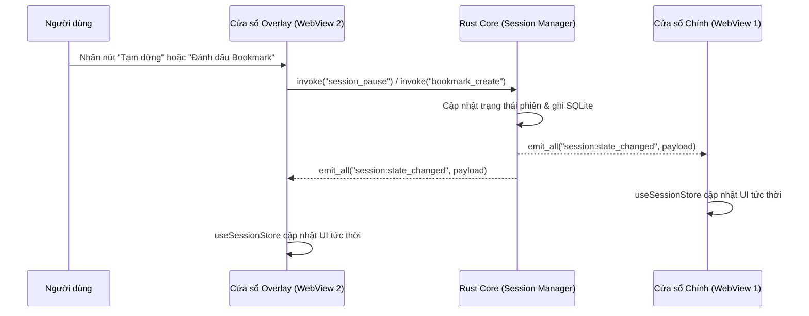

# Kiến Trúc Kỹ Thuật Frontend (Frontend Engineering Architecture)

> **Trạng thái**: Đã phê duyệt (Approved) — Phiên bản 1.0  
> **Ngăn xếp công nghệ**: React 18 + TypeScript 5 + Vite + Zustand + TanStack Virtual + Tailwind CSS + Tauri 2 IPC  
> **Nguyên tắc bất biến**: Zero Business Logic ở Frontend; đồng bộ trạng thái đa cửa sổ qua Rust Backend; chuyển đổi Light/Dark Mode tức thời qua biến CSS

---

## 1. Cấu Trúc Thư Mục Mã Nguồn Frontend (`src/`)

Mã nguồn giao diện đặt tại `src/` và tuân thủ sự phân tách rõ ràng giữa **UI Primitives**, **Domain Components**, **Zustand Stores**, và **Tauri IPC Clients**:

```text
src/
├── assets/                     # Font chữ cục bộ (Inter, JetBrains Mono) & biểu tượng tĩnh
├── components/
│   ├── ui/                     # Lớp 1: Core Primitives (SoftCard, Button, SegmentedControl, Dialog, Badge...)
│   ├── domain/                 # Lớp 2: HopHo Domain Components (RecordingHeroCard, AudioLevelStrip, StorageBreakdownCard...)
│   └── layout/                 # AppShell, SidebarNav, HardwareMiniCard, WindowTitlebar
├── features/                   # Các phân hệ màn hình theo miền nghiệp vụ
│   ├── onboarding/             # Luồng thiết lập lần đầu & kiểm tra phần cứng
│   ├── live-session/           # Bàn điều khiển thu âm trực tiếp & Floating Subtitle Overlay
│   ├── meeting-detail/         # Trình đọc Transcript ảo hóa, phát lại Audio, Biên bản & Action Items
│   ├── library/                # Thư viện cuộc họp & thanh tìm kiếm FTS5
│   └── settings/               # Quản lý gói Model, Dung lượng ổ cứng, Thiết bị âm thanh, Giao diện Sáng/Tối
├── hooks/                      # Custom React Hooks
│   ├── useTauriEvent.ts        # Tự động đăng ký & hủy lắng nghe sự kiện Tauri IPC an toàn
│   ├── useAudioSync.ts         # Đồng bộ vị trí phát WAV với dòng Transcript đang hiển thị
│   └── useTheme.ts             # Quản lý class .dark trên <html> & lắng nghe prefers-color-scheme
├── ipc/                        # Lớp bọc kiểu tĩnh (Typed Wrappers) cho Tauri invoke() commands
│   ├── commands.ts             # Hàm gọi xuống Rust Core (audio, session, transcript, models, storage)
│   ├── events.ts               # Định nghĩa tên sự kiện & kiểu dữ liệu Payload từ Rust bắn lên
│   └── errors.ts               # Bộ phân tích Unified Error Envelope & hiển thị Toast khắc phục
├── stores/                     # Quản lý trạng thái toàn cục bằng Zustand
│   ├── useSessionStore.ts      # Trạng thái thu âm, bộ đếm giây, mức âm lượng VU Meter, luồng câu thoại
│   ├── useMeetingStore.ts      # Cuộc họp đang xem, danh sách Action Items, trạng thái phát lại Audio
│   ├── useModelStore.ts        # Tiến trình tải Model, dung lượng ổ cứng, phần cứng CUDA/CPU
│   └── useSettingsStore.ts     # Cấu hình người dùng, chế độ Light/Dark/System, cấu hình Overlay
├── styles/
│   └── index.css               # Khai báo Token 3 tầng (:root & .dark) theo chuẩn Soft Clean Cards
├── App.tsx                     # Định tuyến cửa sổ chính (Main Window)
├── OverlayApp.tsx              # Điểm nhập độc lập cho cửa sổ phụ đề nổi (Floating Subtitle Overlay)
└── main.tsx                    # Bootstrap ứng dụng theo nhãn cửa sổ hiện tại (main vs overlay)
```

---

## 2. Quản Lý Trạng Thái & Đồng Bộ Đa Cửa Sổ (State Management & Multi-Window Sync)

Vì **Main Window** và **Floating Subtitle Overlay** chạy trên hai ngữ cảnh WebView riêng biệt của Tauri, **Rust Core** đóng vai trò là **Single Source of Truth** duy nhất.



### 2.1. Phân Tách Tần Suất Cập Nhật Trong Zustand (`High-Frequency vs. Low-Frequency State`)

Để tránh việc cập nhật mức âm lượng VU Meter (`20–30 lần/giây`) làm vẽ lại (re-render) toàn bộ danh sách câu thoại Transcript:
1. **Dữ liệu tần suất cao (`audio:level_tick` mỗi `50ms`)**:
   - Chỉ cập nhật vào slice riêng hoặc `ref` gắn trực tiếp với thành phần `AudioLevelStrip` (sử dụng `requestAnimationFrame` hoặc CSS `transform: scaleX()` trên GPU).
   - Tuyệt đối không kích hoạt re-render lên `TranscriptList` hay `AppShell`.
2. **Dữ liệu luồng phụ đề (`stt:partial_segment`, `stt:final_segment`, `translation:segment_ready`)**:
   - Câu đang nhận diện (`partial`) được giữ trong một biến trạng thái đơn lẻ (`activePartialSegment`).
   - Khi câu đã chốt (`final`), nó được đẩy vào mảng `segments` đã chuẩn hóa theo `segment_id` để bản dịch tiếng Việt (`translation:segment_ready`) cập nhật đúng vào câu đó với độ phức tạp $O(1)$.

---

## 3. Cơ Chế Chuyển Đổi Giao Diện Sáng / Tối & Đồng Bộ Đa Cửa Sổ (`Theme Engine`)

Hệ thống hỗ trợ 3 chế độ giao diện: **`light` (Trắng chuẩn Soft Clean Cards)**, **`dark` (Đen/Than chì sâu)**, và **`system` (Tự động theo hệ điều hành)**.

```typescript
// Luồng áp dụng Theme tức thời không gây chớp sáng (Zero-Flash Theme Switching)
export type ThemeMode = 'light' | 'dark' | 'system';

export function applyThemeToDocument(mode: ThemeMode): void {
  const root = document.documentElement;
  const prefersDark = window.matchMedia('(prefers-color-scheme: dark)').matches;
  const isDark = mode === 'dark' || (mode === 'system' && prefersDark);

  root.classList.toggle('dark', isDark);
  root.style.colorScheme = isDark ? 'dark' : 'light';
}
```

- Khi người dùng đổi chế độ `[ Sáng | Tối | Hệ thống ]` trên `SegmentedControl` ở cửa sổ chính:
  1. Hàm `applyThemeToDocument` cập nhật ngay lập tức class `.dark` trên thẻ `<html>`.
  2. Gọi `invoke('settings_update', { theme: newMode })` để lưu xuống SQLite và phát sự kiện `settings:updated` sang cửa sổ phụ để đồng bộ toàn diện.

---

## 4. Tối Ưu Hóa Hiệu Năng Giao Diện (UI Performance Engineering)

1. **Ảo hóa danh sách Transcript (`Virtualization`)**:
   - Một cuộc họp kéo dài 2–3 giờ có thể sinh ra từ `2,000` đến `5,000` đoạn văn bản (`TranscriptSegmentRow`).
   - Sử dụng `@tanstack/react-virtual` (`useVirtualizer`) để chỉ kết xuất (render) khoảng `15–25` dòng đang nằm trong khung nhìn (Viewport), giữ mức tiêu thụ RAM của WebView luôn ổn định và tốc độ cuộn đạt `60 FPS`.
2. **Tự động cuộn thông minh (`Smart Auto-Scroll`)**:
   - Trong lúc đang họp trực tiếp (`Live Session`), danh sách phụ đề tự động cuộn mượt xuống câu mới nhất ở đáy.
   - Ngay khi người dùng chủ động cuộn ngược lên trên để đọc lại câu cũ, chế độ tự động cuộn sẽ tạm ngắt và hiển thị một nút viên thuốc nổi (`Pill Button` nền `--ink`) ở đáy thẻ: *"↓ Quay lại câu hiện tại"*.
3. **Xử lý lỗi tập trung qua Unified Error Envelope**:
   - Mọi lệnh gọi `invoke()` đều đi qua wrapper `safeInvoke<T>()`. Nếu Rust trả về lỗi theo cấu trúc chuẩn `{ code, message, recoverable, suggested_action }`, hệ thống tự động hiển thị thành phần `ErrorEnvelopeToast` với nút hành động khắc phục trực tiếp mà không bao giờ làm trắng màn hình (White Screen of Death).
