# Ngôn Ngữ Thiết Kế & Hệ Thống Token (Design Language & Token Architecture)

> **Trạng thái**: Đã phê duyệt (Approved) — Phiên bản 1.0  
> **Phong cách chủ đạo**: **Soft Clean Cards** (Tối giản, đơn sắc 95%, thẻ bo góc lớn `28px`, phân cấp bằng khoảng trắng và sắc độ xám)  
> **Nguồn tham chiếu gốc**: `docs/research/soft-clean-cards.md`  
> **Chế độ giao diện**: Light Mode (Trắng tinh khiết trên nền xám ấm nhạt) & Dark Mode (Đen/Than chì sâu phân lớp tinh tế)

---

## 1. Triết Lý Thiết Kế (Design Philosophy)

Ngôn ngữ thiết kế của **Họp Hộ (HopHo)** được suy dẫn trực tiếp từ phong cách **Soft Clean Cards** — kết hợp sự tĩnh lặng của sản phẩm năng suất cao cấp (Linear, Apple HIG, Geist) với tính dễ đọc tuyệt đối cho các phiên họp kéo dài nhiều giờ.

1. **Một thẻ = Một tác vụ (1 Card = 1 Task)**: Mỗi thẻ (`Card`) chỉ giải quyết một mục đích rõ ràng (ví dụ: Bộ điều khiển thu âm, Thanh đo âm lượng, Cấu hình thiết bị, Phân bổ dung lượng ổ cứng). Không nhồi nhét quá 3 nhóm thông tin vào cùng một thẻ.
2. **Con số / Tiêu đề chính là nhân vật trung tâm (One Hero Element)**: Mỗi thẻ hoặc khu vực giao diện có đúng **một điểm nhấn thị giác (Hero)** — ví dụ: đồng hồ đếm giờ thu âm `00:42:18`, nút Record tròn `52×52px`, hoặc dung lượng trống `14.2 GB`. Mọi thành phần khác lùi về vai trò bổ trợ.
3. **Màu sắc = Thông tin, không phải trang trí (Color is Information)**:
   - **~95% diện tích giao diện là trung tính (Neutral)**: Trắng, đen và các sắc độ xám.
   - **Màu sắc có độ bão hòa cao chỉ xuất hiện ở 3 nơi**: (1) Trạng thái thu âm / cảnh báo (`--data-alert`), (2) Biểu đồ dung lượng & thanh tín hiệu âm thanh (`--data-1..4`), và (3) Chỉ báo định danh người nói (Speaker Pastels).
4. **Khoảng trắng hào phóng (Generous Whitespace)**: Khoảng đệm bên trong thẻ (`24px`) luôn lớn hơn khoảng cách giữa các thẻ (`16px`). Không bao giờ để nội dung chạm sát viền thẻ.
5. **Phân cấp bằng kích thước chữ và độ xám, không dùng đường kẻ đậm**: Hạn chế tối đa đường kẻ chia cắt (`divider`). Khi bắt buộc phải chia tách danh sách, chỉ sử dụng đường kẻ mảnh `1px` (`--border-hairline`) hoặc khối nền phụ (`--bg-subtle`).
6. **Độ bo góc lớn và đồng nhất (Nested Radius Harmony)**: Thẻ ngoài bo góc `28px` (`--radius-xl`). Các phần tử con nằm bên trong thẻ tuân thủ quy tắc toán học:
   $$\text{Radius}_{\text{inner}} = \max(\text{Radius}_{\text{outer}} - \text{Padding}, \text{8px})$$

```mermaid
flowchart LR
    subgraph L1["Tầng 1: Primitive Tokens"]
        P1["Bảng màu thô (Neutral, Data, Pastel)"]
        P2["Thang đo chữ & Khoảng cách 4px"]
        P3["Bán kính bo góc & Độ mờ bóng đổ"]
    end
    subgraph L2["Tầng 2: Semantic Tokens"]
        S1["Bề mặt: --bg-page, --bg-card, --bg-subtle"]
        S2["Văn bản: --text-primary, --text-secondary, --text-tertiary"]
        S3["Đường viền & Tương tác: --border-card, --ink, --ring-focus"]
    end
    subgraph L3["Tầng 3: Component Tokens"]
        C1["Card (--card-radius: 28px, --card-padding: 24px)"]
        C2["Hero Button (--btn-hero-size: 52px)"]
        C3["Overlay Subtitle (--overlay-bg, --overlay-blur)"]
    end
    L1 --> L2 --> L3
```



---

## 2. Kiến Trúc Token 3 Tầng (Three-Layer Token Architecture)

Hệ thống áp dụng kiến trúc Token 3 tầng chuẩn mực (**Primitive → Semantic → Component**) để đảm bảo tính nhất quán tuyệt đối giữa **Light Mode**, **Dark Mode**, và **Floating Subtitle Overlay** mà không cần sửa đổi mã nguồn của từng Component.

### 2.1. Tầng 1 — Primitive Tokens (Giá trị nguyên bản)

Các hằng số màu sắc nguyên bản không được gọi trực tiếp trong Component React mà chỉ dùng để ánh xạ sang Semantic Tokens.

| Nhóm | Token Nguyên Bản | Giá trị Hex / RGB | Mô tả |
| :--- | :--- | :--- | :--- |
| **Pure & Black** | `--primitive-white` | `#FFFFFF` | Trắng tinh khiết (Bề mặt thẻ Light Mode) |
| | `--primitive-black` | `#09090B` | Đen sâu (Bề mặt nền Dark Mode) |
| **Light Neutrals** | `--neutral-50` | `#F5F5F7` | Xám ấm cực sáng (Nền trang Light Mode) |
| | `--neutral-100` | `#F4F4F6` | Xám nhạt (Khối phụ / Nút Ghost Light Mode) |
| | `--neutral-150` | `#EFEFF2` | Đường kẻ mảnh Light Mode |
| | `--neutral-200` | `#ECECEF` | Trạng thái Hover khối phụ Light Mode |
| | `--neutral-250` | `#E9E9EE` | Viền thẻ Light Mode |
| | `--neutral-400` | `#9A9AA5` | Xám trung tính (Icon phụ / Placeholder) |
| | `--neutral-500` | `#7C7C88` | Xám vừa (Chữ phụ cấp 3 đạt chuẩn tương phản AA) |
| | `--neutral-600` | `#6B6B76` | Xám đậm (Chữ phụ cấp 2 Light Mode) |
| | `--neutral-900` | `#111114` | Đen mực (Nút hành động chính Light Mode) |
| | `--neutral-950` | `#0B0B0F` | Đen tuyền (Chữ chính Light Mode) |
| **Dark Neutrals** | `--dark-950` | `#09090B` | Nền cửa sổ chính Dark Mode |
| | `--dark-900` | `#121215` | Bề mặt thẻ (`Card`) Dark Mode |
| | `--dark-850` | `#1A1A1F` | Khối nền phụ (`Subtle block`) Dark Mode |
| | `--dark-800` | `#1F1F26` | Đường kẻ mảnh (`Hairline`) Dark Mode |
| | `--dark-750` | `#22222A` | Viền thẻ (`Card border`) Dark Mode |
| | `--dark-700` | `#24242B` | Trạng thái Hover khối phụ Dark Mode |
| | `--dark-400` | `#6E6E7A` | Chữ phụ cấp 3 Dark Mode |
| | `--dark-300` | `#A0A0AB` | Chữ phụ cấp 2 Dark Mode |
| | `--dark-50` | `#F5F5F7` | Chữ chính & Nút hành động chính Dark Mode |

---

### 2.2. Tầng 2 — Semantic Tokens (Bảng màu ngữ nghĩa Light & Dark Mode)

Đây là bảng token cốt lõi mà mọi màn hình và component bắt buộc sử dụng.

#### A. Bề mặt, Văn bản, Đường viền & Hành động chính (Surfaces, Text, Borders & Ink)

| Semantic Token | Light Mode (Mặc định) | Dark Mode (`class="dark"`) | Mục đích sử dụng |
| :--- | :--- | :--- | :--- |
| `--bg-page` | `#F5F5F7` | `#09090B` | Nền tổng thể của cửa sổ ứng dụng (Canvas) |
| `--bg-card` | `#FFFFFF` | `#121215` | Bề mặt thẻ (`Card`), Sidebar, Dialog, Popover |
| `--bg-card-elevated` | `#FFFFFF` | `#17171C` | Modal nổi, Dropdown menu, Tooltip |
| `--bg-subtle` | `#F4F4F6` | `#1A1A1F` | Ô chứa phụ bên trong thẻ, rãnh Segmented Control, nút Ghost |
| `--bg-subtle-hover` | `#ECECEF` | `#24242B` | Trạng thái Hover của nút phụ, dòng danh sách cuộc họp |
| `--border-hairline` | `#EFEFF2` | `#1F1F26` | Đường kẻ chia tách nội bộ mảnh `1px` |
| `--border-card` | `#E9E9EE` | `#22222A` | Viền ngoài `1px solid` của thẻ `Card` |
| `--border-focus` | `#1F5FFF` | `#3B7BFF` | Viền điều hướng bàn phím (`:focus-visible`) |
| `--text-primary` | `#0B0B0F` | `#F5F5F7` | Tiêu đề, con số Hero, nội dung văn bản chính |
| `--text-secondary` | `#6B6B76` | `#A0A0AB` | Nhãn (`Label`), phụ đề thẻ, mô tả cài đặt |
| `--text-tertiary` | `#7C7C88` | `#6E6E7A` | Mốc thời gian (`Timestamp`), đơn vị đo, chú thích (`Caption`) |
| `--ink` | `#111114` | `#F5F5F7` | Nền nút hành động chính (Primary CTA, Active Toggle) |
| `--ink-hover` | `#26262B` | `#E2E2E8` | Trạng thái Hover của nút `--ink` |
| `--text-on-ink` | `#FFFFFF` | `#0B0B0F` | Chữ/Icon nằm trên nền `--ink` (Đảo ngược tự động giữa Light/Dark) |

> **Lưu ý về độ tương phản (WCAG AA Compliance)**: Trong Light Mode, `--text-tertiary` được tinh chỉnh ở mức `#7C7C88` (thay vì `#9A9AA5`) để đảm bảo tỷ lệ tương phản $\ge 4.5:1$ trên cả nền `#FFFFFF` và `#F4F4F6` đối với cỡ chữ nhỏ `12px–13px`. Đối với các biểu tượng trang trí không mang ngữ nghĩa độc lập, có thể dùng `--neutral-400` (`#9A9AA5`).

#### B. Màu Dữ Liệu & Trạng Thái Hệ Thống (Data Visualization & Status Tokens)

Theo đúng triết lý **Soft Clean Cards**, bảng màu dữ liệu được giữ cố định sắc thái nhận diện nhưng tinh chỉnh độ sáng (luminance) trong Dark Mode để không gây chói mắt trên nền đen `#121215`:

| Semantic Token | Light Mode | Dark Mode | Ý nghĩa thông tin trong Họp Hộ |
| :--- | :--- | :--- | :--- |
| `--data-1` (Blue) | `#1F5FFF` | `#3B7BFF` | Dữ liệu chính, tiến trình Batch STT/LLM, dung lượng Models, Focus ring |
| `--data-2` (Purple) | `#B13BF0` | `#C45FF5` | Dữ liệu thứ cấp, dung lượng Audio WAV, chỉ báo dịch thuật AI |
| `--data-3` (Orange) | `#FF8A1F` | `#FF9E42` | Cảnh báo nhẹ (Warning), trạng thái Tạm dừng (Paused), dung lượng DB |
| `--data-4` (Green) | `#1FA63A` | `#28C247` | Thành công (Success), GPU CUDA sẵn sàng, tín hiệu âm thanh lý tưởng |
| `--data-alert` (Red) | `#E5483D` | `#FF5A4F` | Đang thu âm (Recording Pulse), âm lượng vượt ngưỡng (Clipping), Lỗi/Xóa |

Mỗi màu trạng thái đi kèm một token nền dịu (`subtle tint`) để dùng cho Badge hoặc Banner thông báo:

| Token Nền Trạng Thái | Light Mode | Dark Mode |
| :--- | :--- | :--- |
| `--status-info-bg` | `#EBF1FF` | `rgba(59, 123, 255, 0.14)` |
| `--status-success-bg` | `#E8F8EC` | `rgba(40, 194, 71, 0.14)` |
| `--status-warning-bg` | `#FFF3E6` | `rgba(255, 158, 66, 0.14)` |
| `--status-danger-bg` | `#FDECEB` | `rgba(255, 90, 79, 0.14)` |

#### C. Bảng Màu Pastel Định Danh Người Nói & Nhãn (Speaker & Category Pastels)

Dùng để phân biệt người nói (`Speaker 1..5`) trong Transcript hoặc nhãn phân loại Action Item:

| Token | Light Mode (Background / Text) | Dark Mode (Background / Text) | Gán mặc định |
| :--- | :--- | :--- | :--- |
| `--pastel-pink` | `#FFD9E8` / `#7A1C44` | `rgba(255, 140, 186, 0.16)` / `#FF9EC4` | Người nói 1 (Host/Me) |
| `--pastel-blue` | `#D9E8FF` / `#143E8A` | `rgba(110, 168, 255, 0.16)` / `#8AB8FF` | Người nói 2 |
| `--pastel-yellow` | `#FFF1C9` / `#73510A` | `rgba(255, 214, 102, 0.16)` / `#FFE082` | Người nói 3 / Bookmark |
| `--pastel-mint` | `#D8F3E4` / `#135E37` | `rgba(92, 214, 147, 0.16)` / `#7AE5A9` | Người nói 4 |
| `--pastel-lavender` | `#E6DDFB` / `#4A248C` | `rgba(182, 149, 255, 0.16)` / `#C8B0FF` | Người nói 5 |

---

### 2.3. Tầng 3 — Component & Overlay Tokens

| Component Token | Light Mode | Dark Mode | Mô tả |
| :--- | :--- | :--- | :--- |
| `--card-radius` | `28px` | `28px` | Bán kính bo góc chuẩn của mọi thẻ `Card` chính |
| `--card-padding` | `24px` | `24px` | Khoảng đệm chuẩn bên trong thẻ |
| `--card-border` | `1px solid var(--border-card)` | `1px solid var(--border-card)` | Đường viền tinh tế bao quanh thẻ |
| `--shadow-card` | `0 1px 2px rgba(15,15,20,0.04), 0 8px 24px -4px rgba(15,15,20,0.06)` | `0 1px 2px rgba(0,0,0,0.4), 0 12px 28px -6px rgba(0,0,0,0.55)` | Bóng đổ khuếch tán mềm của thẻ |
| `--shadow-card-hover` | `0 2px 4px rgba(15,15,20,0.06), 0 16px 32px -6px rgba(15,15,20,0.10)` | `0 4px 8px rgba(0,0,0,0.5), 0 18px 36px -6px rgba(0,0,0,0.70)` | Bóng đổ khi di chuột qua thẻ tương tác |
| `--shadow-pop` | `0 4px 12px rgba(15,15,20,0.12)` | `0 4px 16px rgba(0,0,0,0.65)` | Bóng đổ cho nút tròn nổi, tab đang chọn |
| `--overlay-bg` | `rgba(18, 18, 21, 0.78)` | `rgba(12, 12, 15, 0.82)` | Nền bán trong suốt của cửa sổ Floating Subtitle Overlay (luôn dùng nền tối dịu để nổi bật phụ đề trên mọi màn hình Zoom/Meet) |
| `--overlay-border` | `rgba(255, 255, 255, 0.12)` | `rgba(255, 255, 255, 0.12)` | Viền kính mờ `1px` của cửa sổ Overlay |
| `--overlay-text-final` | `#FFFFFF` | `#FFFFFF` | Chữ phụ đề đã chốt (`final`) trong Overlay |
| `--overlay-text-partial` | `#A0A0AB` | `#A0A0AB` | Chữ phụ đề đang nhận diện (`partial` - in nghiêng) |
| `--overlay-text-vi` | `#FFE082` | `#FFE082` | Dòng bản dịch tiếng Việt nổi bật dễ đọc từ xa |

---

## 3. Hệ Thống Kiểu Chữ (Typography System)

### 3.1. Font Stack (Tối ưu Tiếng Việt & Đa ngôn ngữ CJK)

Để hiển thị hoàn hảo dấu thanh tiếng Việt cùng chữ Hán/Nhật/Hàn (`zh`, `ja`, `ko`) trong dịch thuật thời gian thực:

```css
:root {
  --font-sans: 'Inter', 'Geist', -apple-system, BlinkMacSystemFont, 'Segoe UI',
               'Noto Sans', 'Noto Sans CJK SC', 'Noto Sans JP', 'Noto Sans KR', sans-serif;
  --font-mono: 'JetBrains Mono', 'Geist Mono', 'Cascadia Code', monospace;
}
```

### 3.2. Thang Đo Chữ (Type Scale)

Áp dụng từ chuẩn **Soft Clean Cards** kết hợp tinh chỉnh cho nội dung biên bản họp dài:

| Token | Kích thước (`px` / `rem`) | Line Height | Weight | Tracking (`letter-spacing`) | Ứng dụng trong Họp Hộ |
| :--- | :--- | :--- | :--- | :--- | :--- |
| `display` | `56px` (`3.5rem`) | `1.0` | `400` (Regular) | `-0.03em` | Đồng hồ thu âm chính (`01:24:05`), chỉ số dung lượng Hero lớn |
| `title-lg` | `28px` (`1.75rem`) | `1.15` | `500` (Medium) | `-0.02em` | Tiêu đề màn hình, tiêu đề biên bản cuộc họp |
| `title-md` | `18px` (`1.125rem`) | `1.25` | `600` (SemiBold) | `-0.01em` | Tiêu đề thẻ (`Card Header`), tiêu đề Modal |
| `body-transcript` | `15px` (`0.9375rem`) | `1.60` | `400` (Regular) | `0` | Nội dung Transcript, tóm tắt cuộc họp, ghi chú Markdown |
| `value` | `15px` (`0.9375rem`) | `1.30` | `500` (Medium) | `0` | Giá trị trong danh sách, tên thiết bị âm thanh, tên Model |
| `body` | `14px` (`0.875rem`) | `1.45` | `400` (Regular) | `0` | Văn bản mô tả chung, nội dung bảng Action Items |
| `label` | `13px` (`0.8125rem`) | `1.30` | `500` (Medium) | `0` | Nhãn trường dữ liệu (`Field Label`), tab Segmented Control |
| `caption` | `12px` (`0.75rem`) | `1.30` | `400` (Regular) | `+0.01em` | Mốc thời gian `[00:12:04]`, chú thích biểu đồ, phím tắt (`Ctrl+Shift+M`) |

### 3.3. Quy Tắc Chữ Số & Viết Hoa (Numeric & Casing Rules)

1. **Bắt buộc bật `tabular-nums`**: Mọi bộ đếm thời gian thu âm, mốc thời gian transcript, thanh tiến trình phát lại, chỉ số dB của VU Meter và dung lượng ổ cứng (`GB/MB`) phải áp dụng:
   ```css
   .tabular-nums {
     font-variant-numeric: tabular-nums;
     font-feature-settings: "tnum" 1, "cv11" 1;
   }
   ```
   Điều này ngăn chặn hoàn toàn hiện tượng giật chữ (layout jitter) khi đồng hồ nhảy từng giây.
2. **Không lạm dụng chữ IN HOA (`ALL CAPS`)**: Toàn bộ nhãn, tiêu đề thẻ và nút bấm sử dụng **Sentence case** (Chỉ viết hoa chữ cái đầu câu, ví dụ: `"Dung lượng lưu trữ"`, `" Đang thu âm"`). Ngoại lệ duy nhất là từ viết tắt kỹ thuật (`CUDA`, `CPU`, `WAV`, `JSON`, `SRT`).
3. **Số lớn đi kèm đơn vị nhỏ**: Khi hiển thị chỉ số lớn (ví dụ: `14.2 GB` hoặc `128 ms`), phần số dùng `title-lg` / `display` màu `--text-primary`, còn đơn vị (`GB`, `ms`) dùng `label` (`13px`) màu `--text-tertiary` đặt ngay bên cạnh với `margin-left: 4px`.

---

## 4. Lưới Khoảng Cách & Độ Bo Góc (Spacing & Border Radius)

### 4.1. Hệ Thống Khoảng Cách 4px (4px Spatial Grid)

| Token | Giá trị | Ứng dụng chuẩn |
| :--- | :--- | :--- |
| `--space-1` | `4px` | Khoảng cách giữa số và đơn vị, khoảng cách giữa các thanh bar nhỏ |
| `--space-2` | `8px` | Khoảng cách giữa icon và nhãn, khoảng cách giữa các chip/tag |
| `--space-3` | `12px` | Khoảng đệm trong của khối nền phụ (`--bg-subtle`), khoảng cách dòng danh sách hẹp |
| `--space-4` | `16px` | Khoảng cách giữa các khối nội dung trong cùng một thẻ, khoảng cách lưới giữa các thẻ (`grid-gap`) |
| `--space-5` | `20px` | Khoảng đệm thẻ cỡ vừa (`Compact Card Padding`) |
| `--space-6` | `24px` | Khoảng đệm chuẩn của thẻ (`Standard Card Padding`) |
| `--space-7` | `28px` | Khoảng đệm thẻ Hero lớn |
| `--space-8` | `32px` | Khoảng cách phân tách các khu vực lớn trên màn hình |

### 4.2. Thang Độ Bo Góc (Border Radius Hierarchy)

| Token | Giá trị | Thành phần áp dụng |
| :--- | :--- | :--- |
| `--radius-xl` | `28px` | Thẻ chính (`Card`), hộp thoại Modal (`Dialog`) |
| `--radius-lg` | `16px` | Khối nền phụ lớn nằm trong thẻ (`28px - 12px`), thanh Segmented Control lớn, cửa sổ Overlay |
| `--radius-md` | `12px` | Ô nhập liệu (`Input`, `Select`), nút bấm Ghost/Secondary toàn chiều ngang, khối Waveform |
| `--radius-sm` | `8px` | Nút tab bên trong Segmented Control, thẻ Tag/Badge vuông, Tooltip |
| `--radius-xs` | `4px` | Đầu cột biểu đồ (`Stacked Bar segment`), thanh VU meter nhỏ |
| `--radius-full` | `9999px` | Nút tròn (`Icon Button 32px`, `Hero Record Button 52px`), Pill Badge, Avatar người nói |

---

## 5. Hệ Thống Biểu Tượng & Chuyển Động (Iconography & Motion)

### 5.1. Biểu Tượng (Iconography)

- **Thư viện chuẩn**: `lucide-react` (Lucide Icons). Tuyệt đối không dùng Emoji làm biểu tượng giao diện chức năng.
- **Độ dày nét (`stroke-width`)**: Mặc định `1.75px` cho kích thước `16px–20px` và `1.5px` cho kích thước `24px`. Đầu nét tròn (`stroke-linecap: round`, `stroke-linejoin: round`).
- **Quy tắc Đặc (Filled) vs. Nét (Stroked)**:
  - **Filled (Đặc)**: Chỉ dùng cho các biểu tượng điều khiển phương tiện (Media Controls) mang tính hành động tức thời: `Play`, `Pause`, `Record (Circle)`, `Stop (Square)`, `Bookmark (khi đã đánh dấu)`.
  - **Stroked (Viền nét)**: Dùng cho toàn bộ biểu tượng điều hướng, cài đặt, tìm kiếm, xuất file (`Mic`, `Volume2`, `Settings`, `Download`, `ChevronRight`, `Folder`).

### 5.2. Chuyển Động Vi Mô (Micro-interactions & Motion Tokens)

| Tác vụ / Chuyển động | Thời lượng (`Duration`) | Đường cong (`Easing`) | Hiệu ứng cụ thể |
| :--- | :--- | :--- | :--- |
| **Hover / Press nút bấm** | `120ms` | `ease-out` | Đổi màu nền mượt; khi nhấn (`:active`) thu nhỏ nhẹ `transform: scale(0.97)` |
| **Trượt Segmented Control** | `200ms` | `cubic-bezier(0.32, 0.72, 0, 1)` | Nền trắng/xám của tab đang chọn trượt ngang mượt mà |
| **Mở rộng thẻ / Accordion** | `240ms` | `cubic-bezier(0.32, 0.72, 0, 1)` | Xoay icon mũi tên `90deg` đồng bộ với chiều cao nội dung |
| **Biểu đồ & Thanh tiến trình** | `360ms` | `cubic-bezier(0.22, 1, 0.36, 1)` | Cập nhật chiều rộng (`width`) của thanh dung lượng hoặc tiến độ Batch |
| **Nhịp thở nút Recording** | `2000ms` (Lặp vô hạn) | `ease-in-out` | Vòng hào quang đỏ (`--data-alert`) tỏa nhẹ từ `scale(1)` → `scale(1.12)` với `opacity: 0.25 → 0` |

**Hỗ trợ giảm chuyển động (`prefers-reduced-motion`)**:
```css
@media (prefers-reduced-motion: reduce) {
  *, *::before, *::after {
    animation-duration: 0.01ms !important;
    animation-iteration-count: 1 !important;
    transition-duration: 0.01ms !important;
    scroll-behavior: auto !important;
  }
}
```

---

## 6. Cấu Hình CSS Variables & Tailwind CSS Chuẩn (`index.css` & `tailwind.config.js`)

Dưới đây là khai báo chuẩn để ánh xạ trực tiếp hệ thống Token 3 tầng vào mã nguồn Frontend (`src/index.css`):

```css
@layer base {
  :root {
    /* Surface Tokens - Light Mode (White & Soft Warm Gray) */
    --bg-page: #F5F5F7;
    --bg-card: #FFFFFF;
    --bg-card-elevated: #FFFFFF;
    --bg-subtle: #F4F4F6;
    --bg-subtle-hover: #ECECEF;

    /* Border Tokens - Light Mode */
    --border-hairline: #EFEFF2;
    --border-card: #E9E9EE;
    --border-focus: #1F5FFF;

    /* Text Tokens - Light Mode */
    --text-primary: #0B0B0F;
    --text-secondary: #6B6B76;
    --text-tertiary: #7C7C88;

    /* Primary Action (Ink) - Light Mode */
    --ink: #111114;
    --ink-hover: #26262B;
    --text-on-ink: #FFFFFF;

    /* Data & Status Tokens - Light Mode */
    --data-1: #1F5FFF;
    --data-2: #B13BF0;
    --data-3: #FF8A1F;
    --data-4: #1FA63A;
    --data-alert: #E5483D;

    /* Shadows - Light Mode */
    --shadow-card: 0 1px 2px rgba(15, 15, 20, 0.04), 0 8px 24px -4px rgba(15, 15, 20, 0.06);
    --shadow-card-hover: 0 2px 4px rgba(15, 15, 20, 0.06), 0 16px 32px -6px rgba(15, 15, 20, 0.10);
    --shadow-pop: 0 4px 12px rgba(15, 15, 20, 0.12);

    /* Radii */
    --radius-xl: 28px;
    --radius-lg: 16px;
    --radius-md: 12px;
    --radius-sm: 8px;
    --radius-xs: 4px;
    --radius-full: 9999px;
  }

  .dark {
    /* Surface Tokens - Dark Mode (True Black & Elevated Carbon) */
    --bg-page: #09090B;
    --bg-card: #121215;
    --bg-card-elevated: #17171C;
    --bg-subtle: #1A1A1F;
    --bg-subtle-hover: #24242B;

    /* Border Tokens - Dark Mode */
    --border-hairline: #1F1F26;
    --border-card: #22222A;
    --border-focus: #3B7BFF;

    /* Text Tokens - Dark Mode */
    --text-primary: #F5F5F7;
    --text-secondary: #A0A0AB;
    --text-tertiary: #6E6E7A;

    /* Primary Action (Ink) - Dark Mode (High-contrast inverted pill) */
    --ink: #F5F5F7;
    --ink-hover: #E2E2E8;
    --text-on-ink: #0B0B0F;

    /* Data & Status Tokens - Dark Mode */
    --data-1: #3B7BFF;
    --data-2: #C45FF5;
    --data-3: #FF9E42;
    --data-4: #28C247;
    --data-alert: #FF5A4F;

    /* Shadows - Dark Mode */
    --shadow-card: 0 1px 2px rgba(0, 0, 0, 0.40), 0 12px 28px -6px rgba(0, 0, 0, 0.55);
    --shadow-card-hover: 0 4px 8px rgba(0, 0, 0, 0.50), 0 18px 36px -6px rgba(0, 0, 0, 0.70);
    --shadow-pop: 0 4px 16px rgba(0, 0, 0, 0.65);
  }
}
```

---

## 7. Danh Sách Kiểm Tra Tuân Thủ Phong Cách (Design Guardrails & Anti-Patterns)

Khi xây dựng hoặc đánh giá bất kỳ màn hình nào của **Họp Hộ**, kỹ sư Frontend và AI Agent phải kiểm tra 8 quy tắc bắt buộc sau:

1. **Cấm dùng Gradient lòe loẹt làm nền thẻ**: Bề mặt thẻ (`--bg-card`) luôn là màu đơn sắc phẳng (`#FFFFFF` ở Light Mode, `#121215` ở Dark Mode).
2. **Cấm dùng bóng đổ đậm hoặc viền dày**: Chỉ dùng `--border-card` (`1px`) kết hợp `--shadow-card` siêu nhẹ. Không bao giờ dùng `border-2` màu đen hoặc bóng đổ `shadow-2xl` mặc định của Tailwind.
3. **Không quá 3 cỡ chữ trong một thẻ**: Mỗi thẻ chỉ được phép xuất hiện tối đa 3 cấp độ chữ (ví dụ: `title-md` cho tiêu đề, `display` cho số Hero, và `label`/`caption` cho chú thích phụ).
4. **Đảm bảo vùng nhấn tối thiểu (Touch/Click Target)**: Mọi nút hành động độc lập trên thanh điều khiển thu âm phải có vùng tương tác tối thiểu `32×32px` (nút phụ) và `44×44px` đến `52×52px` (nút thu âm chính).
5. **Trạng thái Focus rõ ràng**: Không bao giờ xóa `outline` mà không thay thế bằng `focus-visible:ring-2 focus-visible:ring-[var(--border-focus)] focus-visible:ring-offset-2`.
6. **Không trộn lẫn nhiều biểu đồ trong một thẻ**: Mỗi thẻ dữ liệu (như thẻ Dung lượng ổ cứng hoặc thẻ VU Meter) chỉ biểu diễn một loại biểu đồ duy nhất.
7. **Luôn giữ độ tương phản cao cho cửa sổ Overlay**: Cửa sổ phụ đề nổi (`Floating Subtitle Overlay`) luôn sử dụng token `--overlay-bg` tối bán trong suốt với `backdrop-filter: blur(16px)` để chữ phụ đề luôn đọc rõ bất kể người dùng đang mở cửa sổ Zoom màu trắng hay trình chiếu slide tối màu.
8. **Đồng bộ tức thời Light/Dark Mode**: Chuyển đổi giao diện sáng/tối phải diễn ra tức thời thông qua biến CSS trên thẻ `<html>` mà không cần tải lại cửa sổ hay làm gián đoạn luồng thu âm.
