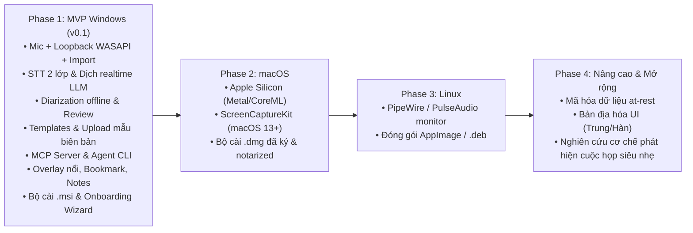
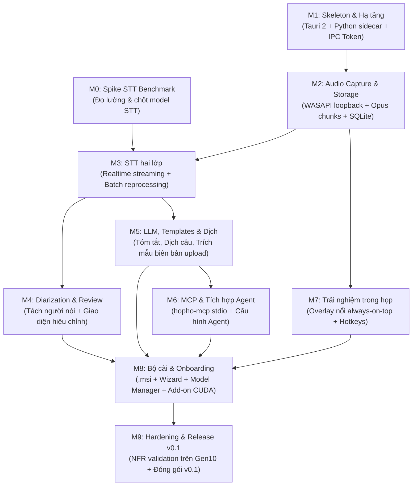

# Product Roadmap — HopHo (Họp Hộ)

**Tầng tài liệu**: Business Layer (`docs/business/roadmap.md`)  
**Phiên bản**: 1.0  
**Ngày cập nhật**: 2026-10-15  
**Nguồn tham chiếu**: `docs/project-idea/requirements.md` §7, `docs/plan/mvp-plan.md` §6  

---

## 1. Lộ trình phát triển tổng thể (Phased Horizons)

---

## 2. Kế hoạch chi tiết Phase 1 — MVP Windows (v0.1)

Phase 1 tập trung toàn lực vào nền tảng Windows x64 với cấu hình máy chuẩn Intel Core i5 Gen 10 / 16GB RAM (Only CPU). Tiến độ được phân rã thành 10 cột mốc (Milestones M0 đến M9):

### Bảng phân kỳ Milestones (Phase 1)

| Milestone | Tên giai đoạn | Trọng tâm bàn giao | Phụ thuộc |
|---|---|---|---|
| **M0** | **Spike benchmark STT** | Bộ benchmark tự động, đo lường trên máy i5 Gen10/16GB, xuất báo cáo chọn model cho các gói Lite/Standard/Pro | Độc lập |
| **M1** | **Skeleton & Hạ tầng** | Scaffold Tauri 2 + Vite React, khung IPC WebSocket có token bảo mật, sidecar lifecycle tự tắt khi rảnh, CI Windows runner | Độc lập |
| **M2** | **Audio Capture & Storage** | Thu âm WASAPI (Mic + Loopback), chunk writer Opus an toàn crash, SQLite schema (Rust chủ quản), import audio/video | M1 |
| **M3** | **STT hai lớp** | Hộp thoại bắt đầu họp, engine realtime streaming đẩy text qua WebSocket, batch engine chạy nền tạm dừng/chạy tiếp, nạp Glossary | M0, M2 |
| **M4** | **Diarization & Review** | Tách người nói sau họp, gán nhãn speaker, nghe lại theo câu transcript, sửa văn bản inline, FTS5 tìm kiếm toàn văn | M3 |
| **M5** | **LLM, Templates & Dịch** | Adapter 3 nhà cung cấp (llama.cpp, OpenAI cloud, Agent CLI), dịch realtime theo câu, trích xuất cấu trúc mẫu biên bản upload, map-reduce họp dài | M3 |
| **M6** | **MCP & Tích hợp Agent** | Tiến trình `hopho-mcp` (stdio) độc lập, cung cấp 6 tools cơ bản, tạo sẵn snippet tích hợp cho Claude/Codex/Antigravity | M5 |
| **M7** | **Trải nghiệm trong lúc họp** | Cửa sổ Overlay always-on-top trong suốt, phím tắt toàn cục (Start/Stop, Bookmark), panel ghi chú nhanh đồng bộ timestamp | M2 |
| **M8** | **Bộ cài đặt & Model Manager** | Đóng gói sidecar exe, bộ cài `.msi`, wizard khảo sát cấu hình tải model có resume, phát hiện và tải add-on CUDA | M4, M5, M6, M7 |
| **M9** | **Hardening & Release v0.1** | Kiểm thử chịu tải 3h liên tục trên máy Gen10 chuẩn, kiểm tra crash recovery, hoàn thiện tài liệu người dùng và phát hành v0.1 | M8 |

---

## 3. Các giai đoạn tiếp theo (Future Phases)

### Phase 2: macOS Platform Support
- Triển khai tầng Audio Capture native bằng `ScreenCaptureKit` (yêu cầu macOS 13+) cho system audio và `CoreAudio` cho microphone.
- Tối ưu hóa mô hình AI tận dụng Apple Silicon NPU/GPU qua Apple Metal và CoreML.
- Đóng gói định dạng `.dmg` kèm chữ ký số và xác thực Apple Notarization.

### Phase 3: Linux Platform Support
- Hỗ trợ kiến trúc âm thanh PipeWire và PulseAudio monitor source.
- Đóng gói ứng dụng dạng `AppImage` và gói `.deb` cho các bản phân phối Ubuntu/Debian phổ biến.

### Phase 4: Nâng cao & Mở rộng tính năng
- Triển khai cơ chế mã hóa dữ liệu cục bộ at-rest cho tệp âm thanh và cơ sở dữ liệu SQLite.
- Bổ sung ngôn ngữ giao diện người dùng (i18n): Tiếng Trung và Tiếng Hàn.
- Nghiên cứu cơ chế phát hiện cuộc họp đang diễn ra với mức tiêu thụ tài nguyên cực thấp (near-zero CPU).
