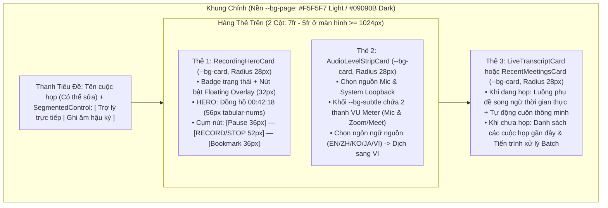

# Đặc Tả Giao Diện Chi Tiết — Release 1.0 MVP (UI Specification)

> **Phiên bản**: Release 1.0 MVP  
> **Phong cách thiết kế**: **Soft Clean Cards** (`--radius-xl: 28px`, đơn sắc ~95%, Light Mode `#FFFFFF`/`#F5F5F7` & Dark Mode `#121215`/`#09090B`)  
> **Tham chiếu Kiến trúc**: `docs/architecture/11-frontend-system-design.md`, `12-design-system.md`, `13-frontend-architecture.md`, `14-design-language.md`  
> **Truy vết Backlog**: `US-001` đến `US-022` (`docs/implementation/release-1/backlog/stories/`)

---

## 1. Ma Trận Ánh Xạ Màn Hình, Thẻ Giao Diện & User Stories

Mọi màn hình trong Release 1.0 MVP đều được cấu thành từ các thẻ `SoftCard` tuân thủ nguyên tắc **"1 Thẻ = 1 Tác vụ"** và **"1 Điểm nhấn Hero duy nhất mỗi thẻ"**:

| Mã Màn Hình | Tên Màn Hình / Cửa Sổ | Đường dẫn (`Route`) | Các Thẻ Chính (`SoftCards`) | Điểm Nhấn Trung Tâm (`Hero Element`) | Truy Vết User Stories |
| :--- | :--- | :--- | :--- | :--- | :--- |
| **SCR-01** | Thiết lập lần đầu & Chọn gói Model | `/onboarding` | 1. Thẻ Kiểm tra Phần cứng & Quyền 2. Thẻ Chọn Gói Model (`Lite`/`Balanced`/`Pro`) | Badge trạng thái phần cứng (`CUDA Sẵn sàng`) & Tiến trình tải Model `%` | `US-017`, `US-018` |
| **SCR-02** | Bàn điều khiển chính (Dashboard) | `/` | 1. `RecordingHeroCard` (Bắt đầu họp) 2. `AudioDeviceCard` (Mic + Loopback VU) 3. `RecentMeetingsCard` (Lịch sử gần đây) | Nút tròn thu âm `52×52px` (`hero-circle`) & Đồng hồ `00:00:00` | `US-001`, `US-002`, `US-003` |
| **SCR-03** | Phiên họp đang diễn ra (Live Session) | `/session/live` | 1. `RecordingHeroCard` (Đang thu âm) 2. `LiveTranscriptCard` (Song ngữ trực tiếp) 3. `QuickBookmarkCard` (Đánh dấu & Ghi chú) | Đồng hồ đếm giờ `.tabular-nums` `56px` + Nút Stop đỏ `--data-alert` | `US-004`, `US-006`, `US-007` |
| **SCR-04** | Cửa sổ Phụ đề nổi (Floating Overlay) | Cửa sổ `overlay` | `FloatingSubtitleOverlay` (Kính mờ `--overlay-bg`, bo góc `16px`) | Dòng bản dịch tiếng Việt nổi bật (`--overlay-text-vi` `#FFE082`) | `US-005` |
| **SCR-05** | Chi tiết Cuộc họp — Tab Gỡ băng & Phát lại | `/meetings/:id?tab=transcript` | 1. `MeetingHeaderCard` 2. `BatchProgressCard` (nếu đang xử lý) 3. `TranscriptReaderCard` 4. `MediaScrubberBar` (Ghim đáy) | Dòng câu thoại đang phát (`Active Playback Sync` màu `--data-1`) | `US-008`, `US-009`, `US-010`, `US-014`, `US-015` |
| **SCR-06** | Chi tiết Cuộc họp — Tab Biên bản & Action Items | `/meetings/:id?tab=summary` | 1. `SummaryMarkdownCard` (Biên bản) 2. `ActionItemsCard` (Bảng việc cần làm) 3. `ExportActionCard` (Xuất `.md/.txt/.srt/.json`) | Tiêu đề biên bản cuộc họp (`title-lg`) & Danh sách Action Items | `US-011`, `US-012`, `US-016` |
| **SCR-07** | Thư viện & Tìm kiếm Toàn văn (FTS5) | `/meetings` | 1. `SearchFilterBarCard` (Ô tìm kiếm + Lọc) 2. Lưới `MeetingHistoryCard` | Thanh tìm kiếm tức thời `< 200ms` kèm số lượng kết quả khớp | `US-013` |
| **SCR-08** | Quản lý Gói Model & Dung lượng ổ cứng | `/settings/models` | 1. `StorageBreakdownCard` (Biểu đồ Stacked Bar) 2. Lưới 3 thẻ Gói Model (`Lite`/`Balanced`/`Pro`) | Chỉ số dung lượng trống ổ cứng (`GB`) & Thanh Stacked Bar 4 màu | `US-017`, `US-022` |
| **SCR-09** | Cài đặt Hệ thống, Giao diện & Bảo mật | `/settings/general` | 1. `AppearanceCard` (Light / Dark / System) 2. `GlossaryCard` (Từ điển thuật ngữ) 3. `CloudLlmConfigCard` + `OutboundConsentModal` | `SegmentedControl` chuyển đổi giao diện Sáng / Tối tức thời | `US-019`, `US-020`, `US-021` |

---

## 2. Đặc Tả Bố Cục Từng Màn Hình (Screen-by-Screen Specifications)

### 2.1. SCR-01: Thiết Lập Lần Đầu & Chọn Gói Model (`/onboarding`)
- **Mục tiêu**: Giúp người dùng hoàn tất cài đặt trong < 2 phút mà không cần kiến thức kỹ thuật về AI.
- **Bố cục**: Căn giữa trên nền `--bg-page`, chiều rộng tối đa `680px`, gồm 2 bước chuyển tiếp mượt trên một thẻ `SoftCard` lớn (`padding: 28px`, `radius: 28px`):
  - **Bước 1 — Kiểm tra Phần cứng & Thiết bị Âm thanh**:
    - Tự động phát hiện GPU NVIDIA CUDA / Apple Metal hoặc CPU AVX2 và hiển thị `StatusBadge` màu `--data-4` (ví dụ: `"Đã phát hiện RTX 3060 (6GB VRAM) — Khuyên dùng gói Balanced"`).
    - Khối nền phụ `--bg-subtle` (`radius: 16px`) cho phép thử giọng Mic và kiểm tra âm thanh hệ thống với thanh VU Meter nhảy trực tiếp.
  - **Bước 2 — Chọn Gói Model Một Chạm (`Lite` / `Balanced` / `Pro`)**:
    - Hiển thị 3 thẻ con có thể chọn (`interactive card`). Mỗi thẻ nêu rõ: Tên gói, Dung lượng tải về (`.tabular-nums`, ví dụ `1.8 GB`), Tốc độ xử lý dự kiến, và nút `"Tải xuống & Bắt đầu"` (`primary-ink`).
    - Thanh tiến trình tải (`--data-1`) hỗ trợ **Tạm dừng / Tiếp tục (Resume)** và kiểm tra mã băm `SHA-256` tự động.

---

### 2.2. SCR-02 & SCR-03: Bàn Điều Khiển Chính & Phiên Họp Trực Tiếp (`/` & `/session/live`)

- **Quy tắc tương tác quan trọng**:
  - Chuyển đổi chế độ `[ Trợ lý trực tiếp | Ghi âm hậu kỳ ]` bằng `SegmentedControl`:
    - Nếu chọn **Trợ lý trực tiếp**: Bật luồng nhận diện giọng nói và dịch thuật thời gian thực + tự động mở cửa sổ `Floating Subtitle Overlay` (nếu được cấu hình).
    - Nếu chọn **Ghi âm hậu kỳ (Record-Only)**: Tắt toàn bộ AI trong lúc họp để tiết kiệm tối đa CPU/RAM (`< 5% CPU`), chỉ thu âm thanh chất lượng cao để xử lý Batch sau khi bấm Dừng.
  - Khi ổ cứng còn trống `< 500 MB`: Hiển thị banner cảnh báo màu `--data-3` ngay đầu thẻ `RecordingHeroCard`. Nếu giảm xuống `< 100 MB`: Автоматически dừng thu âm an toàn, lưu trọn vẹn file `.wav` và báo lỗi qua `ErrorEnvelopeToast`.

---

### 2.3. SCR-04: Cửa Sổ Phụ Đề Nổi (`Floating Subtitle Overlay`)
- **Bố cục**: Một thẻ kính mờ duy nhất (`--overlay-bg`, `backdrop-filter: blur(16px)`, bo góc `16px`, viền mảnh `rgba(255,255,255,0.12)`).
- **Trạng thái bình thường (Không di chuột vào)**:
  - Chỉ hiển thị chấm đỏ thu âm nhỏ (`6px`) + 1 dòng câu gốc (`#FFFFFF` / `#A0A0AB`) + 1 dòng bản dịch tiếng Việt (`#FFE082` đậm vừa). Không có thanh tiêu đề rườm rà gây khuất slide họp.
- **Trạng thái di chuột vào (`:hover`)**:
  - Hiện thanh công cụ mảnh ở góc trên phải với các nút tròn `28×28px`: Tăng/giảm cỡ chữ (`S/M/L`), thanh trượt độ mờ (`Opacity 30%–95%`), nút `Bookmark` (`Ctrl+B`), nút `Pause/Stop`, và nút thu gọn.

---

### 2.4. SCR-05 & SCR-06: Chi Tiết Cuộc Họp, Gỡ Băng & Biên Bản (`/meetings/:id`)
- **Thanh điều hướng đỉnh màn hình**:
  - Bên trái: Nút quay lại (`icon-circle` `32px`), Tiêu đề cuộc họp (nhấp để sửa trực tiếp), Ngày giờ & Thời lượng (`.tabular-nums`).
  - Chính giữa: `SegmentedControl` chuyển đổi giữa 2 chế độ xem:
    1. **`Bản gỡ băng (Transcript)`**
    2. **`Biên bản & Công việc (Notes & Action Items)`**
  - Bên phải: Nút `"Tạo lại biên bản"` (`subtle-block`) và nút `"Xuất file"` (`primary-ink`).
- **Trạng thái đang xử lý hậu kỳ (`Batch Processing Card`)**:
  - Nếu cuộc họp vừa kết thúc ở chế độ Ghi âm hậu kỳ, hiển thị một thẻ tiến trình nổi bật ở đầu trang với thanh tiến độ màu `--data-1` (`.tabular-nums`, ví dụ: `"Đang nhận diện giọng nói & phân tách người nói: 68% — Còn khoảng 45 giây"`), đi kèm nút **Tạm dừng / Tiếp tục (`Pause / Resume`)** và **Hủy (`Cancel`)**.
- **Chế độ 1 — `Bản gỡ băng (Transcript)`**:
  - Danh sách câu thoại ảo hóa (`TranscriptSegmentRow`).
  - Nhấp vào nhãn người nói (`Speaker 1` màu `--pastel-pink`) mở Popover cho phép đổi tên thành `"Anh Minh (PM)"` cho chỉ câu đó hoặc toàn bộ cuộc họp.
  - Đáy màn hình ghim cố định thanh `MediaScrubberBar` (bo góc `20px`, nền `--bg-card-elevated`, bóng đổ `--shadow-card-hover`) hiển thị các điểm đánh dấu `Bookmark` màu `--data-3` trên trục thời gian.
- **Chế độ 2 — `Biên bản & Công việc (Notes & Action Items)`**:
  - Chia làm 2 thẻ `SoftCard` (cạnh nhau trên màn hình rộng `>= 1280px` hoặc xếp dọc trên màn hình nhỏ):
    - **Thẻ Biên bản Tóm tắt (`SummaryMarkdownCard`)**: Hiển thị Bối cảnh, Nội dung thảo luận chính, Quyết định đã chốt. Hỗ trợ chỉnh sửa trực tiếp và nhấp vào mốc `[00:15:30]` để nghe lại đúng đoạn ghi âm gốc.
    - **Thẻ Danh sách Công việc (`ActionItemsCard`)**: Danh sách các đầu việc trích xuất tự động gồm: Checkbox hoàn thành, Nội dung công việc, Nhãn người phụ trách (`Owner` dùng `SpeakerPill`), Hạn chót (`Due date` `.tabular-nums`), và nút thêm/xóa đầu việc.

---

### 2.5. SCR-08 & SCR-09: Quản Lý Dung Lượng, Model & Cài Đặt (`/settings/*`)
- **Thẻ Dung Lượng Lưu Trữ (`StorageBreakdownCard` trong `/settings/models`)**:
  - Thiết kế chuẩn mực theo mẫu **Soft Clean Cards**:
    - Hàng 3 chỉ số (`MetricBlock`): `Đã dùng (GB)` | `Còn trống (GB)` | `Tổng số phiên họp`.
    - Thanh `Stacked Bar Chart` cao `20px` gồm 4 màu (`--data-1` Models, `--data-2` Audio WAV, `--data-3` Database, `--data-4` Exports) cách nhau `2px`, bo góc `4px`.
    - Danh sách chú giải bên dưới kèm nút `"Xóa file ghi âm WAV cũ (Giữ lại biên bản)"` giúp giải phóng hàng GB ổ cứng chỉ với 1 cú nhấp.
- **Thẻ Giao Diện Sáng / Tối (`AppearanceCard` trong `/settings/general`)**:
  - Cung cấp bộ chọn `SegmentedControl` 3 trạng thái: `[ Sáng (Trắng) | Tối (Đen) | Theo hệ thống ]`.
  - Hiển thị 2 hình thu nhỏ trực quan (Preview Card) mô phỏng nền trắng `#FFFFFF` và nền đen `#121215` của phong cách **Soft Clean Cards**.

---

## 3. Hệ Thống Phím Tắt Toàn Cục & Nội Bộ (Keyboard Shortcuts Specification)

| Phím tắt (Windows / Linux) | Phím tắt (macOS) | Phạm vi | Hành động kích hoạt |
| :--- | :--- | :--- | :--- |
| `Ctrl + Shift + R` | `Cmd + Shift + R` | Toàn cục (Global) | Bắt đầu hoặc Tạm dừng/Tiếp tục thu âm phiên họp |
| `Ctrl + Shift + B` | `Cmd + Shift + B` | Toàn cục (Global) | Đánh dấu mốc quan trọng (`Bookmark`) tại giây hiện tại |
| `Ctrl + Shift + O` | `Cmd + Shift + O` | Toàn cục (Global) | Ẩn / Hiện cửa sổ phụ đề nổi (`Floating Subtitle Overlay`) |
| `Ctrl + K` | `Cmd + K` | Trong ứng dụng | Mở nhanh thanh tìm kiếm toàn văn cuộc họp (`FTS5 Search`) |
| `Space` | `Space` | Màn hình Chi tiết họp | Phát / Tạm dừng âm thanh phát lại (khi không đặt con trỏ trong ô nhập chữ) |
| `Alt + Left / Right` | `Opt + Left / Right` | Màn hình Chi tiết họp | Tua lùi / Tua tiến âm thanh `10 giây` |
