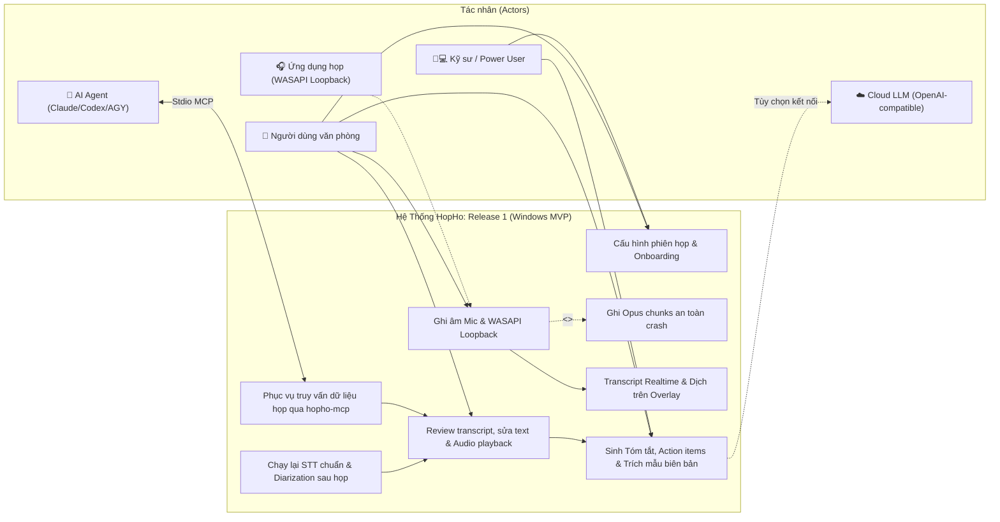
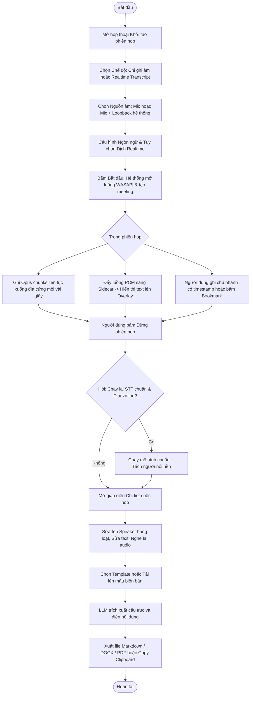

# Product Requirements Document (PRD): HopHo MVP Windows (v0.1)

**Tầng tài liệu**: Implementation Layer (`docs/implementation/release-1/prd.md`)  
**Release**: release-1 (MVP Windows v0.1)  
**Phiên bản**: 1.0  
**Ngày cập nhật**: 2026-10-15  
**Tác giả**: Senior IT Business Analyst & Product Owner  
**Trạng thái**: Draft — chờ Product Owner duyệt  

---

## 1. Mục tiêu Đợt Phát hành & Bối cảnh Kinh doanh (Business Context)

### 1.1 Mục tiêu đợt phát hành (Release Goals)
- **Tham chiếu Business Layer**: Bám sát mục tiêu tại [brd.md](../../business/brd.md) và cột mốc Phase 1 tại [roadmap.md](../../business/roadmap.md).
- **Mục tiêu cốt lõi của Release 1**:
  1. Cung cấp bộ cài đặt hoàn chỉnh `.msi` cho người dùng hệ điều hành Windows x64.
  2. Cho phép người dùng thu âm cuộc họp trực tiếp (qua Microphone) hoặc cuộc họp online (qua WASAPI Loopback hệ thống kết hợp mic) mà không cần cài đặt bot vào Zoom, Google Meet hay Microsoft Teams.
  3. Cung cấp tùy chọn phiên âm trực tiếp (Realtime transcript) kèm tùy chọn phiên dịch câu trực tiếp trên cửa sổ nổi (Overlay always-on-top).
  4. Sau khi kết thúc họp, cho phép chạy lại STT bản chính xác cao kết hợp phân tách người nói (Speaker Diarization), hỗ trợ nghe lại theo từng câu và hiệu chỉnh transcript trực tiếp.
  5. Tự động hóa tạo tóm tắt, trích xuất action items và điền nội dung vào mẫu biên bản cuộc họp người dùng tải lên (`.docx`, `.md`, `.pdf`) thông qua mô hình LLM local (llama.cpp), Cloud LLM hoặc Agent CLI.
  6. Mở cổng tích hợp dữ liệu cuộc họp cho các AI Agent bên ngoài (Claude Desktop, Claude Code, Codex, Antigravity) qua máy chủ Model Context Protocol (`hopho-mcp`).

### 1.2 Chỉ số thành công (Success Metrics & KPIs)

| Chỉ số (KPI) | Mốc tham chiếu (Baseline) | Mục tiêu Release 1 (MVP) | Cách thức đo lường |
|---|---|---|---|
| **Thời lượng họp hỗ trợ tối đa** | Chưa hỗ trợ | **3 giờ liên tục** không suy giảm hiệu năng | Test ghi âm và xử lý phiên họp kéo dài 3h |
| **Tải tài nguyên khi chạy Realtime** | N/A | **CPU <= 50%, RAM <= 4GB** trên máy chuẩn (i5 Gen10/16GB) | Monitor tài nguyên hệ thống qua tiến trình chạy |
| **Độ trễ phiên âm thời gian thực** | N/A | **<= 5 giây** từ lúc dứt câu đến khi hiện chữ trên Overlay | Đo độ trễ p95 trong phiên phát audio mẫu |
| **Tốc độ xử lý sau họp** | N/A | **<= 1x thời lượng họp** (STT + Diarization) | Đo thời gian chạy lại file audio 1h hoàn tất trong <= 60 phút |
| **Bảo toàn dữ liệu khi có sự cố** | N/A | **0% mất mát âm thanh đã ghi** khi app bị tắt đột ngột | Kill tiến trình giữa chừng, kiểm tra dữ liệu khôi phục khi mở lại |
| **Tải tài nguyên khi rảnh (Idle)** | N/A | **0% CPU** tiến trình AI sidecar khi không ghi âm | Giám sát trạng thái sidecar tự động tắt sau N phút rảnh |

---

## 2. Đối tượng sử dụng trong Release này (User Personas)

### Persona 1: Nguyễn Văn An — Quản lý dự án / Thư ký cuộc họp (Non-technical / Low-code)
- **Vai trò**: Người dùng văn phòng phổ thông, thường xuyên chủ trì hoặc ghi chép các cuộc họp nội bộ và họp khách hàng.
- **Mục tiêu trong Release 1**:
  - Cài đặt app nhanh chóng bằng file `.msi`, không phải cấu hình môi trường hay gõ lệnh.
  - Tự động ghi lại toàn bộ âm thanh cuộc họp Zoom mà không cần xin phép add bot vào phòng họp.
  - Sau họp có ngay bản tóm tắt và danh sách việc cần làm (action items) để gửi cho sếp.
  - Tải lên mẫu biên bản họp của công ty (file Word `.docx`) và app tự động điền nội dung vào đúng mẫu.
- **Rào cản hiện tại**: Tốn hàng giờ nghe lại file ghi âm để chép tay; dùng bot cloud thì khách hàng không đồng ý cho bot tham gia.

### Persona 2: Trần Minh Tuấn — Kỹ sư phần mềm cao cấp (Power User & Developer)
- **Vai trò**: Lập trình viên, thường xuyên tham gia họp kỹ thuật và sử dụng các công cụ AI Agent (Claude Code, Antigravity, Codex).
- **Mục tiêu trong Release 1**:
  - Họp kỹ thuật nói trộn thuật ngữ tiếng Anh và tiếng Việt (code-switching), yêu cầu hệ thống nhận diện đúng các thuật ngữ chuyên ngành đã khai báo trong Glossary.
  - Tận dụng máy tính có GPU NVIDIA để tăng tốc độ xử lý thông qua gói add-on CUDA.
  - Dùng Claude Desktop hoặc Antigravity qua MCP để tự động đọc transcript cuộc họp sáng nay và sinh issue trên GitHub/Jira.
- **Rào cản hiện tại**: Các công cụ họp thông thường không hỗ trợ nói trộn ngôn ngữ và thiếu cổng MCP để tích hợp vào luồng làm việc tự động.

### Persona 3: Elena Smith — Chuyên viên đàm phán quốc tế (Đa ngôn ngữ)
- **Vai trò**: Thường xuyên tham gia các cuộc họp trực tuyến với đối tác nước ngoài nói tiếng Anh/Trung/Hàn.
- **Mục tiêu trong Release 1**:
  - Bật cửa sổ Overlay always-on-top hiển thị bản dịch tiếng Việt trực tiếp khi đối tác đang nói trên màn hình.
  - Bản dịch hiển thị theo câu hoàn chỉnh, tự nhiên, không che khuất màn hình chia sẻ của Zoom.

---

## 3. Ranh giới hệ thống & Sơ đồ phạm vi (Scope & System Boundary)

> **Mục đích**: Đồng bộ nhất quán với sơ đồ ranh giới hệ thống tại [01-system-context.md](../../architecture/01-system-context.md).

### 3.1 Sơ đồ Use Case Đợt phát hành Release 1

### 3.2 Phạm vi chi tiết (Scope Definition)

- **In-Scope (Cam kết bàn giao trong Release 1)**:
  - Hỗ trợ đầy đủ trên hệ điều hành **Windows 10/11 x64**.
  - Ghi âm từ microphone và WASAPI loopback (họp online Zoom/Meet/Teams) không dùng bot.
  - Nhập (import) file âm thanh/video có sẵn (`.mp3`, `.wav`, `.m4a`, `.mp4`).
  - STT hai lớp: Realtime streaming (bản nháp) và Batch reprocessing (bản chuẩn) hỗ trợ tạm dừng/chạy tiếp.
  - Phân tách người nói (Speaker Diarization) sau họp, đổi tên người nói hàng loạt.
  - Dịch realtime theo câu qua LLM, hiển thị phụ đề dịch trên Overlay always-on-top.
  - Sinh tóm tắt, action items, biên bản mặc định và trích xuất cấu trúc mẫu biên bản người dùng upload (`.docx`, `.md`, `.pdf`).
  - Hỗ trợ 3 nhóm nhà cung cấp LLM: `llamacpp` (nhúng), `openai_compat` (cloud), `agent_cli` (`claude -p`, `codex exec`, `agy`).
  - Máy chủ MCP `hopho-mcp` (stdio) kèm cấu hình mẫu cho Claude Desktop, Claude Code, Codex, Antigravity.
  - Bộ cài đặt `.msi`, wizard onboarding, Model Manager quản lý tải gói Lite/Standard/Pro và add-on CUDA.
  - Chat hỏi–đáp trong phạm vi một cuộc họp; template tùy chỉnh; xuất Markdown/DOCX/PDF và copy clipboard.
  - Bookmark và ghi chú tay có timestamp trong lúc họp; hotkey toàn cục và tray icon.
  - Workspace/Project, tag, Glossary theo workspace; tìm kiếm toàn văn (SQLite FTS5) trên transcript/summary.
  - Quản lý lưu trữ: thư mục data cô lập, màn hình Storage, xóa audio nhưng giữ transcript; không telemetry; API key trong OS keychain.

- **Out-of-Scope (Tuyệt đối không làm trong Release 1)**:
  - Nền tảng macOS và Linux (chuyển sang Phase 2 và Phase 3).
  - Bot tham gia phòng họp ảo Zoom/Meet/Teams.
  - Phân tách người nói (Diarization) trong thời gian thực.
  - Lưu trữ hồ sơ nhận diện giọng nói (Voice Profile) qua các cuộc họp.
  - Tự động xây dựng connector đẩy dữ liệu sang Notion, Jira, Slack (ủy quyền cho Agent làm qua MCP).
  - Bộ máy RAG tìm kiếm ngữ nghĩa nội bộ ứng dụng (chỉ cung cấp SQLite FTS5; RAG do Agent xử lý).
  - Tự động đồng bộ dữ liệu lên đám mây hoặc chạy ngầm theo dõi cuộc họp.
  - Mã hóa dữ liệu at-rest (chuyển sang Phase 4).

---

## 4. Quy trình nghiệp vụ chính (Core Workflows)

### 4.1 Quy trình thực hiện phiên họp hoàn chỉnh (End-to-End Meeting Flow)

---

## 5. Yêu cầu chức năng & Quy tắc nghiệp vụ (Functional & Business Rules)

| Mã yêu cầu | Nhóm chức năng | Tên chức năng | Mô tả nghiệp vụ | Quy tắc nghiệp vụ cốt lõi (Business Rules) | Mức ưu tiên |
|---|---|---|---|---|---|
| **FR-AUD-01** | Nguồn âm | Ghi âm Microphone | Thu âm thanh trực tiếp từ microphone máy tính cho họp trực tiếp tại văn phòng | Kiểm tra quyền truy cập microphone trước khi khởi tạo luồng thu âm | **P0 (Must)** |
| **FR-AUD-02** | Nguồn âm | Ghi System Audio + Mic | Thu âm thanh loopback từ ứng dụng họp (Zoom/Meet) kết hợp mic cá nhân | Sử dụng WASAPI loopback native trên Windows; tuyệt đối không dùng bot | **P0 (Must)** |
| **FR-AUD-03** | Nguồn âm | Nhập file âm thanh/video | Import file media có sẵn để xử lý như một cuộc họp | Chuẩn hóa định dạng qua ffmpeg đóng gói kèm thành file Opus chuẩn | **P1 (Should)** |
| **FR-AUD-04** | Nguồn âm | Thiết bị & VU meter | Chọn thiết bị âm thanh và màn hình test âm lượng | Hiển thị biểu đồ mức âm lượng (VU meter) trực quan trước khi bắt đầu | **P0 (Must)** |
| **FR-AUD-05** | Nguồn âm | Ghi phân đoạn an toàn | Lưu âm thanh xuống đĩa theo từng đoạn (chunk) | Ghi đĩa định kỳ mỗi vài giây kèm fsync; crash máy không làm mất dữ liệu đã ghi | **P0 (Must)** |
| **FR-START-01** | Luồng bắt đầu | Hộp thoại khởi tạo | Hiển thị bảng chọn thông số trước mỗi cuộc họp | Cho phép lưu cấu hình lựa chọn làm mặc định cho các phiên sau | **P0 (Must)** |
| **FR-STT-01** | Phiên âm | Kiến trúc STT 2 lớp | Realtime dùng model nhẹ; sau họp chạy model lớn chính xác cao | Realtime và chạy lại sau họp đều là tùy chọn độc lập do user quyết định | **P0 (Must)** |
| **FR-STT-04** | Phiên âm | Chia câu Realtime | Luồng transcript realtime chỉ chia câu theo dấu ngắt nghỉ | Không thực hiện phân tách người nói trong chế độ realtime | **P0 (Must)** |
| **FR-STT-05** | Phiên âm | Hỗ trợ Code-switching | Nhận diện chính xác hội thoại nói trộn tiếng Việt và tiếng Anh | Phải nạp từ điển Glossary vào hotwords/prompt của mô hình | **P0 (Must)** |
| **FR-STT-07** | Phiên âm | Chạy lại sau họp an toàn | Tiến trình chạy nền ưu tiên thấp sau khi cuộc họp kết thúc | Cho phép tạm dừng (pause) và chạy tiếp (resume) theo checkpoint | **P0 (Must)** |
| **FR-DIA-01** | Diarization | Tách người nói sau họp | Phân biệt người nói và gán nhãn `Speaker N` | Chỉ chạy offline sau họp; không lưu voice profile giữa các cuộc họp | **P0 (Must)** |
| **FR-DIA-03** | Diarization | Đổi tên người nói | User đổi nhãn `Speaker N` thành tên thật | Đổi một lần tự động áp dụng đồng bộ cho toàn bộ transcript | **P0 (Must)** |
| **FR-TRN-01** | Dịch trực tiếp | Dịch câu Realtime | Dịch ngôn ngữ cuộc họp sang ngôn ngữ native của user | Dịch theo câu hoàn chỉnh qua LLM; giao diện Overlay chỉ hiển thị bản dịch | **P1 (Should)** |
| **FR-LLM-01** | Xử lý LLM | Template có sẵn | Sinh Tóm tắt, Ý chính, Quyết định, Action items, Báo cáo | Cung cấp sẵn các mẫu prompt Markdown tiêu chuẩn | **P0 (Must)** |
| **FR-LLM-07** | Xử lý LLM | Tải lên mẫu biên bản | User upload file mẫu `.docx`/`.md`/`.pdf` | App trích cấu trúc heading/bảng làm khung, LLM điền nội dung, xuất `.docx` | **P0 (Must)** |
| **FR-LLM-08** | Xử lý LLM | Tích hợp 3 Provider | Hỗ trợ llama.cpp local, Cloud OpenAI-compat, và Agent CLI | Xác nhận người dùng trước khi gửi dữ liệu lên cloud; lưu key trong OS keychain | **P0 (Must)** |
| **FR-MCP-01** | Tích hợp Agent | Máy chủ MCP Server | Cung cấp tiến trình `hopho-mcp` (stdio) | Cung cấp đủ 6 tools truy vấn: danh sách, chi tiết, transcript, search, action items, save | **P0 (Must)** |
| **FR-UX-02** | Trải nghiệm | Cửa sổ Overlay nổi | Cửa sổ phụ đề always-on-top nổi trên màn hình | Cửa sổ hệ thống độc lập, chỉnh được vị trí, kích thước và độ trong suốt | **P0 (Must)** |
| **FR-UX-03** | Trải nghiệm | Phím tắt & Khay hệ thống | Hotkey toàn cục bắt đầu/dừng ghi và bookmark | Hotkey hoạt động ngay cả khi cửa sổ HopHo không ở trạng thái active | **P1 (Should)** |
| **FR-REV-01** | Quản lý sau họp | Audio Playback theo câu | Bấm vào câu transcript để nghe lại đúng đoạn âm thanh đó | Định vị audio tương ứng chính xác theo timestamp của câu | **P0 (Must)** |
| **FR-REV-04** | Quản lý sau họp | Tìm kiếm toàn văn | Tìm kiếm nhanh trên toàn bộ transcript và summary | Sử dụng SQLite FTS5 index, phản hồi tức thời | **P0 (Must)** |
| **FR-DATA-02** | Dữ liệu | Thư mục dữ liệu cô lập | Toàn bộ dữ liệu nằm trong 1 thư mục duy nhất do user chọn | Mặc định gợi ý ổ đĩa còn trống nhiều nhất, không cố định ổ C | **P0 (Must)** |
| **FR-INS-02** | Cài đặt | Onboarding Wizard | Hướng dẫn cấu hình lần đầu sau khi cài đặt | Khảo sát phần cứng, đề xuất gói Lite/Standard/Pro, hỗ trợ resume tải model | **P0 (Must)** |

> 💡 **Bàn giao Implementation**: Bảng trên chỉ nêu các FR cốt lõi kèm business rule; danh mục đầy đủ nằm tại [srs.md](./srs.md). Toàn bộ FR sẽ được skill `user-story-ac-writer` phân rã thành các User Story chi tiết kèm Acceptance Criteria chuẩn Given-When-Then tại `docs/implementation/release-1/backlog/`.

---

## 6. Rào chắn kiến trúc cho Đợt phát hành (Architecture Guardrails)

> ⛔ **Bắt buộc tuân thủ Single Source of Truth**: Mọi thành viên đội ngũ phát triển và AI Coding Agent khi triển khai code cho Release 1 phải tuân thủ nghiêm ngặt các bất biến kiến trúc sau:

1. **Kiến trúc Dữ liệu (Data Architecture)**:
   - Tuân thủ cấu trúc bảng và mô hình dữ liệu quy định tại [05-data-architecture.md](../../architecture/05-data-architecture.md).
   - Rust Core là chủ sở hữu duy nhất của SQLite Schema và các tệp migration. Python Sidecar và MCP chỉ truy cập qua package dùng chung `packages/hopho_store`.
   - Tuyệt đối không tạo bảng lưu trữ Voice Profile / Voice Embedding giữa các cuộc họp.
2. **Kiến trúc Giao tiếp & Bảo mật (Security & IPC Architecture)**:
   - Tuân thủ quy định tại [07-security-architecture.md](../../architecture/07-security-architecture.md) và [08-integration-architecture.md](../../architecture/08-integration-architecture.md).
   - Giao tiếp giữa Rust Core và Python Sidecar bắt buộc phải chạy qua địa chỉ loopback `127.0.0.1`, cổng ngẫu nhiên, và xác thực bằng token ngẫu nhiên sinh mới mỗi lần khởi động sidecar.
   - API Key của Cloud LLM bắt buộc lưu trong Windows Credential Manager thông qua OS keychain API, không lưu plaintext trong config hay cơ sở dữ liệu.
3. **Tiêu chuẩn Thiết kế & Cấu trúc Thư mục (Design Principles & Structure)**:
   - Tuân thủ nguyên tắc Clean Architecture và cấu trúc monorepo quy định tại [09-design-principles.md](../../architecture/09-design-principles.md) và [10-folder-structure.md](../../architecture/10-folder-structure.md).
   - Phân định rõ ràng trách nhiệm: Rust đảm nhận Audio capture, Storage, System Hotkey, Windowing; Python đảm nhận AI Runtime (STT, Diarization, LLM, Dịch).

---

## 7. Quản lý Câu hỏi mở (Open Questions Log)

Dưới đây là danh mục các rủi ro kỹ thuật và câu hỏi mở nghiệp vụ được chuyển hóa trực tiếp từ bản khảo sát yêu cầu ban đầu (R1–R5 trong `requirements.md`):

| Mã OQ | Nội dung câu hỏi mở & Rủi ro kỹ thuật | Bên phụ trách | Trạng thái | Hướng xử lý & Milestone chốt |
|---|---|---|---|---|
| **OQ-01** | Khả năng đáp ứng NFR-02/03 (CPU <= 50%, Trễ <= 5s) khi chạy Realtime STT + Dịch local trên máy chuẩn Gen10 chỉ có CPU? | AI Lead / Architect | `[ ] Open` | Chốt bằng Spike Benchmark M0 (`spike-stt-benchmark.md`). Nếu máy quá tải, app sẽ hiển thị khuyến nghị user dùng chế độ "Chỉ ghi âm" hoặc dùng Cloud/Agent để dịch. |
| **OQ-02** | Kích thước gói cài đặt Python Sidecar có thể bị phình to (300MB - 1GB) nếu phụ thuộc nặng vào thư viện PyTorch? | Tech Lead / Sidecar Dev | `[ ] Open` | Áp dụng quyết định kiến trúc AD-5: Ưu tiên tối đa các runtime nhẹ như CTranslate2, ONNX (sherpa-onnx) và llama.cpp nhúng, cô lập torch nếu có lựa chọn thay thế. |
| **OQ-03** | Mô hình Diarization `pyannote` là gated model trên Hugging Face (đòi hỏi token và chấp nhận điều khoản), gây khó khăn cho trải nghiệm cài đặt của user phổ thông? | Product Owner / AI Dev | `[ ] Open` | Chốt ở cột mốc M4 (mini-spike so sánh). Giả định ban đầu: ưu tiên engine `sherpa-onnx` (nhẹ, không gated). Pyannote chỉ là tùy chọn mở rộng cho power user. |
| **OQ-04** | Bản quyền và điều khoản cấp phép (License) của các mô hình AI (PhoWhisper, Qwen, Whisper, sherpa-onnx) có xung đột với giấy phép mã nguồn mở Apache 2.0 của HopHo không? | PO / Legal Lead | `[ ] Open` | Lập bảng xác minh License chi tiết trong báo cáo benchmark M0 trước khi đưa bất kỳ mô hình nào vào gói phân phối mặc định. Không đóng gói sẵn các model có license cấm thương mại (ví dụ NLLB CC-BY-NC). |
| **OQ-05** | Khả năng thay đổi cú pháp và định dạng đầu ra của các Agent CLI (`claude -p`, `codex exec`, `agy`) qua từng phiên bản nâng cấp của các hãng? | Architect / Integration Dev | `[ ] Open` | Thiết kế lớp Adapter trung gian có cơ chế tự động kiểm tra phiên bản (version probe) trước khi gọi lệnh và xử lý bắt lỗi tường minh (explicit error handling). |

---

## 8. Kế hoạch bàn giao & Bước tiếp theo

1. **Thiết kế Kiến trúc Chi tiết (Architecture Handoff)**:
   - Bàn giao các yêu cầu bất biến sang tầng Architecture (`docs/architecture/02` đến `docs/architecture/10`) để Lead Architect hoàn thiện thiết kế chi tiết.
2. **Phân rã User Stories & Kế hoạch Sprint (Delivery Backlog)**:
   - Kích hoạt skill `user-story-ac-writer` để bóc tách toàn bộ yêu cầu chức năng (FR, xem [srs.md](./srs.md)) và 7 yêu cầu phi chức năng (NFR) thành các User Story độc lập kèm kịch bản kiểm thử Given-When-Then tại `docs/implementation/release-1/backlog/`.
3. **Triển khai kỹ thuật**:
   - Khởi động đồng thời hai nhánh công việc: Cột mốc **M0 (Spike STT Benchmark)** và **M1 (Scaffold Tauri Skeleton & Sidecar IPC)** theo đúng trình tự tại [roadmap.md](../../business/roadmap.md).
