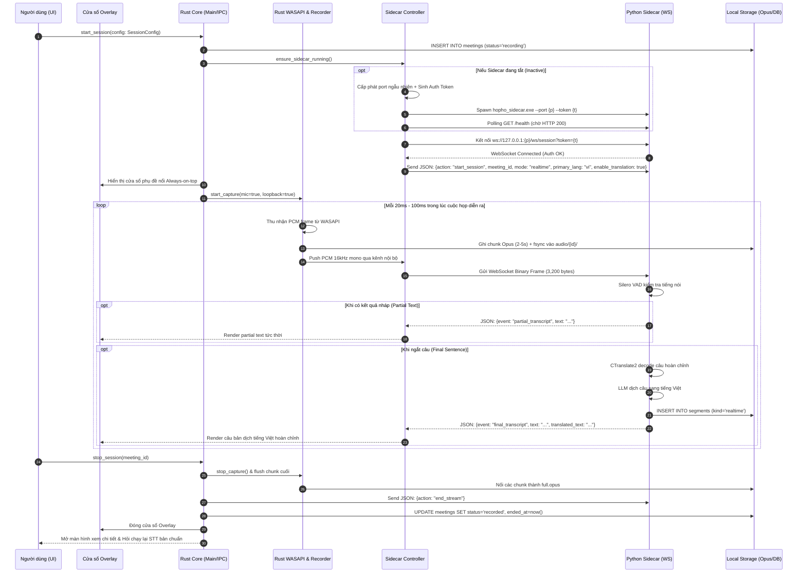
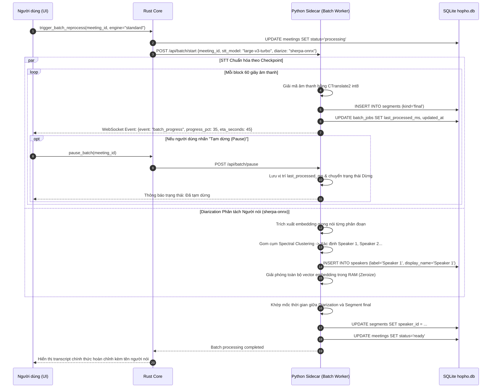
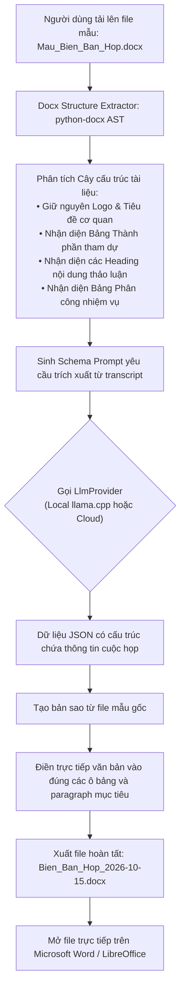
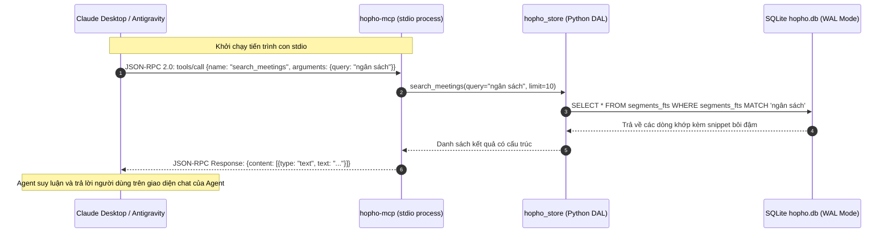

# Technical Design Document (TDD): HopHo MVP Windows (Release 1)

**Tầng tài liệu**: Implementation Layer (`docs/implementation/release-1/technical-design.md`)  
**Release**: release-1 (MVP Windows v0.1)  
**Phiên bản**: 1.0  
**Ngày cập nhật**: 2026-10-15  
**Trạng thái**: Draft — chờ Tech Lead duyệt  
**Nguồn tham chiếu**: [prd.md](./prd.md), [srs.md](./srs.md), [mvp-plan.md](../../../plan/mvp-plan.md), [02-high-level-architecture.md](../../architecture/02-high-level-architecture.md)  

---

## 1. Bối cảnh & Phạm vi Kỹ thuật Đợt phát hành

Tài liệu Thiết kế Kỹ thuật này chi tiết hóa giải pháp kiến trúc, luồng dữ liệu (Sequence Diagrams), máy trạng thái (Activity Swimlanes) và giao ước IPC phục vụ triển khai 22 User Stories ([US-001](../backlog/stories/US-001.md) đến [US-022](../backlog/stories/US-022.md)) trong Release 1 (Windows MVP v0.1).

### Rào chắn Kiến trúc Bắt buộc:
- Tuân thủ cấu trúc dữ liệu SQLite Schema tại [05-data-architecture.md](../../architecture/05-data-architecture.md).
- Tuân thủ quy định bảo mật và cổng phê duyệt gửi dữ liệu tại [07-security-architecture.md](../../architecture/07-security-architecture.md).
- Tuân thủ mô hình phân tách tiến trình và quản lý vòng đời tại [03-service-architecture.md](../../architecture/03-service-architecture.md).

---

## 2. Sơ đồ Luồng Kỹ thuật Chi tiết (Sequence Diagrams)

### 2.1 Luồng Khởi tạo & Phiên âm Thời gian thực (Realtime Session Sequence)

Luồng kỹ thuật mô tả sự phối hợp giữa React UI, Rust Core, WASAPI Audio Capture và Python Sidecar trong một phiên họp trực tiếp có bật phiên dịch:



---

### 2.2 Luồng Tự phục hồi khi gặp Sự cố (Crash Recovery Swimlane)

Biểu đồ làn bơi (Swimlane Activity Diagram) mô tả cơ chế tự động bảo vệ dữ liệu khi máy tính bị mất điện hoặc ứng dụng bị tắt đột ngột (US-003, NFR-05):

```mermaid
flowchart TD
    subgraph AppStart ["Giai đoạn Khởi động Ứng dụng"]
        A1[Người dùng mở lại HopHo] --> A2[Rust Core thực thi kiểm tra tính toàn vẹn DB]
        A2 --> A3{Tìm thấy meeting có status = 'recording'?}
    end

    subgraph RecoveryPhase ["Giai đoạn Phục hồi Dữ liệu"]
        A3 -- Không --> A4[Vào màn hình chính bình thường]
        A3 -- Có --> B1[Xác định phiên họp bị tắt đột ngột]
        B1 --> B2[Cập nhật SQLite: status = 'interrupted', ended_at = timestamp chunk cuối]
        B2 --> B3[Quét thư mục audio/{meeting_id}/ kiểm tra các chunk Opus]
        B3 --> B4[Xây dựng lại file full.opus từ các chunk hiện có]
    end

    subgraph UserInteraction ["Giai đoạn Phản hồi Người dùng"]
        B4 --> C1[Hiển thị Toast cảnh báo phục hồi thành công trên UI]
        C1 --> C2[Cho phép người dùng chọn: Nghe lại audio dở dang hoặc Chạy lại STT]
    end
```

---

### 2.3 Luồng Chạy lại STT Bản chuẩn & Phân tách Người nói (Batch Pipeline Sequence)

Mô tả tiến trình xử lý ngoại tuyến chất lượng cao với cơ chế Tạm dừng / Chạy tiếp (US-008, US-009):



---

### 2.4 Luồng Trích xuất & Điền Mẫu Biên bản Người dùng Tải lên (Uploaded Minutes Flow)

Mô tả tính năng đột phá cho phép người dùng upload file Word mẫu của công ty (`.docx`) và xuất ra văn bản chuẩn format (US-013, FR-LLM-07):



---

### 2.5 Luồng Truy vấn Dữ liệu Cuộc họp qua MCP (Model Context Protocol Flow)

Mô tả cơ chế các AI Agent bên ngoài truy xuất dữ liệu độc lập (US-016, FR-MCP-01):



---

## 3. Giao diện Lập trình Ứng dụng Nội bộ (Internal IPC API Surface)

### 3.1 Danh mục Tauri Commands (Rust Backend Handlers)

| Command Name | Tham số đầu vào (Parameters) | Kiểu dữ liệu trả về (Return Type) | Mô tả hành động |
|---|---|---|---|
| `start_session` | `config: SessionConfig` | `Result<MeetingId, HopHoError>` | Bắt đầu phiên họp, khởi động thu âm WASAPI, tạo meeting row |
| `stop_session` | `meeting_id: String` | `Result<(), HopHoError>` | Dừng ghi âm, đóng file chunk cuối, cập nhật status |
| `pause_batch` | `meeting_id: String` | `Result<(), HopHoError>` | Tạm dừng tiến trình chạy lại STT sau họp |
| `resume_batch` | `meeting_id: String` | `Result<(), HopHoError>` | Tiếp tục chạy STT từ checkpoint đã lưu |
| `update_speaker_name` | `speaker_id: String, name: String` | `Result<(), HopHoError>` | Đổi tên người nói đồng bộ toàn bộ transcript |
| `update_segment_text` | `segment_id: String, text: String` | `Result<(), HopHoError>` | Hiệu chỉnh văn bản inline và set `edited=true` |
| `generate_output` | `meeting_id: String, template_id: String` | `Result<OutputId, HopHoError>` | Kích hoạt LLM sinh tóm tắt / biên bản theo mẫu |
| `upload_template` | `file_path: String, name: String` | `Result<TemplateId, HopHoError>` | Trích xuất cấu trúc và lưu file mẫu biên bản mới |
| `get_storage_stats` | Không có | `Result<StorageStats, HopHoError>` | Quét dung lượng 4 nhóm (models, audio, db, exports) |
| `clean_meeting_audio`| `meeting_id: String` | `Result<(), HopHoError>` | Xóa tệp âm thanh Opus nhưng giữ nguyên transcript |

---

## 4. Kịch bản Kiểm thử & Tiêu chuẩn Nghiệm thu Kỹ thuật (Verification Plan)

| Tầng kiểm thử | Công cụ thực thi | Tiêu chí vượt qua (Pass Criteria) | Cột mốc xác minh |
|---|---|---|---|
| **Rust Unit Tests** | `cargo test --all` | Kiểm tra chunk writer, parser mốc thời gian, logic crash recovery không panic | **M1, M2** |
| **Python Unit Tests** | `uv run pytest -v` | Kiểm tra các adapter `LlmProvider` (mock), trích xuất template docx, thuật ngữ glossary | **M1, M5, M6** |
| **Frontend Tests** | `pnpm vitest run` | Render component, xử lý state Zustand, xử lý phím tắt và định dạng i18n | **M1, M7** |
| **Integration IPC** | `pytest tests/integration/` | Kết nối WebSocket nội bộ kèm token, truyền nhận PCM frame và trả về event hợp lệ | **M1, M3** |
| **Stress Test 3 Giờ** | Script phát audio 3h liên tục | CPU $<= 50\%$, RAM $<= 4\text{GB}$, không rò rỉ bộ nhớ, phục hồi đầy đủ khi kill -9 | **M3, M9** |
| **MCP Integration** | Claude Desktop thật | Gọi 6 tools qua stdio phản hồi dữ liệu chính xác trong $< 500\text{ms}$ | **M6** |
