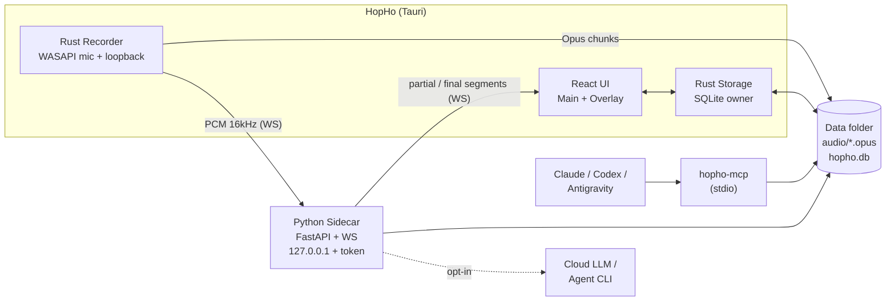
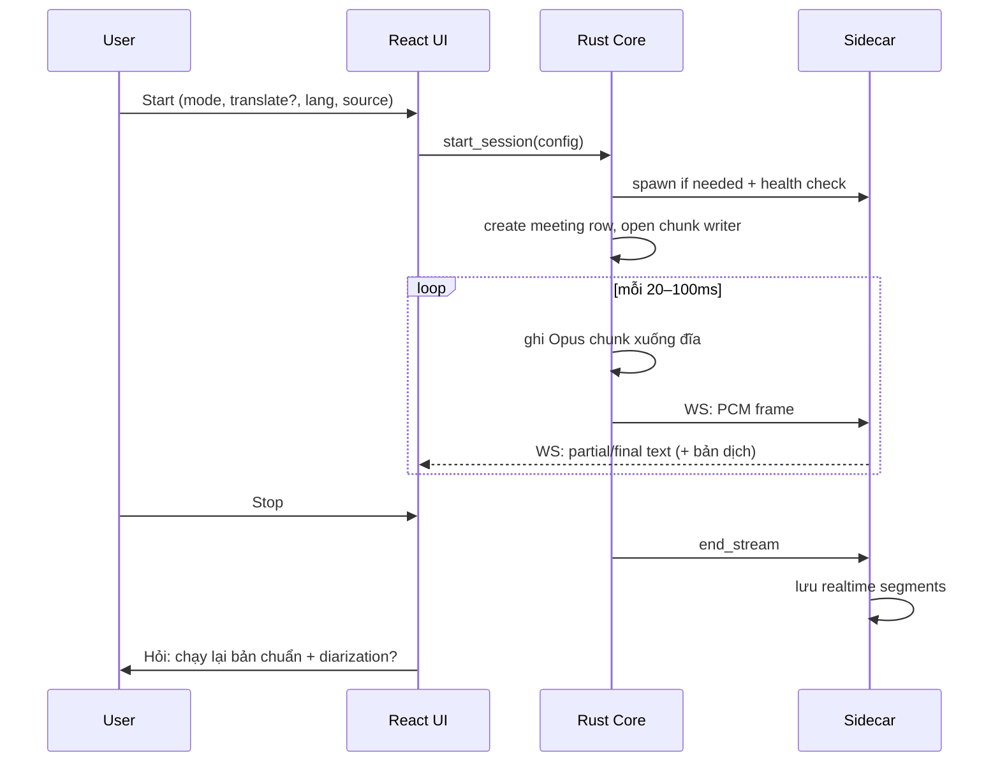
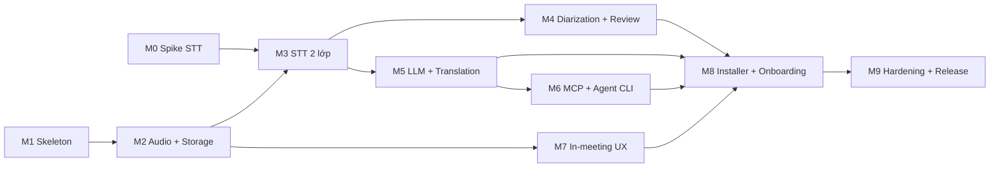

# HopHo — Kế hoạch MVP (Windows)

> Nguồn yêu cầu: [requirements.md](../project-idea/requirements.md)
> Spike liên quan: [spike-stt-benchmark.md](./spike-stt-benchmark.md)
> Trạng thái: **Approved v1** — 2026-10-13

---

## 1. Mục tiêu & phạm vi

**Mục tiêu MVP (v0.1):** Bản Windows cài đặt được bằng `.msi`. Người dùng phổ thông dùng được để:

1. Ghi âm cuộc họp trực tiếp (mic) hoặc họp online (mic + system audio), hoặc import file có sẵn.
2. Xem transcript realtime (tùy chọn) kèm dịch realtime (tùy chọn) trên overlay.
3. Sau họp, chạy lại STT bản chuẩn + diarization, đổi tên người nói, nghe lại và sửa transcript.
4. Sinh tóm tắt / action items / biên bản (kể cả theo mẫu user upload) bằng LLM local, cloud hoặc Agent CLI. Chat hỏi–đáp và export.
5. Cho Claude Desktop/Code, Codex, Antigravity truy cập dữ liệu họp qua MCP.

**Phạm vi:** toàn bộ FR trong requirements, trừ mục Out of scope (§7) và các mục ghi "giai đoạn sau" (FR-DATA-08). macOS/Linux thuộc Phase 2/3, nhưng code phải tách lớp audio capture theo từng OS ngay từ đầu.

**Mốc phần cứng:** mọi chỉ tiêu NFR đo trên máy **i5 Gen10 / 16GB, chỉ CPU**. Gen8/9 chỉ cần chạy được.

---

## 2. Quyết định kiến trúc (đã chốt)

| # | Quyết định | Lý do |
|---|---|---|
| AD-1 | Tauri 2 (Rust) + React/TS + **Python sidecar** | Bộ cài shell nhẹ; Rust thu audio native; Python có hệ sinh thái AI tốt nhất |
| AD-2 | Rust ↔ sidecar qua **FastAPI + WebSocket trên `127.0.0.1`**, port ngẫu nhiên, **token sinh mỗi lần chạy** | Dễ gửi luồng PCM nhị phân; chạy song song nhiều tác vụ (realtime + chạy lại sau họp) |
| AD-3 | **`hopho-mcp` là tiến trình riêng** (stdio), đọc SQLite (WAL) trực tiếp | Agent tự khởi chạy MCP, không phụ thuộc HopHo có đang mở hay không |
| AD-4 | **Rust là chủ của SQLite schema** (migration), sidecar và MCP chỉ đọc/ghi qua package Python dùng chung `hopho_store` | Một nguồn duy nhất cho schema; tránh lệch phiên bản |
| AD-5 | Ưu tiên runtime **CTranslate2 / ONNX / llama.cpp**, tránh torch nếu có lựa chọn tương đương | Giảm kích thước sidecar (rủi ro R2) |
| AD-6 | Sidecar **chỉ khởi động khi cần** (ghi âm, xử lý, LLM), tự tắt sau N phút rảnh | NFR-06 |
| AD-7 | Model **chốt bằng benchmark** (M0 cho STT, M4 cho diarization, M5 cho dịch/LLM) | Theo quyết định của user |

---

## 3. Cấu trúc monorepo

```
HopHo/
├── apps/desktop/                # Tauri 2 app
│   ├── src/                     # React + TS (UI chính, overlay, settings, onboarding)
│   ├── src-tauri/
│   │   ├── src/audio/           # capture: wasapi.rs (Win), mac/linux stub cho Phase 2/3
│   │   ├── src/recorder/        # chunk writer Opus, crash recovery
│   │   ├── src/storage/         # SQLite + migrations (chủ schema)
│   │   ├── src/sidecar/         # spawn/health/stop sidecar, token, WebSocket client
│   │   └── src/system/          # tray, hotkey, overlay window, keychain
│   └── package.json
├── sidecar/                     # Python (uv), đóng gói thành exe
│   ├── pyproject.toml
│   └── src/hopho_sidecar/
│       ├── api/                 # FastAPI routes + WS
│       ├── stt/                 # realtime + batch engines
│       ├── diarization/
│       ├── llm/                 # providers: llamacpp, openai_compat, agent_cli
│       ├── translation/
│       ├── templates/           # render prompt, trích mẫu biên bản upload
│       └── export/              # md/docx/pdf
├── packages/hopho_store/        # Python: truy cập SQLite dùng chung (sidecar + mcp)
├── mcp/                         # hopho-mcp (Python, MCP SDK)
│   └── integrations/            # config/skill mẫu: claude-desktop, claude-code, codex, antigravity
├── templates/                   # Template prompt mặc định (.md)
├── spikes/stt-benchmark/        # M0
└── docs/
```

> Cấu trúc này là đề xuất ban đầu. Tên/thư mục có thể điều chỉnh khi scaffold ở M1, nhưng ranh giới trách nhiệm (Rust: audio/storage/system; Python: AI) giữ nguyên.

---

## 4. Kiến trúc runtime



### Luồng một phiên realtime



---

## 5. Data model sơ bộ (SQLite)

| Bảng | Trường chính |
|---|---|
| `workspaces` | id, name, created_at |
| `meetings` | id, workspace_id, title, started_at, ended_at, mode, primary_lang, source, status (`recording`/`recorded`/`processing`/`ready`/`interrupted`) |
| `meeting_tags` | meeting_id, tag |
| `audio_chunks` | id, meeting_id, seq, path, start_ms, duration_ms, channel (`mic`/`loopback`/`mixed`) |
| `segments` | id, meeting_id, kind (`realtime`/`final`), start_ms, end_ms, speaker_id, text, lang, translated_text, edited |
| `speakers` | id, meeting_id, label (`Speaker 1`), display_name |
| `bookmarks` | id, meeting_id, at_ms, label |
| `notes` | id, meeting_id, at_ms, content |
| `glossary_terms` | id, workspace_id, term, aliases |
| `templates` | id, name, kind (`builtin`/`custom`/`uploaded_minutes`), prompt_md, source_file_path |
| `outputs` | id, meeting_id, template_id, provider, content_md, created_at |
| `chat_messages` | id, meeting_id, role, content, created_at |
| `segments_fts`, `outputs_fts` | FTS5 virtual tables |

Không có bảng voice profile (FR-DIA-04).

---

## 6. Milestones



M0 và M1 làm song song được. Sau M3 thì M4, M5 và M7 cũng làm song song được.

### M0 — Spike benchmark STT
- **Mục tiêu:** chọn model + runtime STT cho realtime và chạy lại sau họp, theo gói Lite/Standard/Pro.
- **Chi tiết:** xem [spike-stt-benchmark.md](./spike-stt-benchmark.md).
- **DoD:** có `docs/reports/stt-benchmark-<date>.md`, có kết quả trên ít nhất 1 máy Gen10/16GB chỉ CPU, và bảng đề xuất model cho từng gói.

### M1 — Skeleton & hạ tầng
- **FR/NFR:** NFR-06, NFR-07.
- **Công việc:**
  - Scaffold `apps/desktop` (Tauri 2 + React + TS + Vite), khung i18n (vi/en).
  - Scaffold `sidecar` (uv, FastAPI). Endpoint `/health`, `/version`, WS echo.
  - Rust `sidecar` module: spawn exe/`uv run` (môi trường dev), sinh token, chọn port ngẫu nhiên, health check, tự tắt khi rảnh, khởi động lại khi crash.
  - Quy ước báo lỗi thống nhất (error code + message i18n) từ sidecar → Rust → UI.
  - CI (GitHub Actions, Windows runner): lint + test + build.
- **DoD:** chạy app, UI gọi được sidecar qua token, tắt app thì sidecar cũng tắt, CI xanh.

### M2 — Audio capture & Storage
- **FR/NFR:** FR-AUD-01..05, FR-DATA-01..05, NFR-05.
- **Công việc:**
  - WASAPI capture mic + loopback (crate `cpal` hoặc `wasapi`), resample 16kHz mono cho STT, lưu kênh riêng để phục vụ diarization.
  - Chunk writer Opus (chunk vài giây), fsync định kỳ. Khi mở app, phát hiện meeting `recording` dở thì chuyển sang `interrupted` và cho phép khôi phục.
  - Import file audio/video (đóng gói kèm ffmpeg) → chuẩn hoá thành Opus.
  - Chọn thư mục data (gợi ý ổ còn trống nhiều nhất), cấu trúc `data/ models/ audio/ exports/ logs/`, di chuyển thư mục data.
  - SQLite schema + migration (Rust), package `hopho_store` (Python).
  - Màn hình test thiết bị (VU meter), màn hình Storage.
- **DoD:** ghi 3h liên tục không lỗi. Kill process giữa chừng vẫn còn audio tới chunk cuối. Import được mp3/mp4/m4a/wav.

### M3 — STT hai lớp
- **FR/NFR:** FR-START, FR-STT-01..07, FR-GLO, NFR-02/03/04.
- **Phụ thuộc:** M0 (model), M2.
- **Công việc:**
  - Hộp thoại bắt đầu họp: chế độ, dịch (bật/tắt + ngôn ngữ đích), ngôn ngữ chính/auto, nguồn, workspace/tag, lưu làm mặc định.
  - Realtime engine trong sidecar: VAD + streaming/chunked decode, đẩy partial/final qua WS, chỉ chia câu (không tách người nói).
  - Batch engine sau họp: chạy nền, ưu tiên thấp, tạm dừng/chạy tiếp (checkpoint theo đoạn), progress.
  - Glossary → hotwords / initial prompt.
  - Đo CPU/RAM/trễ thực tế trong app, log để so với NFR.
- **DoD:** trên máy Gen10 đạt NFR-02/03 với model gói Standard; chạy lại 1h audio ≤ 1h.

### M4 — Diarization & Review
- **FR:** FR-DIA-01..04, FR-REV-01..05.
- **Công việc:**
  - Mini-spike so sánh sherpa-onnx và pyannote (độ chính xác, tốc độ, license/gated), chọn mặc định.
  - Gắn diarization vào batch pipeline, map speaker cho từng segment final.
  - UI transcript: đổi tên speaker, click segment để phát lại đoạn audio, sửa text inline (đánh dấu `edited`).
  - FTS5 search, workspace/tag, xoá audio thủ công/tự động sau N ngày nhưng giữ transcript.
- **DoD:** meeting 1h có speaker label hợp lý; sửa/phát lại/tìm kiếm hoạt động; chạy lại STT + diarization vẫn ≤ 1x thời lượng họp.

### M5 — LLM, Templates & Dịch
- **FR:** FR-TRN-01..05, FR-LLM-01..07, FR-DATA-06/07.
- **Công việc:**
  - Interface `LlmProvider` với 3 implementation: `llamacpp` (nhúng), `openai_compat`, `agent_cli` (adapter cho `claude -p`, `codex exec`, `agy`, có kiểm tra phiên bản CLI).
  - Settings: chọn provider theo từng tác vụ (summary, chat, dịch); API key lưu trong Windows Credential Manager.
  - Hộp xác nhận "dữ liệu sẽ gửi tới X" trước mọi lần gọi cloud/agent.
  - Template mặc định (Tóm tắt, Ý chính/Quyết định, Action items, Biên bản, Báo cáo) + CRUD template tùy biến.
  - **Upload mẫu biên bản** (DOCX/MD/PDF): trích cấu trúc (heading, bảng, trường) → template; xuất DOCX bám theo cấu trúc mẫu.
  - Chunking transcript dài (họp 3h) cho LLM: map-reduce theo đoạn.
  - Chat hỏi–đáp trong phạm vi một cuộc họp; trộn notes + bookmarks vào prompt.
  - Dịch realtime theo câu bằng LLM (local/cloud), overlay chỉ hiện bản dịch.
  - **Mini-spike dịch:** benchmark vài LLM tổng quát và LLM chuyên dịch (vi↔en/zh/ko) về chất lượng và độ trễ trên máy Gen10 → chốt model mặc định.
  - Export MD/DOCX/PDF, copy clipboard.
- **DoD:** cả 3 provider sinh được summary cho meeting 3h; template upload ra DOCX đúng khung; dịch realtime đạt trễ chấp nhận được (chỉ tiêu cụ thể chốt sau mini-spike).

### M6 — MCP & tích hợp Agent
- **FR:** FR-MCP-01..04.
- **Công việc:**
  - `hopho-mcp` (Python MCP SDK, stdio) gồm các tool: `list_meetings`, `get_meeting`, `get_transcript`, `search_meetings`, `get_action_items`, `save_summary`.
  - Phát hiện vị trí thư mục data qua file config chung của HopHo.
  - Gói tích hợp: snippet config cho Claude Desktop, Claude Code, Codex, Antigravity + skill mẫu (ví dụ "tóm tắt cuộc họp gần nhất"). Trong Settings có nút "Copy config"/"Cài vào…".
- **DoD:** từ mỗi agent hỏi "tóm tắt cuộc họp sáng nay" và nhận được kết quả đúng; `save_summary` hiển thị trong app.

### M7 — Trải nghiệm trong lúc họp
- **FR:** FR-UX-01..06.
- **Phụ thuộc:** M2 (làm được trước M3, phần hiển thị text gắn vào sau).
- **Công việc:** overlay always-on-top (cửa sổ Tauri trong suốt, kéo thả, chỉnh opacity/kích thước), tray icon, hotkey toàn cục (start/stop, bookmark), panel ghi chú tay có timestamp.
- **DoD:** overlay hiển thị trên Zoom/Meet ở chế độ fullscreen-window; hotkey hoạt động khi app không có focus.

### M8 — Bộ cài, Onboarding & Model Manager
- **FR:** FR-INS-01..06.
- **Công việc:**
  - Đóng gói sidecar thành exe (PyInstaller/Nuitka, chọn sau khi đo kích thước), nhúng vào Tauri làm sidecar binary.
  - `.msi` (WiX qua Tauri bundler) + code signing (nếu có cert).
  - Onboarding wizard: thư mục data → benchmark phần cứng nhanh → đề xuất gói Lite/Standard/Pro → tải model → test mic/loopback.
  - Model Manager: tải tiếp được khi rớt mạng, kiểm tra checksum, mirror HF, xoá model, hiển thị dung lượng.
  - Add-on CUDA: phát hiện GPU NVIDIA → hỏi user → tải.
  - Auto-update qua Tauri updater, cần user xác nhận.
- **DoD:** trên máy Windows sạch (chưa có Python/CUDA), cài `.msi` → wizard → ghi và tóm tắt được một cuộc họp mà không cần dòng lệnh.

### M9 — Hardening & Release v0.1
- **Công việc:** đo NFR trên máy Gen10 thật (3h realtime + chạy lại), test crash recovery, rà soát tất cả đường lỗi (NFR-07), hoàn thiện i18n vi/en, tài liệu người dùng (README, hướng dẫn tích hợp agent), bảng license model, release GitHub.
- **DoD:** đạt toàn bộ NFR trên máy chuẩn; checklist test tay pass; release v0.1 có `.msi`.

---

## 7. Chiến lược test

| Tầng | Công cụ | Phạm vi |
|---|---|---|
| Python unit | `pytest` (+ `pytest-asyncio`) | STT/LLM adapters (mock), template render, export, `hopho_store`, MCP tools |
| Rust unit | `cargo test` | chunk writer, recovery, migration, sidecar lifecycle |
| UI unit | `vitest` + Testing Library | component, store, i18n |
| Integration | pytest + httpx WS client; Rust test spawn sidecar thật | IPC token, streaming PCM, batch pipeline với audio mẫu ngắn |
| Hiệu năng | script phát audio mẫu 1h/3h qua pipeline, ghi CPU/RAM/trễ | NFR-01..04, chạy thủ công trên máy Gen10 ở M3, M9 |
| Thủ công | checklist trong `docs/` | overlay trên Zoom/Meet/Teams, hotkey, installer máy sạch, agent integrations |

Quy tắc chung: lint + test phải xanh trước khi merge (ruff + mypy cho Python, clippy + rustfmt cho Rust, eslint + tsc cho TS).

---

## 8. Rủi ro theo milestone

| Rủi ro | MS | Giảm thiểu |
|---|---|---|
| Không có model STT nào đạt NFR realtime trên Gen10 | M0/M3 | Gói Lite dùng model nhỏ hơn; gợi ý chế độ "Chỉ ghi âm"; giới hạn thread |
| Sidecar quá nặng (torch) | M4/M8 | AD-5; diarization ưu tiên sherpa-onnx; đo kích thước ngay khi đóng gói thử ở M1 |
| pyannote là gated model | M4 | Mặc định sherpa-onnx; pyannote là tùy chọn nâng cao |
| WASAPI loopback lệch nhịp/drift giữa mic và loopback | M2 | Timestamp theo clock chung; lưu 2 kênh riêng; test họp dài |
| CLI của agent đổi cú pháp | M5/M6 | Adapter có kiểm tra phiên bản; báo lỗi rõ ràng |
| Tóm tắt họp 3h vượt context của LLM local | M5 | Map-reduce theo đoạn; cảnh báo chất lượng khi dùng model nhỏ |
| Overlay bị app họp fullscreen che | M7 | Hướng dẫn dùng chế độ windowed/borderless; test sớm |
| License model không tương thích phân phối | M0/M5/M8 | Lập bảng license trước khi đưa model vào gói tải mặc định |

---

## 9. Ngoài phạm vi kế hoạch này

- Ước lượng thời gian theo ngày/tuần (chưa biết quy mô team).
- Phase 2 (macOS) và Phase 3 (Linux): sẽ lập kế hoạch riêng sau M9.
