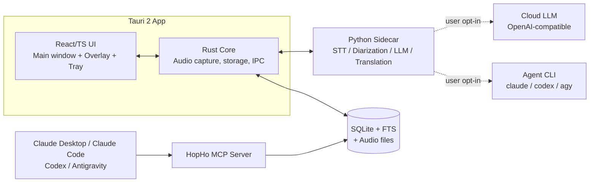
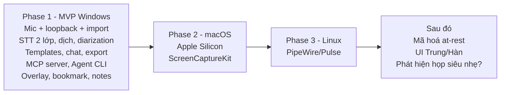

# HopHo (Họp Hộ) — Đặc tả yêu cầu chi tiết

> "Để AI họp hộ bạn."
> Nguồn: [idea.md](./idea.md) + phiên brainstorm (grill-me) ngày 2026-10-13.
> Trạng thái: **Draft v1** — chờ review.
> Sau khi tách tài liệu theo 3 tầng, nguồn sự thật hiện hành nằm ở `docs/business/`, `docs/architecture/`, `docs/implementation/` (xem [architecture/README.md](../architecture/README.md)). Tài liệu này là đầu vào ban đầu.

---

## 0. Nguyên tắc xuyên suốt

1. **User quyết định mọi thứ**: Không tự động ghi âm, không tự bật realtime/dịch, không tự gửi dữ liệu lên cloud. Mọi hành động quan trọng đều hỏi trước hoặc do user cấu hình.
2. **Local-first**: Mặc định toàn bộ xử lý & dữ liệu nằm trên máy user. Cloud chỉ dùng khi user chọn.
3. **Nhẹ khi không dùng**: Không có tiến trình chạy ngầm tốn tài nguyên khi không ghi âm.
4. **Dễ cài cho người dùng lowcode/nocode**: Không yêu cầu cài Python, CUDA, Ollama hay dòng lệnh.

---

## 1. Tổng quan sản phẩm

| Hạng mục                        | Quyết định                                                             |
| ------------------------------- | ---------------------------------------------------------------------- |
| Loại sản phẩm                   | Desktop app cho Windows, macOS, Linux                                  |
| License                         | Open-source, Apache 2.0                                                |
| Thứ tự phát hành                | **Windows (MVP)** → macOS Apple Silicon → Linux                        |
| Phần cứng tối thiểu             | CPU Intel Core i5 Gen8/9 / AMD tương đương, RAM 16GB, chỉ CPU — chạy được, chấp nhận chậm (ít máy còn dùng) |
| Phần cứng chuẩn (mốc hiệu năng) | Intel Core i5 Gen10 / AMD tương đương, RAM 16GB — mốc tham chiếu cho mọi chỉ tiêu NFR                       |
| Tăng tốc phần cứng              | Apple Silicon (Metal/CoreML), NVIDIA GPU (CUDA — gói add-on tải thêm)  |
| Ngôn ngữ hỗ trợ (nội dung họp)  | Việt, Anh, Trung, Hàn (trọng tâm tiếng Việt, hỗ trợ nói trộn Việt–Anh) |
| Ngôn ngữ UI (MVP)               | Việt + Anh, có sẵn khung i18n để thêm Trung/Hàn                        |

---

## 2. Kiến trúc kỹ thuật

- **Shell**: Tauri 2 (Rust), giao diện viết bằng React + TypeScript.
- **Audio capture** (Rust native):
  - Windows: WASAPI cho mic + loopback.
  - macOS: CoreAudio cho mic + ScreenCaptureKit (macOS 13+) cho system audio.
  - Linux: PipeWire/PulseAudio monitor source.
- **AI runtime**: Python sidecar, đóng gói sẵn (PyInstaller hoặc tương đương). User không cần tự cài Python.
- **LLM local**: llama.cpp nhúng sẵn. Ollama chỉ là tùy chọn, không bắt buộc.
- **Lưu trữ**: SQLite (metadata, transcript, summary, FTS) + file audio.

---

## 3. Yêu cầu chức năng

### 3.1 Nguồn âm thanh (FR-AUD)

| ID        | Yêu cầu                                                                                                     |
| --------- | ----------------------------------------------------------------------------------------------------------- |
| FR-AUD-01 | Ghi âm từ **microphone** (họp trực tiếp tại văn phòng).                                                     |
| FR-AUD-02 | Ghi **system audio (loopback) + mic** cho họp online (Zoom/Meet/Teams…). Không dùng bot tham gia phòng họp. |
| FR-AUD-03 | **Import file** audio/video có sẵn để xử lý như một cuộc họp.                                               |
| FR-AUD-04 | User chọn thiết bị mic/loopback; có màn hình test thiết bị (VU meter).                                      |
| FR-AUD-05 | Audio được ghi xuống đĩa theo từng đoạn (chunk) liên tục, crash không làm mất phần đã ghi.                  |

### 3.2 Luồng bắt đầu cuộc họp (FR-START-01)

Trước mỗi phiên, app **hỏi user** (có thể lưu thành mặc định):

1. **Chế độ**: `Chỉ ghi âm` (xử lý sau) **hoặc** `Realtime transcript`.
2. Nếu chọn Realtime: **có bật dịch không?** Nếu bật thì chọn ngôn ngữ đích (mặc định = ngôn ngữ native trong Settings).
3. **Ngôn ngữ chính** của cuộc họp: chọn cụ thể hoặc `Auto-detect`.
4. **Nguồn**: Mic / Mic + System audio.
5. **Workspace/Project** và tag (tùy chọn).

### 3.3 Speech-to-Text (FR-STT)

| ID        | Yêu cầu                                                                                                                   |
| --------- | ------------------------------------------------------------------------------------------------------------------------- |
| FR-STT-01 | **Hai lớp**: (a) Realtime dùng model nhẹ/streaming để hiện bản nháp; (b) sau họp chạy lại bằng model lớn để ra bản chuẩn. |
| FR-STT-02 | Realtime và chạy lại sau họp đều là **tùy chọn** do user quyết định.                                                      |
| FR-STT-03 | App **đề xuất** model theo phần cứng (từ kết quả benchmark), user có quyền đổi.                                           |
| FR-STT-04 | Transcript realtime chỉ cần chia câu bằng dấu chấm/phẩy, **không tách người nói** khi realtime.                           |
| FR-STT-05 | Hỗ trợ nói trộn Việt–Anh (code-switching).                                                                                |
| FR-STT-06 | Nạp **Glossary** (thuật ngữ, tên riêng) vào hotwords/initial prompt của STT.                                              |
| FR-STT-07 | Chạy lại sau họp ở chế độ nền, ưu tiên thấp, cho **tạm dừng/chạy tiếp**.                                                  |

Ứng viên model (chốt khi phát triển, dựa trên benchmark — xem [spike-stt-benchmark.md](../plan/spike-stt-benchmark.md)):

| Mục đích             | Ứng viên                                                                   |
| -------------------- | -------------------------------------------------------------------------- |
| Realtime / streaming | Whisper small/base (faster-whisper, int8), sherpa-onnx Zipformer streaming |
| Chạy lại sau họp     | Whisper large-v3-turbo, PhoWhisper (tiếng Việt)                            |

### 3.4 Phân biệt người nói — Diarization (FR-DIA)

| ID        | Yêu cầu                                                                                 |
| --------- | --------------------------------------------------------------------------------------- |
| FR-DIA-01 | **Chỉ chạy sau họp** (không làm realtime).                                              |
| FR-DIA-02 | Engine: pyannote (chính xác hơn) hoặc sherpa-onnx (nhẹ hơn), chọn theo phần cứng.       |
| FR-DIA-03 | User **đổi nhãn** `Speaker N` thành tên thật; đổi một lần là áp dụng cho cả transcript. |
| FR-DIA-04 | **Không** lưu voice profile/embedding giữa các cuộc họp.                                |

### 3.5 Dịch realtime (FR-TRN)

| ID        | Yêu cầu                                                                                                                 |
| --------- | ----------------------------------------------------------------------------------------------------------------------- |
| FR-TRN-01 | Dịch là **tùy chọn**, hỏi khi bắt đầu phiên realtime.                                                                   |
| FR-TRN-02 | Dịch bằng **LLM tổng quát hoặc LLM chuyên dụng cho dịch**: local (llama.cpp/Ollama) hoặc cloud OpenAI-compatible. Không dùng chức năng dịch của STT. |
| FR-TRN-03 | User chọn engine dịch trong Settings; app đề xuất theo phần cứng. Model cụ thể được chốt khi phát triển dựa trên benchmark (M5).                    |
| FR-TRN-04 | Dịch **theo câu hoàn chỉnh**, không dịch từng từ.                                                                       |
| FR-TRN-05 | Giao diện **chỉ hiển thị bản dịch** (bản gốc vẫn được lưu trong transcript).                                            |

> [!NOTE]
> Whisper chỉ dịch được **sang tiếng Anh** (`task=translate`). Các hướng khác, ví dụ Anh/Trung/Hàn → Việt, gần như chắc chắn phải qua LLM.
> NLLB dùng license CC-BY-NC (cấm thương mại), **không đóng gói sẵn**.

- Giải pháp sử dụng model LLM nhỏ để dịch hoặc model dịch chuyên dụng.

### 3.6 Xử lý sau họp — LLM (FR-LLM)

| ID        | Yêu cầu                                                                                                                                     |
| --------- | ------------------------------------------------------------------------------------------------------------------------------------------- |
| FR-LLM-01 | **Template có sẵn**: Tóm tắt, Ý chính/Quyết định, Action items (việc – người phụ trách – deadline), Biên bản cuộc họp (format VN), Báo cáo. |
| FR-LLM-02 | User **tạo/sửa template** riêng. Mỗi template là một file prompt Markdown.                                                                  |
| FR-LLM-03 | **Chat hỏi–đáp** trong phạm vi một cuộc họp (dựa trên transcript).                                                                          |
| FR-LLM-04 | Summary có trộn **ghi chú tay** và **bookmark** của user.                                                                                   |
| FR-LLM-05 | Glossary được nạp vào prompt để sửa chính tả thuật ngữ/tên riêng.                                                                           |
| FR-LLM-06 | Export **Markdown / DOCX / PDF** và copy vào clipboard.                                                                                     |
| FR-LLM-07 | User **upload mẫu biên bản** (DOCX/MD/PDF). App trích cấu trúc mẫu làm khung, LLM điền nội dung, export DOCX/MD. Template "Biên bản cuộc họp" có sẵn chỉ là mẫu mặc định chung. |
| FR-LLM-08 | **Nhà cung cấp LLM**: hỗ trợ 3 nhóm Local (llama.cpp nhúng/Ollama), Cloud OpenAI-compatible, Agent CLI; chọn riêng cho từng tác vụ trong Settings (chi tiết bên dưới). |

**LLM Providers** (chọn trong Settings, có thể đặt riêng cho từng tác vụ):

1. **Local**: llama.cpp nhúng sẵn (hoặc Ollama nếu user đã có).
2. **Cloud OpenAI-compatible**: base URL + API key (lưu trong OS keychain).
3. **Agent CLI**: gọi `claude -p`, `codex exec`, `agy`… ở chế độ headless để dùng gói plan sẵn có của user.

Chế độ khuyến nghị: **hybrid**, STT chạy local và LLM chạy cloud/agent.

### 3.7 Tích hợp Agent qua MCP (FR-MCP)

| ID        | Yêu cầu                                                                                                                                                      |
| --------- | ------------------------------------------------------------------------------------------------------------------------------------------------------------ |
| FR-MCP-01 | HopHo cung cấp **MCP server** với các tool dự kiến: `list_meetings`, `get_meeting`, `get_transcript`, `search_meetings`, `get_action_items`, `save_summary`. |
| FR-MCP-02 | Có sẵn **plugin/skill/config** cho Claude Desktop, Claude Code, Codex, Antigravity, và hướng dẫn cài 1-click hoặc copy-paste.                                |
| FR-MCP-03 | Việc đẩy dữ liệu sang Notion/Jira/Slack… để **agent làm qua MCP**, HopHo không tự build connector.                                                           |
| FR-MCP-04 | Tìm kiếm/RAG xuyên toàn bộ lịch sử họp để agent đảm nhận qua MCP. Trong app chỉ có full-text search.                                                         |

### 3.8 Trải nghiệm trong lúc họp (FR-UX)

| ID       | Yêu cầu                                                                                                                                                                                        |
| -------- | ---------------------------------------------------------------------------------------------------------------------------------------------------------------------------------------------- |
| FR-UX-01 | **Cửa sổ chính**: danh sách cuộc họp, transcript, summary, settings.                                                                                                                           |
| FR-UX-02 | **Overlay nổi always-on-top trên màn hình** (cửa sổ hệ thống, không nhúng vào app họp/trình duyệt). Hiển thị phụ đề/bản dịch và nút record/stop. Chỉnh được độ trong suốt, kích thước, vị trí. |
| FR-UX-03 | **Tray icon** + **hotkey toàn cục** để bắt đầu/dừng ghi.                                                                                                                                       |
| FR-UX-04 | **Bookmark** thời điểm quan trọng bằng hotkey trong lúc họp.                                                                                                                                   |
| FR-UX-05 | **Ghi chú tay** song song, tự gắn timestamp.                                                                                                                                                   |
| FR-UX-06 | **Không** tự phát hiện cuộc họp đang diễn ra và **không** chạy ngầm để theo dõi. Chỉ chấp nhận nếu cơ chế đó nhẹ tới mức gần như không tốn tài nguyên (xem lại ở giai đoạn sau).               |

### 3.9 Sau họp — Review & quản lý (FR-REV)

| ID        | Yêu cầu                                                                    |
| --------- | -------------------------------------------------------------------------- |
| FR-REV-01 | **Playback**: click vào câu transcript để nghe lại đúng đoạn audio đó.     |
| FR-REV-02 | **Sửa transcript** bằng tay.                                               |
| FR-REV-03 | **Workspace/Project** để nhóm các cuộc họp, gắn **tag**.                   |
| FR-REV-04 | **Full-text search** (SQLite FTS) trên transcript/summary.                 |
| FR-REV-05 | Xoá audio (thủ công hoặc tự động sau N ngày) nhưng **giữ lại transcript**. |

### 3.10 Glossary (FR-GLO)

| ID        | Yêu cầu                                           |
| --------- | ------------------------------------------------- |
| FR-GLO-01 | Từ điển thuật ngữ/tên riêng theo **workspace**.   |
| FR-GLO-02 | Dùng cho cả STT (hotwords) và LLM (sửa chính tả). |

---

## 4. Lưu trữ & quyền riêng tư (FR-DATA)

| ID         | Yêu cầu                                                                                                                                                                                  |
| ---------- | ---------------------------------------------------------------------------------------------------------------------------------------------------------------------------------------- |
| FR-DATA-01 | Mọi dữ liệu lưu **local**: SQLite + audio dạng Opus (khoảng 30MB cho 1 giờ).                                                                                                             |
| FR-DATA-02 | **Một thư mục data duy nhất, cô lập**, do user chọn khi onboarding. Mặc định gợi ý ổ còn trống nhiều nhất, **không cố định ổ C**. Gồm `data/`, `models/`, `audio/`, `exports/`, `logs/`. |
| FR-DATA-03 | Đổi thư mục data hoặc di chuyển dữ liệu sang ổ khác được từ Settings.                                                                                                                    |
| FR-DATA-04 | Màn hình **Storage** hiển thị trực quan dung lượng theo loại (models / audio / transcript / exports), có nút mở thư mục và dọn dẹp.                                                      |
| FR-DATA-05 | **Không telemetry**.                                                                                                                                                                     |
| FR-DATA-06 | Trước khi gửi dữ liệu lên cloud LLM hoặc Agent CLI, **hiển thị rõ** dữ liệu sẽ gửi tới đâu.                                                                                              |
| FR-DATA-07 | API key lưu trong **OS keychain**.                                                                                                                                                       |
| FR-DATA-08 | (Giai đoạn sau) Mã hoá dữ liệu at-rest.                                                                                                                                                  |

---

## 5. Cài đặt & quản lý model (FR-INS)

| ID        | Yêu cầu                                                                                                                                     |
| --------- | ------------------------------------------------------------------------------------------------------------------------------------------- |
| FR-INS-01 | Bộ cài nhỏ: `.msi`/`.exe` (Windows), `.dmg` đã ký + notarize (macOS), AppImage/`.deb` (Linux).                                              |
| FR-INS-02 | **Onboarding wizard**: chọn thư mục data → benchmark phần cứng → đề xuất gói model (Lite / Standard / Pro) → tải model → test mic/loopback. |
| FR-INS-03 | Tải model **tải tiếp được khi rớt mạng (resume)**, có thanh tiến độ, hỗ trợ mirror Hugging Face.                                            |
| FR-INS-04 | **Model Manager**: thêm/xoá/đổi model, hiển thị dung lượng.                                                                                 |
| FR-INS-05 | Gói **CUDA** là add-on, chỉ tải khi phát hiện máy có GPU NVIDIA và user đồng ý.                                                             |
| FR-INS-06 | Tự cập nhật app (auto-update) qua Tauri updater, user xác nhận trước khi cập nhật.                                                          |

---

## 6. Yêu cầu phi chức năng (NFR)

| ID     | Yêu cầu                                                                                                        |
| ------ | -------------------------------------------------------------------------------------------------------------- |
| NFR-01 | Thời lượng họp tối đa hỗ trợ: **3 giờ**.                                                                       |
| NFR-02 | Chế độ realtime: **≤ 50% CPU**, **≤ 4GB RAM** trên máy chuẩn (i5 Gen10/16GB). Không được làm Zoom/Meet bị lag. |
| NFR-03 | Độ trễ realtime transcript **≤ 5 giây** trên máy chuẩn.                                                        |
| NFR-04 | Chạy lại sau họp (STT + diarization) **≤ 1x thời lượng họp** trên máy chuẩn.                                   |
| NFR-05 | **Không mất audio khi crash**; khi mở lại app thì khôi phục được phiên đang dở.                                |
| NFR-06 | Khi không ghi âm: **không có tiến trình nền tốn tài nguyên** (sidecar AI chỉ khởi động khi cần).               |
| NFR-07 | Mọi lỗi được báo rõ cho user, không có lỗi im lặng.                                                            |

---

## 7. Phạm vi MVP & lộ trình

**Không nằm trong phạm vi (out of scope)**:

- Bot tham gia Zoom/Meet/Teams.
- Diarization realtime; lưu voice profile.
- Connector trực tiếp tới Notion/Jira/Slack (để agent làm qua MCP).
- RAG xuyên lịch sử họp bên trong app.
- Đồng bộ cloud.
- Tự phát hiện cuộc họp hoặc tự ghi âm.
- Nhắc đồng thuận ghi âm / disclaimer pháp lý.

---

## 8. Rủi ro & câu hỏi mở

| #   | Nội dung                                                                                   | Ghi chú                                                                                       |
| --- | ------------------------------------------------------------------------------------------ | --------------------------------------------------------------------------------------------- |
| R1  | Realtime STT + dịch local trên máy chuẩn Gen10 (chỉ CPU) có thể không đạt NFR-02/03.        | Benchmark ở M0 ([spike-stt-benchmark.md](../plan/spike-stt-benchmark.md)). Dự phòng: gợi ý "Chỉ ghi âm" hoặc dịch bằng cloud. Gen8/9 chỉ là mức tối thiểu, chấp nhận chậm. |
| R2  | Bộ cài Python sidecar (torch) có thể nặng 300MB–1GB.                                       | Cân nhắc ưu tiên runtime ONNX/CTranslate2, tránh torch nếu được.                              |
| R3  | Model pyannote là gated model trên Hugging Face (cần chấp nhận điều khoản/token).          | Ảnh hưởng trải nghiệm lowcode. Có thể dùng sherpa-onnx làm mặc định.                          |
| R4  | License của từng model (PhoWhisper, Qwen, pyannote…) phải tương thích để phân phối/tải về. | Cần lập bảng license trước khi chốt danh sách model.                                          |
| R5  | Agent CLI headless: cú pháp/khả năng thay đổi theo phiên bản từng vendor.                  | Cần lớp adapter và kiểm tra phiên bản.                                                        |
